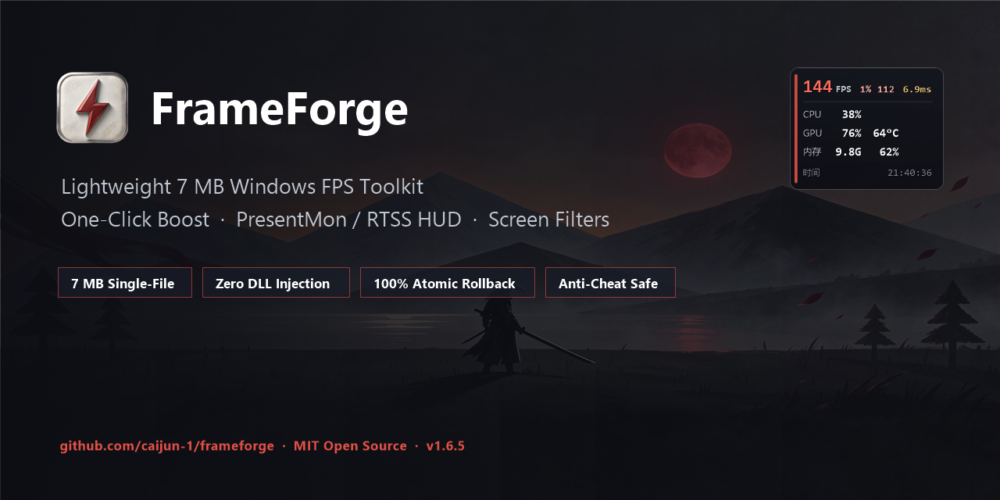
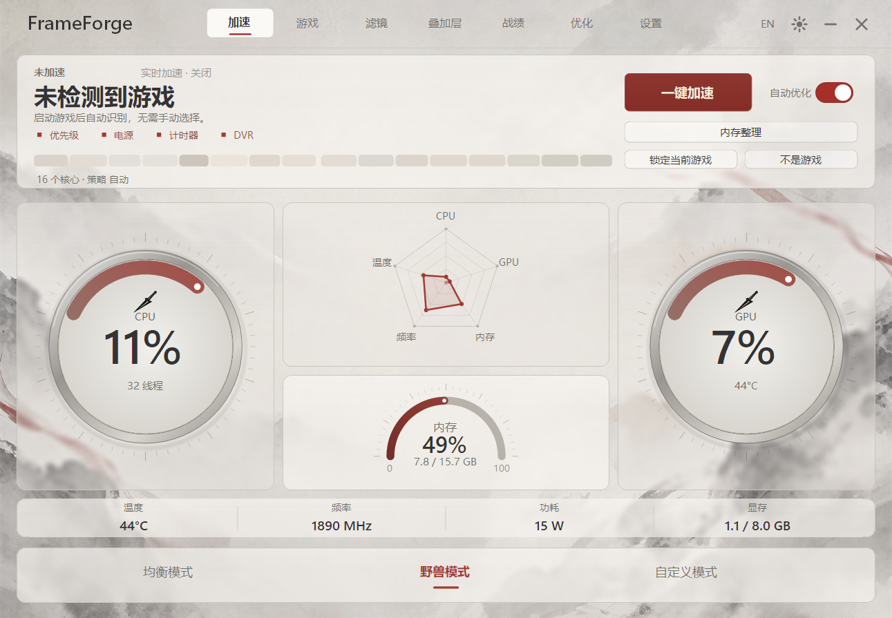
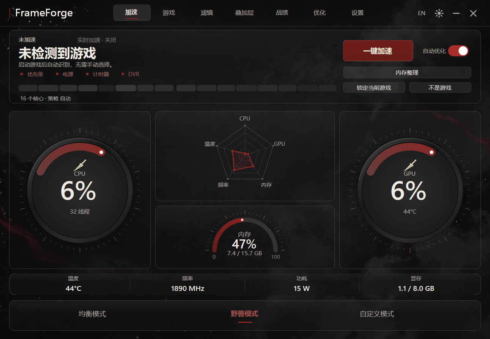
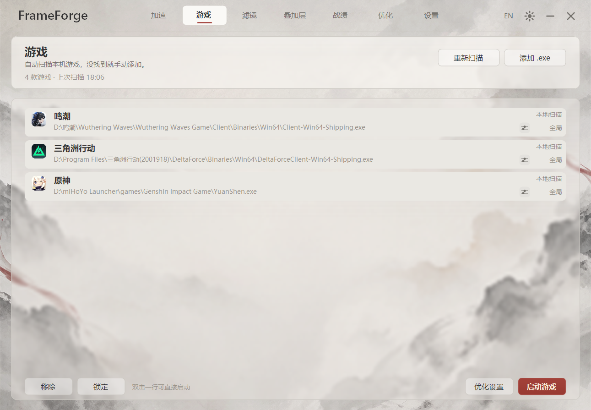
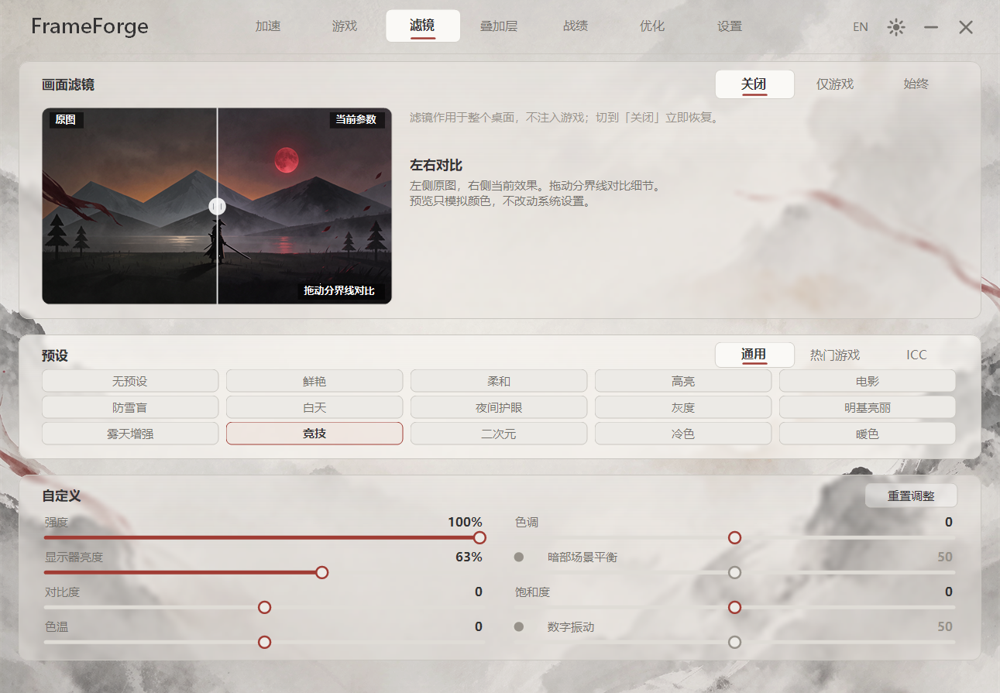
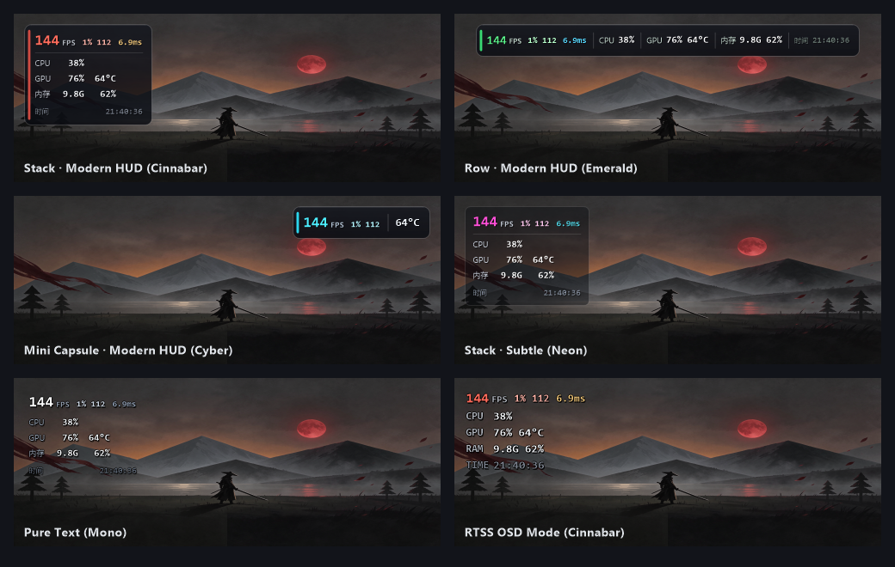
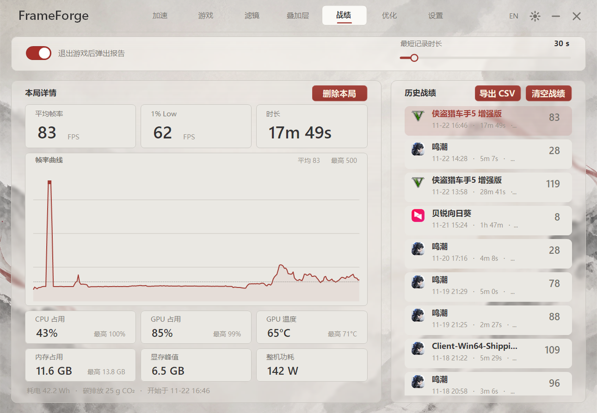
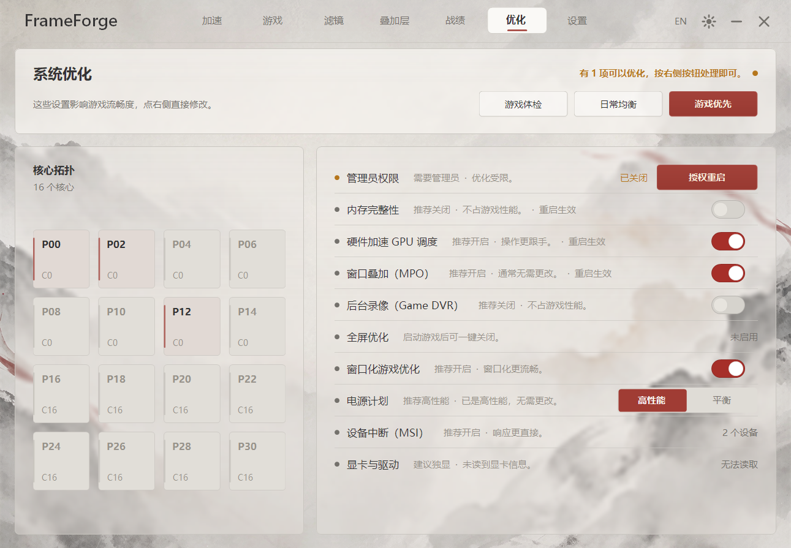
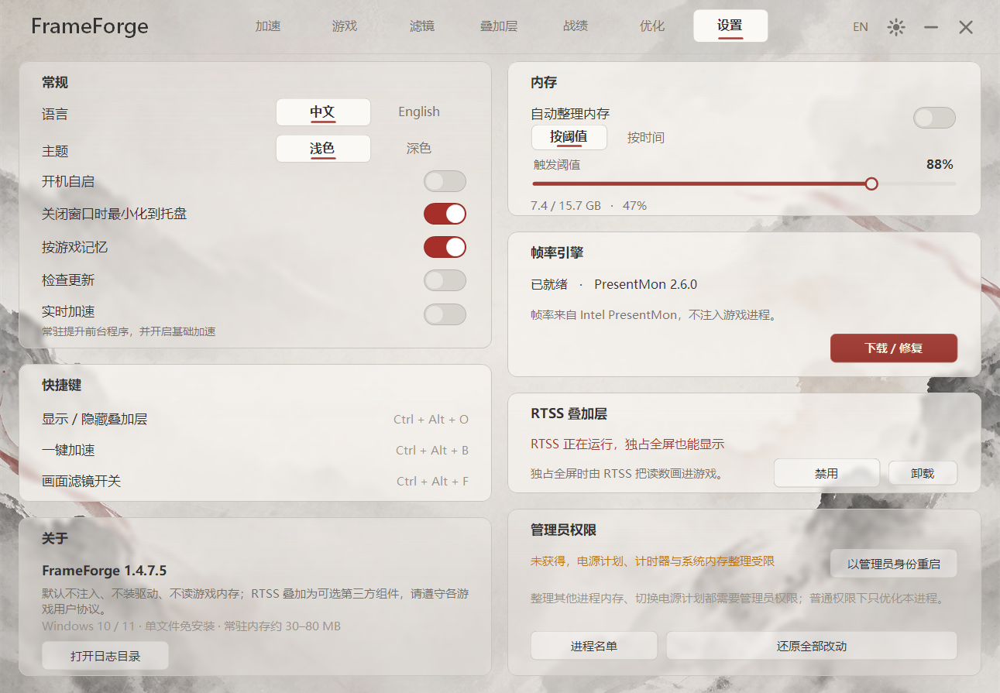

<p align="center"></p>

<h1 align="center">FrameForge</h1>

<p align="center"><b>Lightweight Windows FPS Gaming Toolkit</b><br>
One-Click Reversible Boost · PresentMon / RTSS Modern HUD · Hardware Screen Filters · Post-Match Reports</p>

<p align="center">Single-File · Portable · ~7 MB · Zero DLL Injection by Default · Optional RTSS OSD</p>

<p align="center">
  
  
  
  
  
  
</p>

<p align="center">
  <a href="https://github.com/caijun-1/frameforge/releases/latest">Download Latest (v1.6.6)</a> ·
  <a href="https://caijun-1.github.io/frameforge/">Website</a> ·
  <a href="#why-frameforge">Why FrameForge</a> ·
  <a href="README.md">简体中文</a>
</p>

<p align="center"></p>

---

## Why FrameForge

| Dimension | FrameForge | Typical Optimizer / Monitor Suites |
| --- | --- | --- |
| **Footprint** | Single ~7 MB portable `.exe`, no installer, no lingering services | Tens to hundreds of MB, multiple drivers and background services |
| **Anti-Cheat Safety** | **Zero DLL injection by default** (Intel PresentMon ETW), optional RTSS | Hook injection often conflicts with kernel anti-cheat |
| **Rollback Guarantee** | **SCTL v2 Write-Ahead Journal** with HMAC verification and watchdog auto-restore | Registry and power tweaks rarely tracked or rolled back after a crash |
| **All-in-One Scope** | Boost + telemetry + modern HUD + hardware filters / ICC + match reports | Usually requires 2–3 separate utilities running at once |
| **Open Source & Privacy** | MIT open source (compiles via in-box `csc.exe`), zero telemetry, zero ads | Closed source, ads, popups, or mandatory accounts |

---

## Highlights

- **One-click transactional boost** — process priority, high-performance power plan, 1 ms timer resolution, Game DVR / fullscreen optimization off, working-set trim, plus opt-in advanced steps: suspend background hogs (with confirmation), physical core reservation / P-core or single-CCD scheduling, NIC/GPU interrupt affinity steering, and per-game profiles. Every system change is recorded in an HMAC-signed write-ahead journal (`BoostJournal`) and restored automatically on exit or crash recovery.
- **Live hardware monitoring** — CPU/GPU rings, a five-axis radar (CPU / GPU / RAM / clock / temperature), a RAM arc, and a GPU temperature / clock / power / VRAM strip using NVML (NVIDIA) and ADL (AMD).
- **Modern in-game overlay & RTSS sync** — translucent glass HUD layered window with three layouts (`Row` / `Stack` / `Mini`), three backdrop tiers (`HUD` / `Subtle` / `None`), and five unified colour themes (`Cinnabar` / `Emerald` / `Neon` / `Cyber` / `Mono`). Features an enlarged hero FPS readout, monospaced fixed-width columns (no horizontal jitter), ten selectable stats (FPS, 5s 1% low, frame time, CPU, GPU, GPU temp, RAM, RAM %, clock, session), screen-corner presets or free drag, scaling and position lock. In exclusive fullscreen, it hands off seamlessly to RTSS with matching colour themes and hero FPS sizing.
- **Non-invasive screen filters & ICC** — 15 general presets + 8 per-game presets (Delta Force, VALORANT, Genshin Impact, Apex Legends, CS2, PUBG, Naraka, League of Legends) with 6-axis tuning via Windows Magnification / display gamma LUT + NVIDIA NVAPI Digital Vibrance (zero injection), 16:9 draggable A/B preview, hardware DDC/CI & WMI backlight control, and `.icc` / `.icm` profile import (matrix & LUT).
- **Real game detection & My Games** — scans Steam, Epic, GOG, WeGame, miHoYo Launcher and uninstall registries with local caching; resolves generic binaries like `*-Win64-Shipping.exe` to real titles while excluding anti-cheat services, launchers, browsers and overlays.
- **Post-match reports & records** — automatic post-game summary (average/max/min FPS, 1% low, hardware peaks, energy & CO₂ estimate) plus a 300-session history with per-match FPS charts and CSV export.
- **System check-up** — diagnostic Optimize page auditing VBS/HVCI, HAGS, MPO, Game DVR, fullscreen optimization, windowed-game optimization, power plan, MSI interrupts and GPU driver status, with one-click presets and a change journal.
- **Compatibility & privacy first** — anti-cheat components (ACE, EAC, BattlEye, Vanguard) and protected apps (OBS, Discord, recording tools) are never suspended or trimmed. Bilingual UI (Chinese / English), dark and light Wuxia themes, tray mode, zero telemetry.

---

## Screenshots

| Boost (Day · Paper Ink) | Boost (Night · Shadow Blade) |
| --- | --- |
|  |  |

| My Games | Screen Filters |
| --- | --- |
|  |  |

| Overlay (v1.6.5 Modern HUD) | Match Records |
| --- | --- |
|  |  |

| System Check-up | Settings |
| --- | --- |
|  |  |

---

## Quick Start

1. Download `FrameForge.exe` from [Releases](https://github.com/caijun-1/frameforge/releases/latest) (verify with `FrameForge.exe.sha256` if desired) and run it directly — no installation required.
2. Launch your game; FrameForge detects the active game window automatically.
3. Click **Boost**; exiting the game or clicking **Restore** rolls back all applied system settings.
4. For live FPS & 1% Low: open **Settings → FPS Engine → Download / Repair** to fetch Intel PresentMon (~1 MB, MIT) and run as administrator.

### Global Hotkeys

| Shortcut | Action |
| --- | --- |
| `Ctrl + Alt + O` | Toggle in-game overlay |
| `Ctrl + Alt + B` | Toggle one-click boost / restore |
| `Ctrl + Alt + F` | Toggle screen filter (remembers last preset) |

---

## Requirements

- Windows 10 1809+ or Windows 11 (x64)
- .NET Framework 4.8 (pre-installed on Windows 10 1809+ and Windows 11)
- Administrator privileges for ETW FPS capture, power-plan switching and system working-set trimming

## Build from Source

No Visual Studio or .NET SDK is required — Windows' built-in .NET Framework `csc.exe` compiles the entire project directly:

```powershell
powershell -ExecutionPolicy Bypass -File .\build.ps1
.\FrameForge.exe --selftest
```

> Source files intentionally target C# 5 syntax for compatibility with the in-box `csc.exe`.

## Data & Privacy

- All settings, per-game profiles, session records and logs stay locally in `%LOCALAPPDATA%\FrameForge\`.
- Zero telemetry, zero analytics, zero ads. The only network requests are explicitly user-triggered: downloading Intel PresentMon, and a read-only GitHub release check when **Check for updates** is enabled.

---

## Recent Changelog

### v1.6.6

> Comprehensive stability, state-rollback, concurrency, and update-security hardening release across 32 files (Zh/En localization parity at 659/659 keys).

- **Display & Overlay**: Fixed `Display.PathTargetInfo` struct size (+8 bytes to 48 bytes) for `QueryDisplayConfig`; added crash-safe disk persistence & startup recovery for hardware Gamma LUT and NVIDIA DVC; refreshed gamma HDCs on `WM_DISPLAYCHANGE`; fixed 64-bit `Rtss.ZeroMemory`, fallback `MapViewOfFile` access mask, and ANSI truncation; cached the 1×1 probe bitmap in `Overlay.Render()`.
- **State Rollback & Concurrency**: Added `SYSTEM\GAMECONFIGSTORE` to `Tune.AllowedJournalKey()`; retained failed items in `Tune.RestoreAll()`; upgraded `SafeFile.WriteAllText()` to unique `.tmp` + `WriteThrough`; enforced `Revertible` & `StartTime` guards in `BoostJournal`; added `BusyToken` generation guards in `SystemResourceArbiter`; synchronized `FpsEngine` start/stop/watchdog; eliminated per-tick reflection and tray-minimized `StateHub` polling.
- **Update Security & UX**: Used exclusive GUID updater scripts and publisher certificate pinning in `UpdateCheck`; moved `schtasks` off the UI thread; rebuilt tray menus on theme/language switch; disposed control animation timers and enabled keyboard focus; expanded `--selftest` with HMAC tamper, missing `sum=`, and unknown schema `v=99` quarantine checks.

### v1.6.5

> Overlay HUD redesign and reliability hardening release: overhauls both the built-in and RTSS overlays with a modern translucent HUD backdrop, five unified colour themes and a shared preview pipeline, while fixing resource-handover persistence, background steering races, generic process name caching and high-DPI preview scaling.

**Overlay visuals & UX**

- Added a modern translucent HUD backdrop (default): rounded dark vertical-gradient plate, thin glass border, subtle top sheen and a theme-coloured left accent bar; switchable in the UI between `HUD`, `Subtle` and `None` (`overlayBackdrop=hud|subtle|none`).
- Added five unified colour themes — Cinnabar (default), Emerald, Neon, Cyber and Mono (`overlayTheme=cinnabar|green|pink|cyan|mono`) — synced across the live overlay, RTSS output and settings preview, with automatic migration from legacy `rtssColor` settings.
- Improved visual hierarchy: enlarged bold hero FPS with a compact baseline-aligned `FPS` unit, subtle horizontal divider between FPS and hardware rows in stacked mode, vertical dividers between groups in horizontal and mini capsule modes, and right-aligned ambient rows (clock/uptime) that no longer widen hardware columns.
- Upgraded RTSS output to share the same colour themes, use `<S=...>` tags for a larger hero FPS readout, pad labels to fixed width in stacked mode, and separate groups with `|` in single-line mode.
- Settings preview now calls `Overlay.PaintPreview` directly with DPI-aware scaling, eliminating drift between the preview card and the live in-game HUD.

**Reliability & fixes**

- Real-time boost immediately persists updated ownership snapshots when one-click boost hands over PowerScheme/Timer ownership, guaranteeing crash recovery restores the power plan.
- One-click boost overlaying real-time boost as `SHARED` now records the arbiter's original power plan instead of `SchemeHigh`.
- Background ideal-CPU steering verifies the active transaction generation before writing to disk; non-Auto rebalance also logs ideal-CPU updates.
- Generic process names (`Client-Win64-Shipping.exe`) resolved via folder or version metadata no longer pollute the permanent name-only cache.
- Font-pool cleanup runs safely at frame boundaries; `CoreConfig` cache invalidates immediately on settings save.
- Fixed `Settings.Sanitize()` overwriting `overlayBackdrop=hud`, mini mode ignoring metric toggles, desktop position-lock toggle not refreshing overlay visibility, `Ctrl+Alt+O` not syncing the UI toggle, and shutdown not stopping warm-up/update timers.
- Self-test now validates all 5 themes × 3 backdrops × 3 styles and balanced RTSS `<C>` tags (zh/en string parity 650/650).

### v1.6.2

- Arbiter records owner pointers in `SHARED` mode; lock-free I/O busy flags guarded by `try/finally` with a 30 s cap; atomic HMAC key publication; unverified legacy journal handling; concurrent game-DB caches; parent start-time validation in watchdog; deterministic `--restore` exit codes (`0`/`1`/`2`).
- Monospaced Consolas overlay columns with role-based colours and GPU temperature thresholds.

### v1.6.0

- Fixed colour-matrix orientation (column-vector internal math, single transpose on export), recalibrated all 23 presets, continuous Planckian white balance (2700–10000 K), HDR/ACM detection.
- Locked DLL search path to System32, SHA-256 verification for RTSS/updates, Intel signature verification for PresentMon, HMAC-signed journals, safe NVAPI bindings.
- Lock-free arbiter I/O eliminating AB-BA deadlocks, improved CPU load sampling and single-pass real-time process enumeration.

> For earlier release notes (v1.5.0 and prior), see [docs/release-notes/](docs/release-notes/).

---

## License & Security

- License: [MIT](LICENSE)
- Third-party notices: [NOTICE](NOTICE)
- Build signing & verification: [SIGNING.md](SIGNING.md)
- Vulnerability reporting: [SECURITY.md](SECURITY.md)
