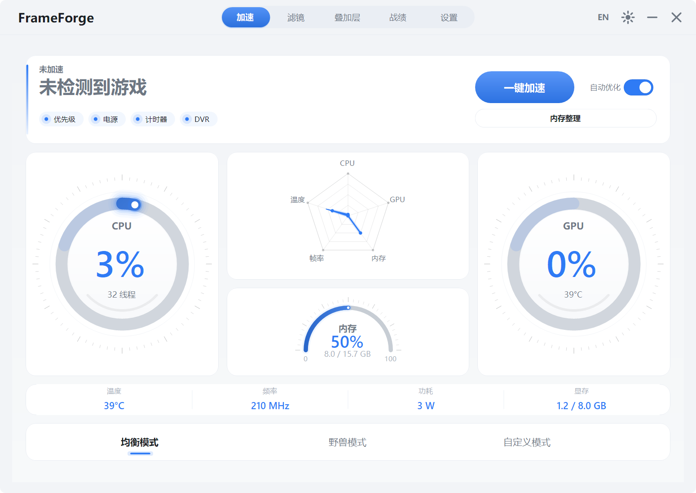
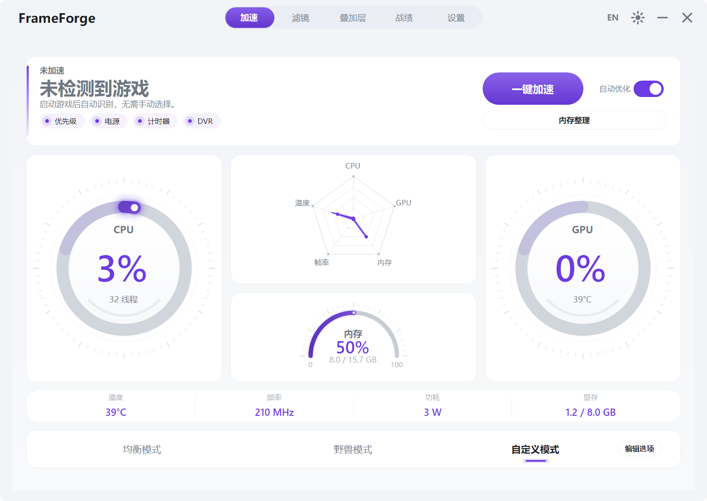
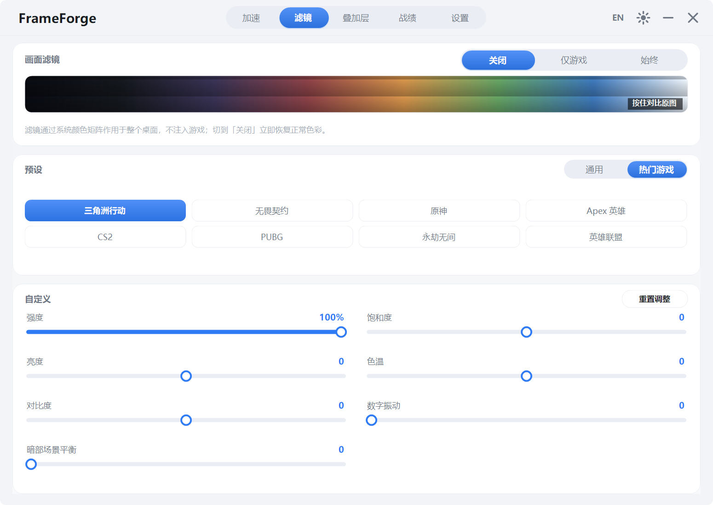
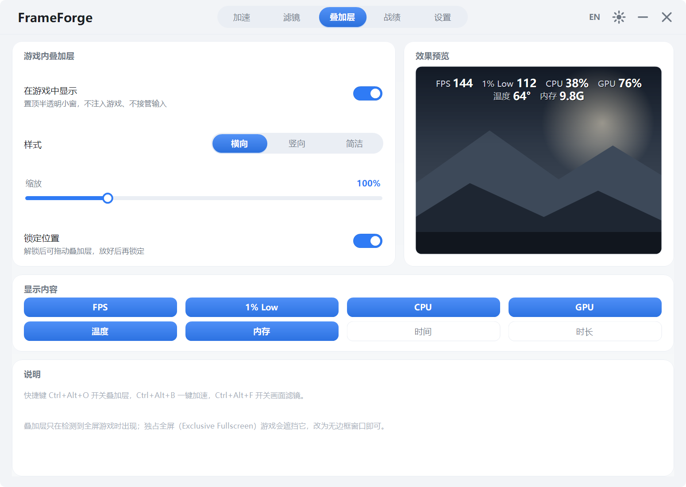
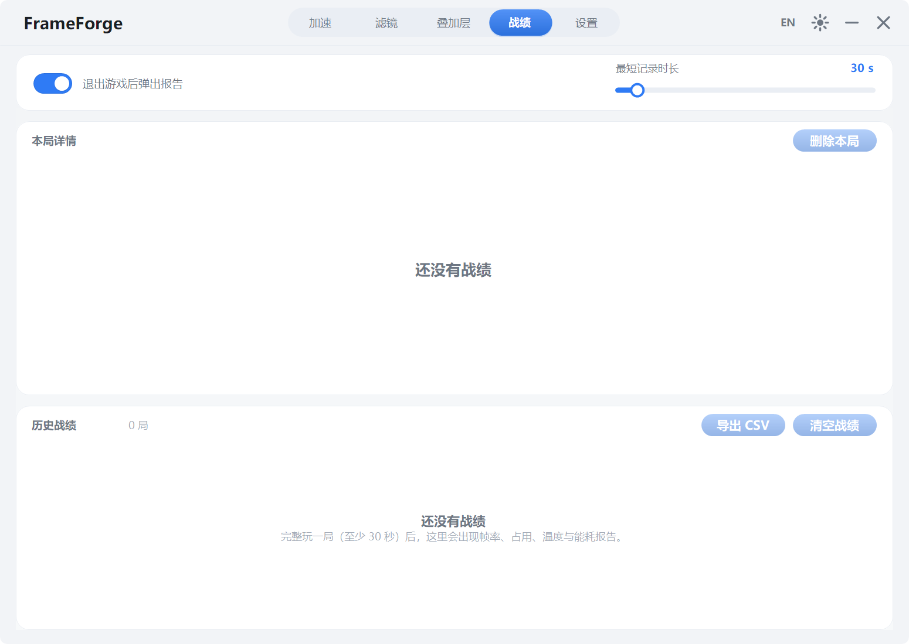
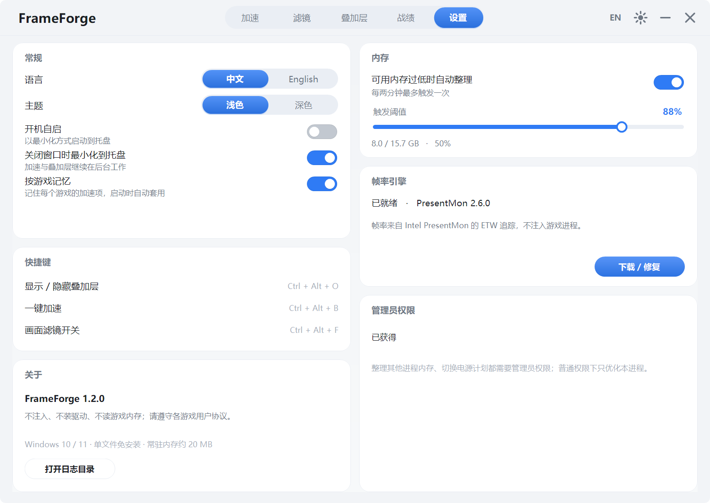

<p align="center"></p>

<h1 align="center">FrameForge</h1>

<p align="center"><b>轻量级 FPS 游戏增效工具 · A lightweight FPS toolkit for Windows</b><br>
一键加速 + 实时帧率监测 + 游戏内叠加层 + 画面滤镜 + 赛后性能报告</p>

<p align="center">单文件 · 免安装 · 312 KB · 不注入游戏 · 不装驱动</p>

<p align="center">
  
  
  
  
  
</p>

<p align="center"><a href="https://github.com/caijun-1/frameforge/releases/latest">下载最新版</a> · <a href="#功能">简体中文</a> · <a href="#english">English</a></p>

---

## 目录

- [功能](#功能)
- [截图](#截图)
- [系统要求](#系统要求)
- [快速开始](#快速开始)
- [加速做了什么](#加速做了什么)
- [帧率从哪来](#帧率从哪来)
- [画面滤镜](#画面滤镜)
- [赛后报告与战绩](#赛后报告与战绩)
- [快捷键](#快捷键)
- [数据与隐私](#数据与隐私)
- [从源码构建](#从源码构建)
- [项目结构](#项目结构)
- [已知限制](#已知限制)
- [English](#english)

---

## 功能

| 模块 | 能力 |
| --- | --- |
| 一键加速 | 进程优先级、高性能电源计划、系统计时器 1 ms、关闭 Game DVR 与全屏优化、内存整理、进阶：暂停后台无窗口占用大户（二次确认）、独占物理核心、设备中断避让、按游戏记忆策略 |
| 实时监测 | 汇聚在加速页的监控仪表：CPU / GPU 占用环形表、五维雷达图（CPU / GPU / 内存 / FPS / 温度）、内存弧表，以及 GPU 温度 / 频率 / 功耗 / 显存四联指标 |
| 游戏识别 | 进程名 → 真实游戏名三层识别（用户 `games.ini` → 内置 200+ 游戏库 → 安装目录 / 文件版本信息），Unreal 的 `*-Win64-Shipping` 这类通用进程名不会再把进程名当成游戏名 |
| 游戏检测 | 四层兜底不漏检：前台游戏窗口 → 后台铺满屏幕的游戏窗口 → 已知游戏进程扫描（窗口化 / 小窗口也算）→ 游戏平台安装目录（Steam / Epic / GOG / Xbox / WeGame 等）辅助识别；我的世界基岩版按进程、Java 版按窗口标题识别 |
| 画面滤镜 | 13 组预设（含电竞、暗部增强、雾天、高对比、动漫等）+ 强度 / 亮度 / 对比度 / 暗部平衡 / 饱和度 / 数字振动 / 色温 七维微调，按住可随时对比原图 |
| 游戏内叠加层 | 置顶半透明小窗，横向 / 纵向 / 简洁三种样式，8 种指标（FPS / 1% Low / CPU / GPU / 温度 / 内存 / 时钟 / 时长）可自选，可缩放、可锁定位置 |
| 赛后报告 | 退出游戏自动弹出性能报告：平均 / 最高 / 最低帧率、1% Low、CPU / GPU / 温度 / 内存 / 显存 / 功耗，以及耗时电量与碳排估算 |
| 战绩历史 | 每局自动归档（最多 300 条），可回看任意一局详情、删除单局、清空或导出 CSV |
| 其他 | 中英双语、深浅双主题、托盘常驻、开机自启、内存阈值自动整理 |

所有加速项都是**可回滚**的系统设置，点「还原设置」或关闭游戏后逐项恢复原状。

## 截图

以下为 **v1.2.0** 界面。模式条改为铺满整卡的三等分色块，「野兽模式」居中；「编辑选项」只在自定义模式下出现。

| 加速（均衡模式） | 加速（自定义模式） |
| --- | --- |
|  |  |

| 滤镜 | 叠加层 |
| --- | --- |
|  |  |

| 战绩 | 设置 |
| --- | --- |
|  |  |

<details>
<summary>旧版界面（v1.1.1，对比用）</summary>

| 加速 | 监测 |
| --- | --- |
|  |  |

| 滤镜 | 叠加层 |
| --- | --- |
|  |  |


</details>

## 系统要求

- Windows 10 1809 及以上 / Windows 11（x64）
- .NET Framework 4.8（Windows 10 1809 起为系统自带）
- 帧率功能需要管理员权限并首次在「设置 → 帧率引擎」下载 Intel PresentMon（约 1 MB）
- 显卡传感器依赖 NVIDIA NVML；其余厂商的传感器读不到时显示 `—`

## 快速开始

1. 下载 `FrameForge.exe`，双击运行，无需安装。
2. 启动游戏并切到游戏窗口，加速页会自动识别铺满屏幕的前台程序。
3. 点 **一键加速**；退出游戏或点 **还原设置** 即可回滚。
4. 想要帧率数字：设置 → 帧率引擎 → 下载 / 修复，然后以管理员身份重启本程序。

## 加速做了什么

| 项目 | 具体动作 | 如何还原 |
| --- | --- | --- |
| 进程优先级 | 游戏进程设为 `HIGH_PRIORITY_CLASS` | 恢复原优先级 |
| 高性能电源计划 | 切换到系统「高性能」方案 | 切回原方案 GUID |
| 系统计时器 1 ms | `timeBeginPeriod(1)` | `timeEndPeriod(1)` |
| 关闭 Game DVR | 写入 `GameDVR_Enabled=0`、关闭全屏优化 | 恢复原注册表值 |
| 内存整理 | 对空闲进程 `EmptyWorkingSet` + 清系统工作集 | 无需还原（缓存会自行重建） |
| 暂停后台进程 | 挂起无窗口且占用靠前的后台进程 | 自动恢复线程 |
| 独占物理核心 | 按 CPU 拓扑把游戏绑到一半完整物理核心，其他进程挪到剩余核心 | 恢复各进程原亲和性掩码 |
| 设备中断避让 | 把网卡 / 显卡的 MSI 中断亲和性指向非游戏核心 | 恢复原注册表值，重启后生效 |
| 按游戏记忆 | 每个游戏单独保存加速项，下次检测到该游戏时自动套用 | 仅写本地配置，无需还原 |

> 进阶项「暂停后台进程」会先列出候选进程并要求二次确认，只挂起、不结束。
> 自动套用只应用安全项（暂停后台进程与中断避让不自动执行）。

## 帧率从哪来

通过 **Intel PresentMon** 的 ETW 会话读取前台游戏进程的呈现事件，计算平均 FPS 与 1% Low。
PresentMon 是在运行时按需下载的独立 exe（MIT 协议），不随本项目分发，也不注入游戏。

## 画面滤镜

滤镜走 Windows 放大镜 API 的全屏颜色矩阵（`Magnification.dll`），作用于整个桌面输出：

- 不注入游戏、不安装驱动、不修改游戏文件；
- 「仅游戏」模式下只在检测到全屏游戏时生效；
- 远程桌面等不支持的环境会给出提示并保持原色；
- 13 组预设：原色、鲜明、柔和、冷色、暖色、高对比、暗部增强、雾天去灰、电竞、动漫、护眼、夜战、复古；
- 七维微调：强度、亮度、对比度、**暗部平衡**（压高光 + 抬黑位，暗处看得更清）、饱和度、**数字振动**（类似 NVIDIA 数字振动，提升色彩浓艳度）、色温；
- **A/B 对比**：按预览图上的按钮（或长按）即可临时查看未加滤镜的原图，随手对比效果。

## 赛后报告与战绩

- 检测到游戏进程后自动开始计时，退出游戏时结算这一局；
- 时长达到「最短记录时长」（默认 30 秒，可在战绩页 5–300 秒之间调整）才会计入，避免误触启动器刷屏；
- 结算时默认弹出报告卡：平均帧率、1% Low、时长三联，CPU / GPU / GPU 温度 / 内存 / 显存峰值 / 整机功耗六格，各带「最高」小字，底部给出一局的耗电量（Wh）与碳排估算（按 0.581 kg CO₂/kWh）；
- 「战绩」页保存最近 300 局，可逐局查看同样的明细、删除单局、清空全部或一键导出 CSV；
- 报告弹窗与自动弹出都可以在战绩页关闭。

## 快捷键

| 按键 | 作用 |
| --- | --- |
| `Ctrl + Alt + O` | 显示 / 隐藏叠加层 |
| `Ctrl + Alt + B` | 一键加速 / 还原 |
| `Ctrl + Alt + F` | 开启 / 关闭画面滤镜（记住上次使用的预设） |

## 数据与隐私

- 配置：`%LOCALAPPDATA%\FrameForge\settings.ini`，按游戏策略在同目录的 `profiles.ini`
- 游戏名映射：同目录的 `games.ini`，可自行添加「进程名=游戏名」
- 战绩：同目录的 `sessions.dat`（纯文本，一行一局，可直接编辑或删除）
- 日志：`%LOCALAPPDATA%\FrameForge\log.txt`（超过 1 MB 轮转一份）
- 不联网、不上传任何数据；唯一的网络请求是你主动触发的 PresentMon 下载。

## 从源码构建

只需要 Windows 自带的 .NET Framework 编译器，无需 Visual Studio / .NET SDK：

```powershell
powershell -ExecutionPolicy Bypass -File .\build.ps1
```

输出 `FrameForge.exe`。自检（不需要开界面）：

```powershell
.\FrameForge.exe --selftest   # 结果写入 %TEMP%\frameforge_selftest.log
```

自检覆盖：传感器采样、显卡识别、游戏检测、游戏名识别与回退、电源方案、后台进程候选、设置映射、CPU 拓扑与核心掩码、按游戏策略读取、中断设备枚举、PresentMon 状态、叠加层初始化、战绩序列化与能耗估算。

> 代码保持 C# 5 语法（随系统分发的 `csc.exe` 只认 C# 5），请勿使用插值字符串、`?.`、表达式体成员等新语法。

## 项目结构

```
frameforge/
├── build.ps1              # 一键编译（csc + app.manifest + app.ico）
├── app.manifest           # DPI 感知、UAC 清单
├── app.ico                # 多尺寸程序图标（16–256px）
├── src/
│   ├── Program.cs         # 入口、单实例、--selftest
│   ├── Settings.cs        # 配置读写
│   ├── Theme.cs / I18n.cs # 配色与中英文案
│   ├── Util.cs / Native.cs# 日志、P/Invoke 声明
│   ├── Overlay.cs         # 分层窗口叠加层
│   ├── Sys/
│   │   ├── Monitor.cs     # CPU / 内存 / GPU 采样
│   │   ├── Pdh.cs / Nvml.cs   # 性能计数器与显卡传感器
│   │   ├── Fps.cs         # PresentMon 下载与帧率读取
│   │   ├── GameDb.cs      # 进程名 → 真实游戏名识别
│   │   ├── Sessions.cs    # 单局战绩采集、归档与 CSV 导出
│   │   ├── Boost.cs       # 加速项与回滚
│   │   ├── Topology.cs    # CPU 物理核心拓扑
│   │   ├── Affinity.cs    # 核心独占与其他进程避让
│   │   ├── Interrupts.cs  # 网卡 / 显卡中断亲和性
│   │   ├── Profiles.cs    # 按游戏保存的加速策略
│   │   ├── MemEngine.cs   # 内存整理与提权
│   │   └── Filter.cs      # 全屏颜色矩阵滤镜
│   └── UI/
│       ├── MainForm.cs        # 外壳：标题栏、导航、托盘
│       ├── MainForm.Actions.cs# 业务动作：加速、叠加层、热键
│       ├── Pages.cs           # 五个页面（加速 / 滤镜 / 叠加层 / 战绩 / 设置）
│       ├── BoostDialog.cs     # 自定义模式的「编辑选项」弹窗
│       ├── ReportForm.cs      # 赛后性能报告弹窗
│       ├── Controls.cs / Widgets.cs # 自绘控件库
└── docs/
    ├── FEASIBILITY.md     # 技术选型与取舍
    └── screenshots/
```

## 已知限制

- 独占全屏（Exclusive Fullscreen）游戏会遮挡叠加层，建议改用无边框窗口；
- 帧率 / 电源计划 / 系统内存整理需要管理员权限，普通权限下只优化本进程；
- 滤镜为桌面级后处理，HDR 与广色域显示器上的观感会与 SDR 略有差异；
- 仅支持 Windows；Linux / macOS 不在计划内。

## 许可

[MIT](LICENSE)。第三方组件声明见 [NOTICE](NOTICE)。

---

## English

**FrameForge** is a portable Windows toolkit for FPS games: one-click boost, live frame-time monitoring, an in-game overlay, desktop-wide screen filters, and an automatic post-game performance report. It ships as a single 312 KB executable with about 20 MB of resident memory, and it never injects into games or installs a driver.

### Highlights

- **One-click boost** — process priority, high-performance power plan, 1 ms timer resolution, Game DVR / fullscreen optimization off, working-set trim, plus opt-in advanced steps: suspend background hogs (with confirmation), reserve physical cores for the game, move NIC/GPU interrupts off those cores, and remember options per game. Every change is reversible.
- **Live monitoring** — a dashboard built into the Boost page: CPU/GPU rings, a five-axis radar (CPU / GPU / RAM / FPS / temperature), a RAM arc, and a GPU temperature / clock / power / VRAM strip.
- **Real game names** — a three-layer lookup (user `games.ini` → built-in library of 200+ titles → install folder / file version info) turns `client-win64-shipping.exe` into the actual game title instead of showing a raw process name.
- **Screen filters** — thirteen presets plus intensity, brightness, contrast, shadow lift, saturation, digital vibrance and warmth sliders, applied through the Windows Magnification color matrix (game-only or always). Hold the A/B button to compare against the original image.
- **In-game overlay** — top-most layered window with three layouts, eight selectable stats, scaling and position lock.
- **Post-game report & records** — a report card pops up when a game exits with average/max/min FPS, 1% low, CPU/GPU/temperature/memory/VRAM/power, plus energy and CO₂ estimates. The Records page keeps the last 300 sessions with per-session detail, delete, clear, and CSV export.
- Bilingual UI (Chinese / English), dark and light themes, tray mode, autostart.

### Requirements

Windows 10 1809+ / Windows 11 (x64) with .NET Framework 4.8. FPS readings require administrator rights and a one-time download of Intel PresentMon from inside the app.

### Build

```powershell
powershell -ExecutionPolicy Bypass -File .\build.ps1
.\FrameForge.exe --selftest
```

No Visual Studio or .NET SDK needed — the in-box `csc.exe` compiles the sources directly. Sources intentionally stay on C# 5 syntax.

### Data

Settings and logs live in `%LOCALAPPDATA%\FrameForge\`. The app makes no network calls except the PresentMon download you start yourself.

### License

[MIT](LICENSE). Third-party notices in [NOTICE](NOTICE).