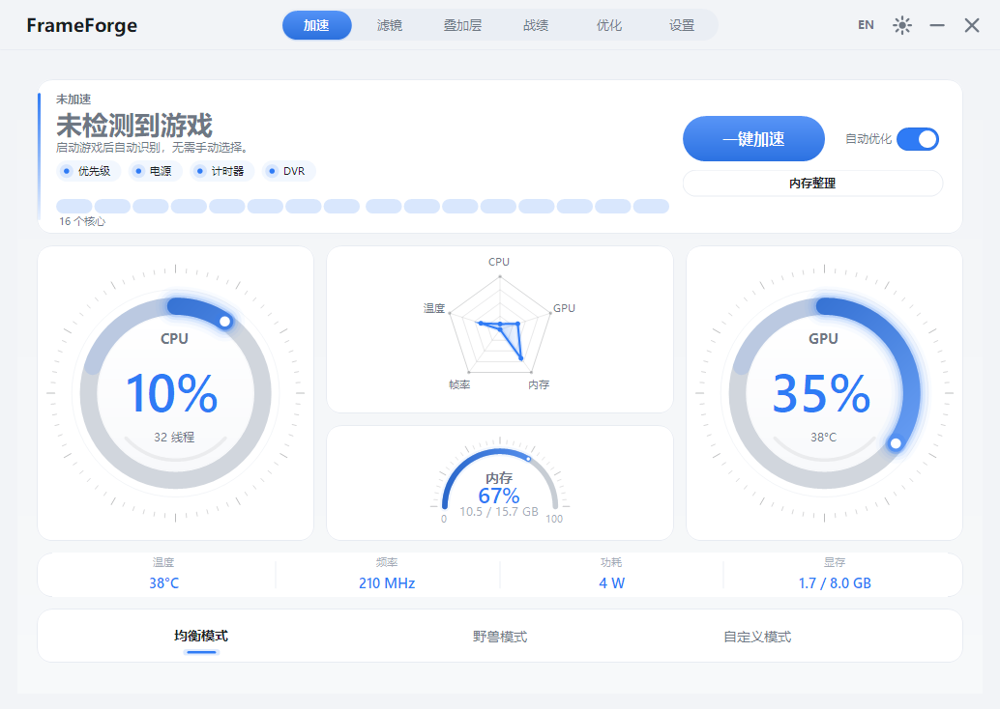
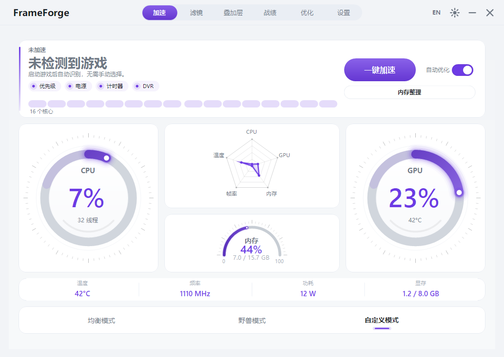
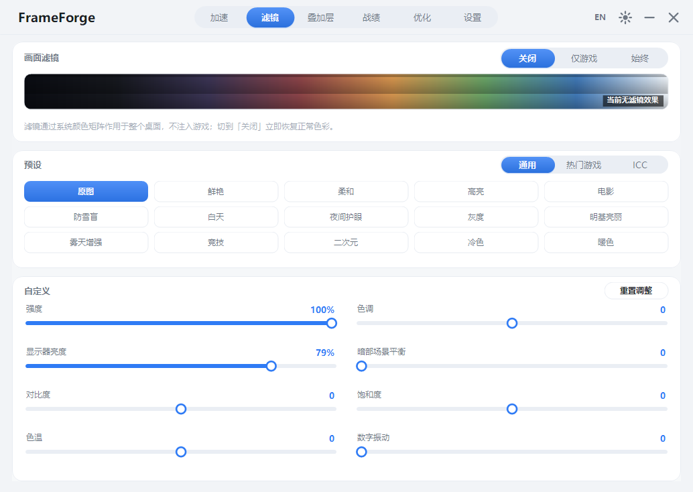
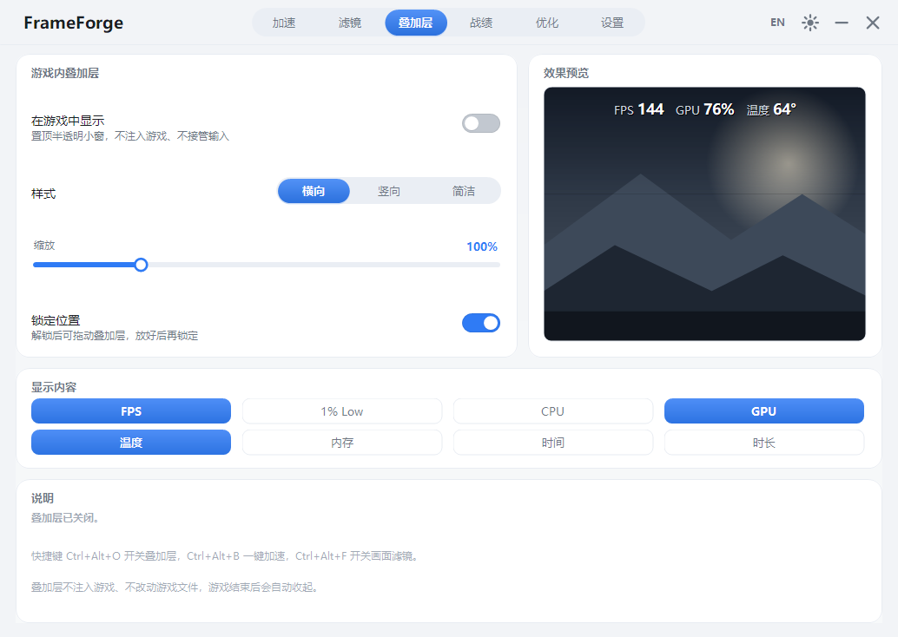
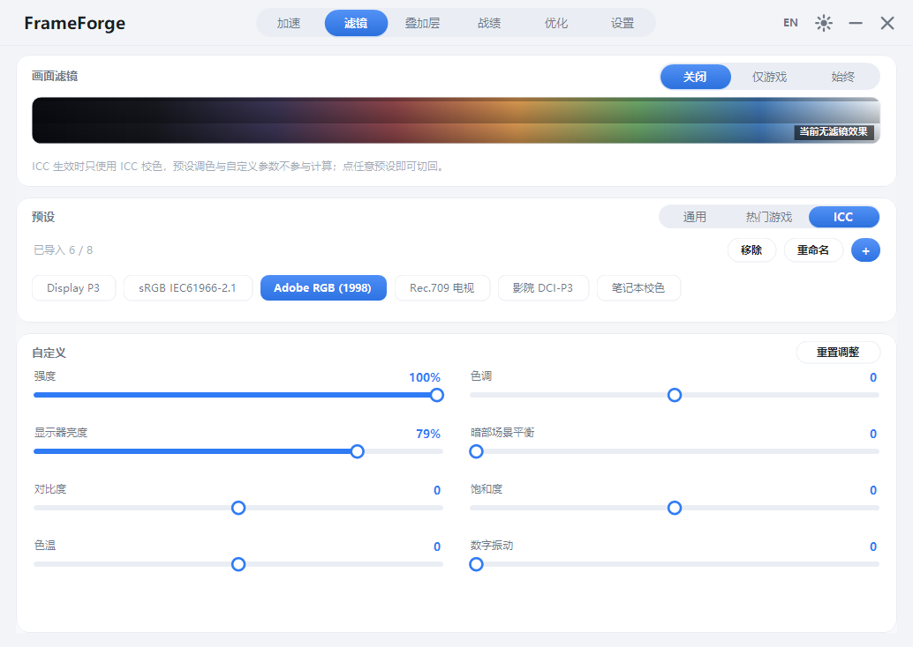
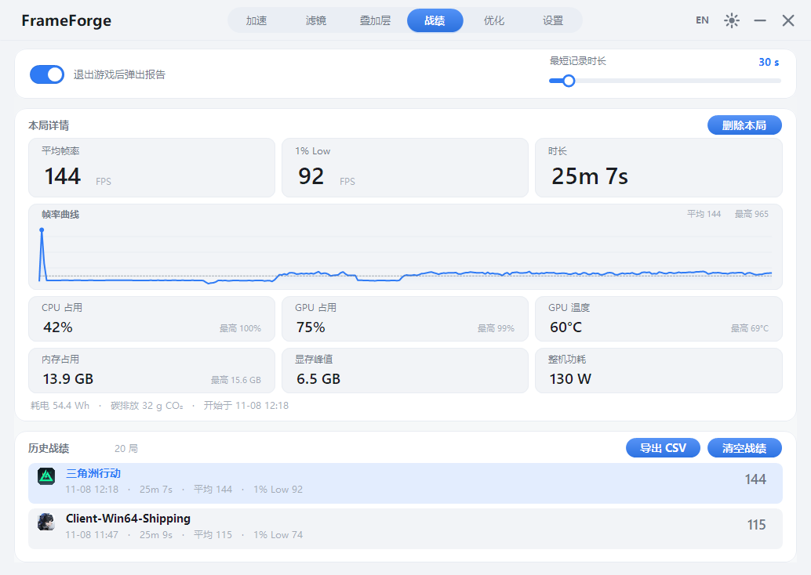
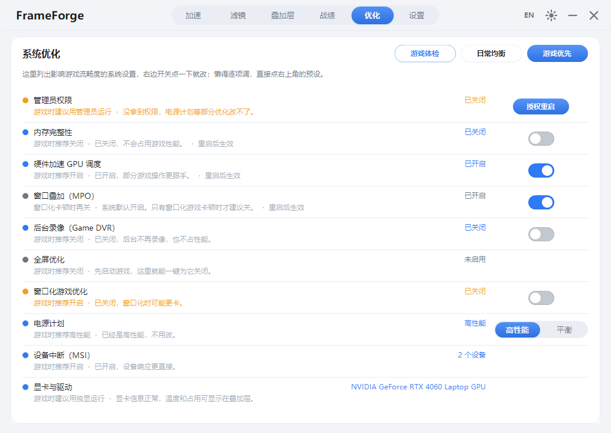
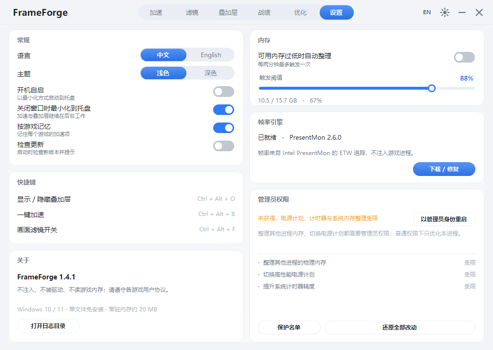

<p align="center"></p>

<h1 align="center">FrameForge</h1>

<p align="center"><b>轻量级 FPS 游戏增效工具 · A lightweight FPS toolkit for Windows</b><br>
一键加速 + 实时帧率监测 + 游戏内叠加层 + 画面滤镜 + 赛后性能报告 + 系统优化</p>

<p align="center">单文件 · 免安装 · 462 KB · 不注入游戏 · 不装驱动</p>

<p align="center">
  
  
  
  
  
  
</p>

<p align="center"><a href="https://github.com/caijun-1/frameforge/releases/latest">下载最新版</a> · <a href="#功能">简体中文</a> · <a href="#english">English</a></p>

---

## 目录

- [功能](#功能)
- [截图](#截图)
- [系统要求](#系统要求)
- [快速开始](#快速开始)
- [加速做了什么](#加速做了什么)
- [系统优化](#系统优化)
- [帧率从哪来](#帧率从哪来)
- [画面滤镜](#画面滤镜)
- [赛后报告与战绩](#赛后报告与战绩)
- [快捷键](#快捷键)
- [数据与隐私](#数据与隐私)
- [从源码构建](#从源码构建)
- [项目结构](#项目结构)
- [已知限制](#已知限制)
- [更新日志](#更新日志)
- [English](#english)

---

## 功能

| 模块 | 能力 |
| --- | --- |
| 一键加速 | 进程优先级、高性能电源计划、系统计时器 1 ms、关闭 Game DVR 与全屏优化、内存整理、进阶：暂停后台无窗口占用大户（二次确认）、独占物理核心、设备中断避让、按游戏记忆策略 |
| 实时监测 | 汇聚在加速页的监控仪表：CPU / GPU 占用环形表、五维雷达图（CPU / GPU / 内存 / FPS / 温度）、内存弧表，以及 GPU 温度 / 频率 / 功耗 / 显存四联指标 |
| 游戏识别 | 进程名 → 真实游戏名三层识别（用户 `games.ini` → 内置 200+ 游戏库 → 安装目录 / 文件版本信息），Unreal 的 `*-Win64-Shipping` 这类通用进程名不会再把进程名当成游戏名（旧版本已归档的记录保持原样） |
| 游戏检测 | 四层兜底不漏检：前台游戏窗口 → 后台铺满屏幕的游戏窗口 → 已知游戏进程扫描（窗口化 / 小窗口也算）→ 游戏平台安装目录（Steam / Epic / GOG / Xbox / WeGame 等）辅助识别；我的世界基岩版按进程、Java 版按窗口标题识别 |
| 画面滤镜 | 15 组通用预设（含冷色、暖色、雾天增强、竞技、二次元等）+ 8 款游戏专用预设（三角洲行动、无畏契约、原神、Apex、CS2、PUBG、永劫无间、英雄联盟）+ 强度 / 对比度 / 暗部平衡 / 饱和度 / 数字振动 / 色温 六维微调，按住可随时对比原图；亮度滑块直接调显示器硬件背光 |
| 游戏内叠加层 | 置顶半透明小窗，横向 / 纵向 / 简洁三种样式，9 种指标（FPS / 1% Low / CPU / GPU / GPU 温度 / 内存 / 内存% / 时钟 / 时长）可自选；位置可选屏幕四角或自由拖动，可缩放、可锁定；跟随游戏所在显示器，并周期重申请置顶以对抗抢占置顶的游戏；检测到独占全屏时提示改用无边框窗口 |
| 赛后报告 | 退出游戏自动弹出性能报告：平均 / 最高 / 最低帧率、1% Low、CPU / GPU / 温度 / 内存 / 显存 / 功耗，以及耗时电量与碳排估算 |
| 战绩历史 | 每局自动归档（最多 300 条），可回看任意一局详情（含帧率折线图）、删除单局、清空或导出 CSV，名字与图标取自游戏本体 |
| 系统优化 | 「优化」页逐项列出会影响帧率的设置（管理员权限、VBS、硬件加速 GPU 计划、窗口叠加 MPO、Game DVR、全屏优化、窗口化游戏优化、电源计划、MSI 中断、显卡与驱动），每项标明游戏时的推荐状态，开关 / 分段选择直接改；顶部「游戏优先」「日常均衡」一键套用，「游戏体检」可查看每一项的实际取值与改动记录 |
| 其他 | 中英双语、深浅双主题、托盘常驻、开机自启、内存阈值自动整理、三档保护名单（系统与自启项永久保护 / 小内存自动保护 / 手动添加）、可选「检查更新」 |

所有加速项都是**可回滚**的系统设置，点「还原设置」或关闭游戏后逐项恢复原状。

## 截图

以下为浅色主题界面，全部取自 v1.4.1。加速页的模式条为铺满整卡的三等分色块，「编辑选项」只在自定义模式下出现；战绩详情里可直接查看本局帧率折线；滤镜预设分「通用 / 热门游戏 / ICC」三页。

| 加速（均衡模式） | 加速（自定义模式） |
| --- | --- |
|  |  |

| 滤镜 | 叠加层 |
| --- | --- |
|  |  |

| 滤镜（ICC 配置文件） |
| --- |
|  |

| 战绩 | 优化（系统体检） |
| --- | --- |
|  |  |

| 设置 |
| --- |
|  |

<details>
<summary>旧版界面（v1.1.1，对比用）</summary>

| 加速 | 监测 |
| --- | --- |
|  |  |

| 滤镜 | 叠加层 |
| --- | --- |
|  |  |


</details>

## 系统要求

- Windows 10 1809 及以上 / Windows 11（x64）
- .NET Framework 4.8（Windows 10 1809 起为系统自带）
- 帧率功能需要管理员权限并首次在「设置 → 帧率引擎」下载 Intel PresentMon（约 1 MB）
- 显卡传感器依赖 NVIDIA NVML；其余厂商的传感器读不到时显示 `—`

## 快速开始

1. 下载 `FrameForge.exe`，双击运行，无需安装。
2. 启动游戏并切到游戏窗口，加速页会自动识别铺满屏幕的前台程序。
3. 点 **一键加速**；退出游戏或点 **还原设置** 即可回滚。
4. 想要帧率数字：设置 → 帧率引擎 → 下载 / 修复，然后以管理员身份重启本程序。

## 加速做了什么

| 项目 | 具体动作 | 如何还原 |
| --- | --- | --- |
| 进程优先级 | 游戏进程设为 `HIGH_PRIORITY_CLASS`；写入后回读确认，被反作弊拒绝时明确提示，不谎报成功 | 恢复原优先级 |
| 理想处理器软引导 | 加速开始时、以及之后每 2 分钟，采样各逻辑核占用，把游戏**主线程**的 `SetThreadIdealProcessor` 指向当前最空闲的核心；只给调度提示，不锁亲和性 | 指回「任意核心」（`MAXIMUM_PROCESSORS`） |
| 高性能电源计划 | 切换到系统「高性能」方案 | 切回原方案 GUID |
| 系统计时器 1 ms | `timeBeginPeriod(1)` | `timeEndPeriod(1)` |
| 关闭 Game DVR | 写入 `GameDVR_Enabled=0`、关闭全屏优化 | 恢复原注册表值 |
| 内存整理 | 对空闲进程 `EmptyWorkingSet` + 清系统工作集 | 无需还原（缓存会自行重建） |
| 暂停后台进程 | 挂起无窗口且占用靠前的后台进程；反作弊组件（ACE / EAC / BattlEye / Vanguard 等）永远不碰 | 自动恢复线程 |
| 独占物理核心 | 按 CPU 拓扑把游戏绑到一半完整物理核心，其他进程挪到剩余核心 | 恢复各进程原亲和性掩码 |
| 设备中断避让 | 把网卡 / 显卡的 MSI 中断亲和性指向非游戏核心 | 恢复原注册表值，重启后生效 |
| 按游戏记忆 | 每个游戏单独保存加速项，下次检测到该游戏时自动套用 | 仅写本地配置，无需还原 |
| 保护名单 | 名单内的程序（如直播、语音、录制软件）与反作弊组件一律不暂停、不整理内存 | 仅写本地配置，无需还原 |

> 进阶项「暂停后台进程」会先列出候选进程并要求二次确认，只挂起、不结束。
> 自动套用只应用安全项（暂停后台进程与中断避让不自动执行）。

## PCBoost 的两层加速原理

FrameForge 的加速逻辑按 PCBoost 的思路拆成两层，一层管「马上抢到算力」，一层管「持续待在对的核心上」。

### 1. 瞬时响应：高优先级与前台特权

后台监控每秒采样一次前台窗口与窗口句柄。识别到游戏后，立刻把游戏进程的 CPU 优先级提到 `HIGH_PRIORITY_CLASS`，打破 Windows 默认的平衡调度，让鼠标输入、键盘响应和游戏主线程优先拿到时间片。写入后会回读确认；被反作弊拒绝时会在界面明确提示，不会假装成功。

### 2. 动态负载平衡：每 2 分钟的理想处理器软引导

加速开始时做第一次引导，之后每 120 秒重新评估一次：用 `NtQuerySystemInformation` 取每个逻辑核的累计 idle / busy 时间，采样两次算出单核占用率，挑出当前最空闲的核心，再对游戏**主线程**（进程内 TID 最小的线程）调用 `SetThreadIdealProcessor`。

- **软引导，不是硬隔离**：`SetThreadIdealProcessor` 只是给调度器的「首选核心」提示，不修改亲和性掩码。游戏需要多核爆发时，依然可以自由调用包括 CPU 0 在内的所有核心，不会浪费算力。
- **为什么能变相避开 CPU 0**：CPU 0 默认承担网卡、鼠标、显卡等硬件中断和大量系统底层服务，绝大多数时间里占用率都不是最低的。按「选最闲」的规则挑选时，它大概率不会被选中，于是主线程自然与系统杂务核心错峰运行——这是一种动态、无副作用的方式，而不是写死「禁用 CPU 0」。
- **负载相同怎么办**：两次采样差值在 0.05% 以内时优先编号非 0 的核心，把 CPU 0 留给中断。
- **与其他项的配合**：启用了「独占物理核心」时，只在分配给游戏的核里挑；界面里的「理想处理器」开关是「全部线程」实验项，与这里的自动软引导互不影响。
- **还原**：还原加速时把主线程指回 `MAXIMUM_PROCESSORS`（交给调度器自己挑），不做任何持久化修改。

## 游戏识别

识别不靠单一关键词，而是「硬性排除 + 多信号评分 + 进程级证据 + 记忆」四层组合，目标是既不漏掉窗口化 / 改了窗口标题 / 换了分辨率的游戏，也不把桌宠、虚拟键盘、加速器、启动器当成游戏。

- **硬性排除窗口**：不可见、最小化、DWM cloaked、带 `WS_EX_TOOLWINDOW / LAYERED / TRANSPARENT / NOACTIVATE`、有 Owner 的窗口直接不看——桌宠、虚拟键盘（触摸键盘 / Onboard）、加速器与监控软件的悬浮窗、截图层都属于这类；
- **窗口尺寸下限**：小于 320×240、或面积不足屏幕 8% 的窗口不参与评分；
- **多信号评分**（满分超过 100，达到 50 即判定为游戏）：游戏库命中 +70、平台目录（Steam / Epic / Xbox 等）+55、仅引擎特征 +35；游戏窗口类 +30、铺满屏幕 +20、位于前台 +10、分辨率达到 640×360 +5；**该进程 GPU 3D 引擎占用 ≥10% +50 / ≥3% +40 / ≥1% +15**；已经确认过的进程 +40；
- **进程级 GPU 证据**：从 PDH 的 `\GPU Engine(*)\Utilization Percentage` 实例名里解析出 pid 和 `engtype_3D`，按 pid 聚合。这是识别「从没见过的窗口化游戏」最硬的一条证据，也是游戏加加、微星小飞机那类工具判断「谁在真正渲染」的办法；
- **持续跟踪**：每 1.5 秒全量重扫一次窗口；前台进程一变立刻单独评估；识别成功后记住句柄和进程，切窗口、读条、回主菜单时状态不会来回跳；
- **排除名单**：进程名与安装目录双重过滤反作弊组件、启动器、桌宠、虚拟键盘、加速器 / 监控工具、3D 与剪辑软件（Blender、Photoshop、Unity 编辑器等）；
- **叠加层跟随游戏**：记住游戏主窗口句柄（DWM 扩展边界优先），窗口化时叠加层限制在游戏窗口内，铺满屏幕时用显示器边界——不管游戏是不是前台、在哪块屏，都贴在游戏上面。

## 系统优化

「优化」页把「哪些设置正在拖慢帧率」做成一张可操作的清单，不再只给一个分数：

- 逐项检查：管理员权限、VBS 虚拟化安全（`DeviceGuard`）、硬件加速 GPU 计划（HAGS）、窗口叠加 MPO、Game DVR 后台录制、全屏优化、窗口化游戏优化、电源计划、网卡 / 显卡 MSI 中断亲和性、显卡与驱动状态；
- 每项都写清「为什么会影响帧率」，能直接改的右侧给开关或高性能 / 平衡分段选择，改完立即写回系统；
- 顶部两个预设一键套用：**游戏优先**（高性能电源 + HAGS 开 + Game DVR 关）、**日常均衡**（平衡电源 + HAGS 开 + Game DVR 开）；
- 改动前先把原值写进 `tune.journal`，需要回溯时可按记录逐项写回，不依赖记忆；
- 需要管理员的项会明确提示「提权重启」，不会假装成功；VBS、HAGS 改完标注重启后生效，关闭内存完整性前还有二次确认；
- 全程在本机完成，不联网、不上传任何结果。

## 帧率从哪来

通过 **Intel PresentMon** 的 ETW 会话读取前台游戏进程的呈现事件，计算平均 FPS 与 1% Low。
PresentMon 是在运行时按需下载的独立 exe（MIT 协议），不随本项目分发，也不注入游戏。

## 画面滤镜

滤镜走 Windows 放大镜 API 的全屏颜色矩阵（`Magnification.dll`），作用于整个桌面输出：

- 不注入游戏、不安装驱动、不修改游戏文件；
- **独占全屏也能生效**：独占全屏时 DWM 被绕过，放大镜的矩阵看不到画面。此时自动改用显示器 gamma LUT（`SetDeviceGammaRamp`），把颜色矩阵换算成逐通道曲线，亮度、对比度、色温、暗部提升仍然有效；离开独占全屏后先还原原始 LUT，再切回放大镜，避免两层效果叠加。饱和度依赖跨通道运算，LUT 模式下只能近似，界面会说明当前所处的模式；
- **预览是真实画面**：预览框里是一帧合成的游戏场景（天空、远山、地面、人物剪影、准星与血条），直接套用当前颜色矩阵，不再用抽象色带，色温、暗部、肤色和 UI 是否会变色都能一眼看出来；
- 「仅游戏」模式下只在检测到全屏游戏时生效；
- 远程桌面等不支持的环境会给出提示并保持原色；
- 15 组通用预设：原图、鲜艳、柔和、高亮、电影、防雪盲、白天、夜间护眼、灰度、明基亮丽、雾天增强、竞技、二次元、冷色、暖色；
- 8 款游戏专用预设：三角洲行动、无畏契约、原神、Apex 英雄、CS2、PUBG、永劫无间、英雄联盟，每款都针对该作场景单独调过；
- 六维微调：强度、对比度、**暗部平衡**（压高光 + 抬黑位，暗处看得更清）、饱和度、**数字振动**（类似 NVIDIA 数字振动，提升色彩浓艳度）、色温；
- 亮度滑块直接调硬件背光：外接显示器走 DDC/CI（VCP 0x10），笔记本内置屏改走 WMI 背光接口；不进滤镜矩阵，也不会出现在截图 / 录屏里；两者都不支持时滑块置灰并给出提示；
- **A/B 对比**：按预览图上的按钮（或长按）即可临时查看未加滤镜的原图，随手对比效果；
- **ICC 配置文件**：预设分组里单开一页「ICC」，点右上角的 **+** 从文件导入显示器 / 校色仪提供的 `.icc` / `.icm`，导入时可以自己起名字；之后点条目应用、再点一次取消，右键条目或点「重命名」可随时改名；矩阵型（`rXYZ`/`gXYZ`/`bXYZ` + TRC）和 LUT 型（`mAB `/`mBA `，曲线 + 3×3 矩阵 + CLUT）都能解析，屏幕校正取 B2A 方向并在 9×9×9 sRGB 网格上拟合成 3×3 + 偏移；**ICC 与预设滤镜互斥**：ICC 生效时只用 ICC 校色，预设与自定义六维参数不参与计算，避免两层颜色变换叠在一起导致偏色，点任意预设即可切回；解析全程在本机完成，文件不可用时明确报错而不是硬套一个错误矩阵。

## 赛后报告与战绩

- 检测到游戏进程后自动开始计时，退出游戏时结算这一局；
- 时长达到「最短记录时长」（默认 30 秒，可在战绩页 5–300 秒之间调整）才会计入，避免误触启动器刷屏；
- 结算时默认弹出报告卡：平均帧率、1% Low、时长三联，CPU / GPU / GPU 温度 / 内存 / 显存峰值 / 整机功耗六格，各带「最高」小字，底部给出一局的耗电量（Wh）与碳排估算（按 0.581 kg CO₂/kWh）；
- 「战绩」页保存最近 300 局，可逐局查看同样的明细、删除单局、清空全部或一键导出 CSV；
- 报告弹窗与自动弹出都可以在战绩页关闭。

## 快捷键

| 按键 | 作用 |
| --- | --- |
| `Ctrl + Alt + O` | 显示 / 隐藏叠加层 |
| `Ctrl + Alt + B` | 一键加速 / 还原 |
| `Ctrl + Alt + F` | 开启 / 关闭画面滤镜（记住上次使用的预设） |

## 数据与隐私

- 配置：`%LOCALAPPDATA%\FrameForge\settings.ini`，按游戏策略在同目录的 `profiles.ini`
- 游戏名映射：同目录的 `games.ini`，可自行添加「进程名=游戏名」
- 战绩：同目录的 `sessions.dat`（纯文本，一行一局，可直接编辑或删除）
- 日志：`%LOCALAPPDATA%\FrameForge\log.txt`（超过 1 MB 轮转一份）
- 默认不联网、不上传任何数据。网络请求只有两项且都由你触发：下载 PresentMon、打开「设置 → 检查更新」后查询 GitHub 最新版本号（只读版本号与发布页链接，不发送任何本地数据）。

## 从源码构建

只需要 Windows 自带的 .NET Framework 编译器，无需 Visual Studio / .NET SDK：

```powershell
powershell -ExecutionPolicy Bypass -File .\build.ps1
```

输出 `FrameForge.exe`。自检（不需要开界面）：

```powershell
.\FrameForge.exe --selftest   # 结果写入 %TEMP%\frameforge_selftest.log
```

自检覆盖：传感器采样、显卡识别、游戏检测、游戏名识别与回退、电源方案、后台进程候选、设置映射、三档加速模式、保护名单归一化、加速日志回滚、CPU 拓扑与核心掩码、按游戏策略读取、中断设备枚举、PresentMon 状态、叠加层初始化、系统体检项与页面绘制、战绩序列化与能耗估算。

> 代码保持 C# 5 语法（随系统分发的 `csc.exe` 只认 C# 5），请勿使用插值字符串、`?.`、表达式体成员等新语法。

## 项目结构

```
frameforge/
├── build.ps1              # 一键编译（csc + app.manifest + app.ico）
├── app.manifest           # DPI 感知、UAC 清单
├── app.ico                # 多尺寸程序图标（16–256px）
├── src/
│   ├── Program.cs         # 入口、单实例、--selftest
│   ├── Settings.cs        # 配置读写
│   ├── Theme.cs / I18n.cs # 配色与中英文案
│   ├── Util.cs / Native.cs# 日志、P/Invoke 声明
│   ├── Overlay.cs         # 分层窗口叠加层
│   ├── Sys/
│   │   ├── Monitor.cs     # CPU / 内存 / GPU 采样
│   │   ├── Pdh.cs / Nvml.cs   # 性能计数器与显卡传感器
│   │   ├── Fps.cs         # PresentMon 下载与帧率读取
│   │   ├── GameDb.cs      # 进程名 → 真实游戏名识别
│   │   ├── Sessions.cs    # 单局战绩采集、归档与 CSV 导出
│   │   ├── Boost.cs       # 加速项与回滚
│   │   ├── BoostJournal.cs# 加速前原值落盘，崩溃后自动还原
│   │   ├── Health.cs      # 系统设置检查（VBS / HAGS / MPO / Game DVR / 全屏优化 / 电源 / MSI / 显卡）
│   │   ├── Compat.cs      # 兼容性标记：按游戏关闭全屏优化、窗口化游戏优化
│   │   ├── Tune.cs        # 设置调节与原值日志（预设、推荐值）
│   │   ├── Display.cs     # 显示器硬件亮度（DDC/CI）
│   │   ├── Update.cs      # 只读查询 GitHub 最新版本
│   │   ├── Topology.cs    # CPU 物理核心拓扑
│   │   ├── Affinity.cs    # 核心独占与其他进程避让
│   │   ├── Interrupts.cs  # 网卡 / 显卡中断亲和性
│   │   ├── Profiles.cs    # 按游戏保存的加速策略
│   │   ├── MemEngine.cs   # 内存整理与提权
│   │   ├── Filter.cs      # 全屏颜色矩阵滤镜
│   │   └── Icc.cs         # ICC 配置文件解析与矩阵拟合
│   └── UI/
│       ├── MainForm.cs        # 外壳：标题栏、导航、托盘
│       ├── MainForm.Actions.cs# 业务动作：加速、叠加层、热键
│       ├── Pages.cs           # 六个页面（加速 / 滤镜 / 叠加层 / 战绩 / 优化 / 设置）
│       ├── HealthPage.cs      # 优化页：逐项调节、推荐状态与预设
│       ├── AuditDialog.cs     # 优化页的「配置审计」弹窗（实际取值与改动记录）
│       ├── TrayMenu.cs        # 自绘托盘菜单（显示主界面 / 退出）
│       ├── WhitelistDialog.cs # 保护名单：勾选不参与加速的程序
│       ├── UpdateDialog.cs    # 检查更新弹窗
│       ├── BoostDialog.cs     # 自定义模式的「编辑选项」弹窗
│       ├── ReportForm.cs      # 赛后性能报告弹窗
│       ├── Controls.cs / Widgets.cs # 自绘控件库
└── docs/
    ├── FEASIBILITY.md     # 技术选型与取舍
    └── screenshots/
```

## 已知限制

- 独占全屏（Exclusive Fullscreen）游戏会遮挡叠加层，程序检测到后会提示改用无边框窗口；这是系统限制，不注入游戏就无法绕过；
- 部分带反作弊的游戏会拒绝修改自身进程优先级，此时该项会明确标为「被游戏拒绝」，其余加速项照常生效；
- 帧率 / 电源计划 / 系统内存整理需要管理员权限，普通权限下只优化本进程；
- 滤镜为桌面级后处理，HDR 与广色域显示器上的观感会与 SDR 略有差异；
- 仅支持 Windows；Linux / macOS 不在计划内。

## 更新日志

### v1.4.3.6

**新增**

- 按 PCBoost 原理实装「理想处理器软引导」：加速开始时、以及之后每 2 分钟，采样各逻辑核占用，把游戏主线程引导到当前最空闲的核心；只调 `SetThreadIdealProcessor`，不锁亲和性，需要多核时仍可用全部核心。CPU 0 承担系统中断与杂务，按「选最闲」的规则通常会被自然避开。
- 新增「游戏识别」说明：硬性窗口样式排除、多信号评分、进程级 GPU 3D 证据、1.5 秒重扫与已确认进程记忆。

**修复**

- 游戏漏检与误检：重写识别逻辑，不再「进程名命中就当游戏」。桌宠（Shimeji / Live2D 等）、虚拟键盘（触摸键盘 / Onboard）、加速器与监控悬浮窗（UU / 迅游 / BoosterX / 小飞机等）、启动器、编辑器与剪辑软件都会被排除；窗口化、改标题、换分辨率的游戏改由 GPU 3D 占用与窗口特征共同识别。
- 窗口变化后检测失效：每 1.5 秒全量重扫窗口，前台进程一变立刻评估，并记住游戏窗口句柄，切窗口 / 读条 / 回主菜单不再丢失状态。
- 独占全屏滤镜无效：独占全屏时 DWM 被绕过，放大镜矩阵不生效；现在自动切到显示器 gamma LUT，退出独占全屏后还原原始 LUT 再切回放大镜，避免叠加。
- 滤镜预览「颜色太抽象」：抽象色带换成合成的真实游戏场景，按当前颜色矩阵渲染，调色差在哪一眼可见。
- 叠加层定位：改为跟随游戏主窗口（DWM 扩展边界），窗口化时限制在游戏窗口内，铺满屏幕时贴显示器边界，不再只看前台窗口所在屏幕。

### v1.4.3.5

**修复**

- 反作弊组件不再被当成游戏：BattlEye Launcher、ACE-Helper、EasyAntiCheat、ACE-Guard 等进程会弹全屏窗口、又装在游戏目录下，之前会被记进战绩并被自动加速；现在从进程名和安装目录两条路都排除，旧版本已写进战绩的历史记录读取时直接丢弃。
- 显卡驱动异常时不再带崩 FrameForge：驱动复位或驱动自身出错时 `nvml.dll` 会直接抛访问违例，普通 `catch` 接不住；现在捕获后停用显卡数据采集（界面显示 —），帧率、加速、内存等功能不受影响。
- 帧率长时间不显示：界面心跳里对已释放的进程对象读 `HasExited` 会抛异常并中断刷新；同时多个采集看门狗线程会互相杀掉对方刚启动的 PresentMon、反复拆建 ETW 会话，导致一直采不到第一行数据。现在旧看门狗会自动退出，失败按 10/20/40 秒退避，连续 6 次仍无数据才停手并记日志。

### v1.4.3.1

**新增**

- 自动内存整理支持两种触发方式：**按阈值**（占用达到设定值才整理，60–95%）与**按时间**（每隔 5–60 分钟整理一次），在「设置 → 内存」里切换；两种方式都会在游戏运行或加速中自动跳过。

**优化**

- 设置页「内存」卡片重新排版：触发方式选择移到标题下方左侧，不再和右上角开关重叠；阈值与间隔共用同一根滑杆，切换模式时量程、单位与标签一起变化。

### v1.4.3

**修复**

- 修复浏览器被当成游戏：360 国际版等 Chromium 浏览器（F11 全屏或无边框窗口）不再被识别为游戏、不再被自动加速；Chromium / 浏览器 / UWP 外壳的窗口类也一并排除。
- 游戏识别改为按证据判定：内置游戏库、Steam / Epic / WeGame 等游戏目录、Unreal / Unity / Godot 引擎特征命中即算游戏，与窗口大小无关，窗口化、小窗口、无边框、全屏都能识别；认不出的程序只有「铺满屏幕 + 读不到进程名或窗口类属于游戏引擎」时才按游戏处理。

**新增**

- 滤镜新增「**暗部场景平衡**」与「**数字振动**」的独立开关：滑杆默认 50、开关默认关闭；两者作为独立增强层叠加在预设或 ICC 之上，使用 ICC 校色时也能单独生效。
- 叠加层排版向小飞机（MSI Afterburner / RTSS）靠拢：同一台设备的数值合并到一行，设备名（CPU / GPU / 内存）只写一次，占用、温度等数值依次排在其后并按列右对齐；贴角边距从 24 px 收到 10 px，竖向行距与内边距压紧，同一组指标占的面积明显更小；默认改为「竖向 + 左上」，开箱就是贴角窄条。

**优化**

- 叠加层稳定性：绘制画布、预乘缓冲与 DIB 按尺寸复用，不再每 200 ms 分配几百 KB 内存；DIB 创建失败时直接跳过这一帧，不会往空指针里写导致进程被系统终止；渲染异常每分钟最多记一条日志；显示项与简洁样式的温度/帧率全部关闭时自动收起，不再留一条「-- FPS」挂在屏幕上。
- 叠加层去掉「**CPU 温度**」选项：AMD 笔记本（如拯救者 R9000P）不通过 ACPI 暴露 CPU 热区，WMI 与 PDH 都读不到，留着只会一直显示 `--`；CPU 占用、GPU 温度等其余指标不受影响。
- 页面排版统一：五个页面的页面边距与卡片内边距统一为 20 px，区块标题字号提到 10.2 pt（不再小于行标题），切换页面时内容左边缘不再左右跳动；加速页去掉多余的一层内缩与底部空档；健康页在最小窗口高度下十行指标也能完整显示。

### v1.4.2

**新增**

- 新增「**加速排除**」名单：系统输入法与触摸键盘等界面进程始终排除，壁纸、OBS、Streamlabs、Discord 等常见叠加/直播程序默认排除；名单可在「设置 → 进程名单」的第二个标签页里逐项勾选，自动和手动加速都会跳过它们。
- 自定义优化项新增「**进程优先级档位**」：低 / 低于正常 / 正常 / 高于正常 / 高（默认高），并新增「**推荐值**」一键恢复默认勾选。
- 加速中在加速页显示目标进程名、PID、优先级档位与核心数，锁定时附带「已锁定」标记，方便核对加速对象。
- 自定义优化项新增实验开关「**线程理想处理器**」：仅建议游戏线程使用性能核，不修改亲和性掩码；默认关闭，自动加速不会启用。

### v1.4.1.3

**修复**

- 修复带反作弊的游戏切到后台就被判定「游戏结束」：读取进程名被拒绝时不再当作退出，并增加 5 秒宽限期，只有进程真正结束才还原并提示。
- 修复触摸键盘 / 手写面板被当成游戏：切回桌面时加速目标不再跳到 `TabTip`、`InputApp` 等系统外壳进程，回到游戏后仍继续加速原来的游戏。
- 频繁切换多个应用时不再反复弹出「加速结束」提示。

**新增**

- 加速页新增「**锁定当前游戏**」按钮：锁定后手动加速与自动加速都只认这个进程，切屏或回到桌面都不会改变目标；再次点击解除，锁定结果写入设置，重启后仍然有效。

### v1.4.1.2

**修复**

- 修复「检查更新」误报：四段版本号（如 1.4.1.1）之前被截成三段参与比较，已是最新也会一直提示发现新版本；现在保留修订号，正确判定。

### v1.4.1.1

**新增**

- 叠加层位置可选**屏幕四角**：自动 / 左上 / 右上 / 左下 / 右下；选固定角后紧贴该角，手动拖动会切回「自动」，两种方式都能用。
- 叠加层新增「**内存%**」显示项，和原有「内存」（已用容量）可分别开关。

**改进**

- 帧率数值改为 Afterburner / RTSS 风格的粉紫色，其他数值保持白色，右侧预览同步。
- CPU 温度与 GPU 温度拆成两个显示项，分别开关；CPU 温度读 ACPI 热区，取不到时显示 `--`，不编数字。
- 叠加层的时间精确到秒（`HH:mm:ss`）。
- 独占全屏检测更稳：部分系统只上报「有全屏程序」时也能识别并给出提示，提示文案明确为「窗口全屏（无边框）」。
- 优化页不再把「关闭全屏优化」标为推荐：关掉它会把游戏变成真独占全屏，叠加层反而无法覆盖。

### v1.4.1

**新增**

- 画面滤镜新增 **ICC 配置文件**：预设分组里单开「ICC」页，点右上角 **+** 从文件导入 `.icc` / `.icm`，导入时可自定义名字；左键点条目启用、再点一次取消，右键或「重命名」按钮可随时改名，不需要重新导入。
- 矩阵型（`rXYZ`/`gXYZ`/`bXYZ` + TRC）与 LUT 型（`mAB `/`mBA `，曲线 + 3×3 矩阵 + CLUT）ICC 都能解析；屏幕校正取 B2A 方向，在 9×9×9 sRGB 网格上拟合成 3×3 + 偏移。

**改进**

- ICC 与预设滤镜现在**互斥**：ICC 生效时只用 ICC 校色，预设与自定义六维参数不参与计算，避免两层颜色变换叠加导致偏色；点任意预设即可切回。
- 叠加层新增常驻状态行：未开启 / 等待游戏 / 正在显示（带游戏名）/ 独占全屏受限，一眼看出当前为什么没有画面。
- 叠加层会自愈：窗口被游戏顶掉、或清空全部显示项后再勾回来，会自动重新上屏，不必反复开关。
- 切换显示器、拔插副屏或修改分辨率后，叠加层按当前目标屏重新定位，不会再停在屏幕外。
- 锁定位置的叠加层每帧重新声明置顶，游戏反复抢占最前也能回来。

**修复**

- 修复无畏契约等**独占全屏**游戏里叠加层不显示的问题：程序检测到独占全屏后会提示改用「无边框窗口」，这是系统限制，不注入游戏无法绕过。
- 修复叠加层在切换全屏 / 修改分辨率后消失的问题。

## 许可

[MIT](LICENSE)。第三方组件声明见 [NOTICE](NOTICE)。

发布件由 CI 从 tag 构建后签名，校验方式与「不做什么」见 [SIGNING.md](SIGNING.md)；漏洞报告见 [SECURITY.md](SECURITY.md)。

---

## English

**FrameForge** is a portable Windows toolkit for FPS games: one-click boost, live frame-time monitoring, an in-game overlay, desktop-wide screen filters, and an automatic post-game performance report. It ships as a single 498 KB executable with about 20 MB of resident memory, and it never injects into games or installs a driver.

### Highlights

- **One-click boost** — process priority, high-performance power plan, 1 ms timer resolution, Game DVR / fullscreen optimization off, working-set trim, plus opt-in advanced steps: suspend background hogs (with confirmation), reserve physical cores for the game, move NIC/GPU interrupts off those cores, and remember options per game. Every change is reversible.
- **Live monitoring** — a dashboard built into the Boost page: CPU/GPU rings, a five-axis radar (CPU / GPU / RAM / FPS / temperature), a RAM arc, and a GPU temperature / clock / power / VRAM strip.
- **Real game names** — a three-layer lookup (user `games.ini` → built-in library of 200+ titles → install folder / file version info) turns `client-win64-shipping.exe` into the actual game title instead of showing a raw process name.
- **Screen filters** — fifteen general presets plus eight tuned per-game looks (Delta Force, VALORANT, Genshin, Apex, CS2, PUBG, Naraka, League of Legends), with intensity, brightness, contrast, shadow lift, saturation, digital vibrance and warmth sliders, applied through the Windows Magnification color matrix (game-only or always). Hold the A/B button to compare against the original image. The brightness slider drives the monitor's hardware backlight (DDC/CI, or WMI on laptop panels), so it stays out of the color matrix and out of screenshots. You can also import an ICC profile (`.icc` / `.icm`) from its own **ICC** tab in the presets card — click **+** to import, name it while importing, click the entry to apply (click again to clear), and rename it any time via right-click or *Rename*. Both matrix profiles (`rXYZ`/`gXYZ`/`bXYZ` + TRC) and LUT profiles (`mAB `/`mBA ` — curves, 3×3 matrix and CLUT) are parsed; screen correction uses the B2A direction and is fitted to a 3×3 + offset on a 9×9×9 sRGB grid. ICC and preset filters are mutually exclusive: while an ICC profile is active it is the only filter applied, and presets plus the six manual sliders are left out of the math, so two color transforms never stack. Click any preset to switch back.
- **In-game overlay** — top-most layered window with three layouts, nine selectable stats (FPS, 1% low, CPU, GPU, GPU temp, RAM, RAM %, clock, session), screen-corner presets or free dragging, scaling and position lock. It follows the monitor the game is on and re-asserts top-most every frame, so games that grab the top spot cannot bury it; if the game runs in exclusive fullscreen, the app tells you to switch to borderless instead of silently showing nothing.
- **Post-game report & records** — a report card pops up when a game exits with average/max/min FPS, 1% low, CPU/GPU/temperature/memory/VRAM/power, plus energy and CO₂ estimates. The Records page keeps the last 300 sessions with per-session detail (including an FPS chart), delete, clear, and CSV export.
- **System check-up** — the Optimize page lists the settings that quietly cost frames (admin rights, VBS, hardware-accelerated GPU scheduling, MPO overlay, Game DVR, fullscreen optimization, windowed-game optimization, power plan, MSI interrupt affinity, GPU driver) with the recommended state for gaming, inline toggles, two one-click presets, and a “PC check-up” view that shows the actual value and change journal for every row.
- **Compatibility first** — anti-cheat components (ACE, EAC, BattlEye, Vanguard…) are never suspended or memory-trimmed, and if a game rejects the priority change the app says so instead of claiming success. Anything on the protected list (OBS, Discord, recording tools…) is left alone too.
- Bilingual UI (Chinese / English), dark and light themes, tray mode, autostart, optional update check.

### Changelog

#### v1.4.3.6

**New**

- Ideal-processor soft steering following the PCBoost model: on boost and every 2 minutes thereafter, per-logical-core load is sampled and the game's main thread is pointed at the least busy core via `SetThreadIdealProcessor`. Affinity is never locked, so the game can still burst across every core; because CPU 0 carries most interrupts and system housekeeping, "pick the idlest" usually steers away from it on its own.
- A new "Game detection" section documents the hard window-style exclusions, multi-signal scoring, per-process GPU 3D evidence, 1.5 s rescan and confirmed-process memory.

**Fixed**

- Missed and false game detections: detection no longer treats a process-name hit as a game. Desktop pets, virtual keyboards, accelerator/monitor overlays, launchers, editors and NLEs are excluded; windowed games, renamed windows and resolution changes are recognised by GPU 3D usage plus window traits.
- Detection dropping after a window change: a full window rescan runs every 1.5 s, foreground changes are evaluated immediately, and the game window handle is remembered so loading screens and alt-tabs keep the state.
- Filters not working in exclusive fullscreen: DWM is bypassed there, so the magnifier matrix never reached the screen. It now falls back to the display gamma LUT and restores the original LUT before switching back, avoiding double-grading.
- Abstract filter preview: the swatch strip is replaced by a synthetic game frame rendered through the active colour matrix.
- Overlay placement now follows the game's main window (DWM extended bounds) instead of the monitor of the foreground window.

#### v1.4.3.5

**Fixed**

- Anti-cheat components are no longer treated as games: BattlEye Launcher, ACE-Helper, EasyAntiCheat and ACE-Guard open full-screen windows and live under the game folder, so they used to be recorded as game sessions and auto-boosted. They are now excluded by both process name and install path, and stale entries already written to the records are dropped on load.
- A faulty GPU driver can no longer take FrameForge down with it: when the driver resets or misbehaves, `nvml.dll` can raise an access violation that a plain `catch` cannot intercept. The exception is now handled, GPU stats stop updating (shown as —), and FPS, boost and memory features keep working.
- FPS could stay blank for a long time: reading `HasExited` on a disposed process object threw inside the UI heartbeat and stopped the refresh, while several watchdog threads kept killing each other's PresentMon and tearing down the ETW session, so the first data row never arrived. Old watchdogs now retire, failures back off at 10/20/40 s, and collection stops with a log entry after six consecutive empty attempts.

#### v1.4.3.1

**New**

- Auto memory trim now supports two trigger modes: **Threshold** (trim only when usage reaches the configured 60–95%) and **Interval** (trim every 5–60 minutes), switchable under Settings → Memory. Both modes are skipped while a game is running or a boost is active.

**Improved**

- Reworked the Memory card on the Settings page: the trigger-mode selector now sits below the title on the left instead of overlapping the switch in the top-right corner, and threshold and interval share one slider whose range, unit and label follow the selected mode.

#### v1.4.3

**Fixed**

- Browsers are no longer mistaken for games: 360 Browser and other Chromium browsers (F11 fullscreen or borderless) are no longer detected or auto-boosted. Chromium, browser and UWP shell window classes are excluded as well.
- Game detection is now evidence-based: a match in the built-in game database, a Steam / Epic / WeGame library folder, or Unreal / Unity / Godot engine fingerprints is enough regardless of window size — windowed, small, borderless and fullscreen all work. An unknown app only counts as a game when it covers the screen *and* its process name is unreadable or its window class belongs to a game engine.

**New**

- Separate switches for **Shadow balance** and **Digital vibrance** (slider default 50, switches off by default). Both stack on top of presets or ICC profiles, so they also work while an ICC correction is active.
- Overlay layout now follows MSI Afterburner / RTSS: metrics from the same device share one row with the device name (CPU / GPU / RAM) printed once and its values (usage, temperature, ...) laid out in aligned columns; corner margin tightened from 24 px to 10 px, with tighter row pitch and padding, so the same metrics take noticeably less screen space. Defaults are now Stack + Top L.

**Improved**

- Overlay stability: the drawing canvas, premultiply buffer and DIB are reused by size instead of allocating hundreds of KB every 200 ms; a failed DIB allocation now skips that frame instead of writing through a null pointer (which would terminate the process); render errors are logged at most once a minute; the overlay collapses when every metric (including all Compact-style items) is switched off instead of leaving a "-- FPS" badge on screen.
- Removed the **CPU temperature** field from the overlay: AMD laptops (e.g. Legion R9000P) expose no ACPI thermal zone, so WMI and PDH both come back empty and the field could only ever show `--`. CPU usage, GPU temperature and the other stats are unaffected.
- Consistent page layout: page margins and card padding are unified at 20 px across all five pages, section headers moved up to 10.2 pt (no longer smaller than row titles), and the content edge no longer jumps when switching pages. The Boost page loses an extra inset and a bottom gap; the Health page fits all ten rows at the minimum window height.

#### v1.4.2

**New**

- **Boost exclude list**: input methods and touch-keyboard shell UIs are always excluded, while wallpaper engines, OBS, Streamlabs and Discord are excluded by default. Both manual and automatic boosts skip them; edit the list under Settings → App lists → Boost exclude.
- **Priority levels**: Low / Below normal / Normal / Above normal / High (default High) in the custom options dialog, with a warning when a low level is picked.
- **Visible boost target**: the Boost page now shows the target process, PID, priority level, core count and pin state while boosted.
- **Thread ideal CPU (experimental)**: hints game threads toward P-cores without touching affinity masks; off by default and never enabled by automatic boost.

**Improved**

- Hover descriptions for every custom option, plus a **Recommended** button to restore defaults.
- The app-lists dialog now has **Pause protection** and **Boost exclude** tabs.

#### v1.4.1.3

**Fixed**

- Games with anti-cheat are no longer treated as “exited” when sent to the background: a denied process-name read is no longer counted as exit, and a 5-second grace period is applied so tweaks are only restored when the process is really gone.
- The touch keyboard / handwriting panel are no longer mistaken for a game: switching to the desktop no longer retargets the boost to `TabTip`, `InputApp` or other shell processes, and returning to the game keeps boosting the same process.
- No more repeated “game exited” toasts when switching between several apps.

**New**

- A **Pin game** button on the Boost page: once pinned, both manual and automatic boosts target only that process, no matter how often you switch windows or return to the desktop. Click again to unpin; the choice is saved and survives restarts.

#### v1.4.1.2

**Fixed**

- Fixed a false update prompt: four-part versions (e.g. 1.4.1.1) were truncated to three parts before comparison, so the app kept reporting a new release even when already up to date. The revision number is now preserved.

#### v1.4.1.1

**New**

- **Screen-corner overlay placement**: Auto / Top Left / Top Right / Bottom Left / Bottom Right. A fixed corner keeps the overlay pinned there, and dragging it manually switches back to Auto — both ways stay available.
- New **RAM %** stat, switchable independently of the existing **RAM** (used capacity) stat.

**Improved**

- The FPS value now uses an Afterburner / RTSS-style pink, while other values stay white; the on-page preview matches.
- CPU and GPU temperatures are now two separate stats with individual toggles. CPU temperature comes from the ACPI thermal zone and shows `--` when unavailable instead of inventing a number.
- The overlay clock now shows seconds (`HH:mm:ss`).
- More reliable exclusive-fullscreen detection: systems that only report “a fullscreen app is running” are now handled, and the hint explicitly says “borderless (windowed) fullscreen”.
- The Optimize page no longer recommends turning fullscreen optimizations off: doing so turns the game into true exclusive fullscreen, where the overlay cannot draw on top.

#### v1.4.1

**New**

- **ICC profiles** in the screen-filter presets: a dedicated **ICC** tab with a **+** button to import `.icc` / `.icm` files and name them on import. Left-click an entry to apply, click again to clear; right-click or *Rename* to rename at any time without re-importing.
- Both matrix (`rXYZ`/`gXYZ`/`bXYZ` + TRC) and LUT (`mAB `/`mBA ` — curves, 3×3 matrix and CLUT) profiles are parsed; screen correction uses the B2A direction, fitted to a 3×3 + offset on a 9×9×9 sRGB grid.

**Improved**

- ICC and preset filters are now **mutually exclusive**: while an ICC profile is active it is the only filter applied — presets and the six manual sliders no longer stack on top of it, so two color transforms never double up. Click any preset to switch back.
- The overlay page now has a permanent status line: off / waiting for a game / showing (with the game name) / blocked by exclusive fullscreen.
- The overlay self-heals: if the game buries the window, or you re-enable all stats after clearing them, it comes back on screen without toggling the switch.
- After switching monitors, unplugging a second display or changing resolution, the overlay re-anchors to the current target monitor instead of staying off-screen.
- With position lock on, the overlay re-asserts top-most on every frame, so games that keep grabbing the top spot cannot bury it.

**Fixed**

- Fixed the overlay not showing in **exclusive fullscreen** games such as VALORANT: the app now detects exclusive fullscreen and asks you to switch to borderless windowed, which is the only way around this OS-level limitation without injecting into the game.
- Fixed the overlay disappearing after a fullscreen toggle or a resolution change.

### Requirements

Windows 10 1809+ / Windows 11 (x64) with .NET Framework 4.8. FPS readings require administrator rights and a one-time download of Intel PresentMon from inside the app.

### Build

```powershell
powershell -ExecutionPolicy Bypass -File .\build.ps1
.\FrameForge.exe --selftest
```

No Visual Studio or .NET SDK needed — the in-box `csc.exe` compiles the sources directly. Sources intentionally stay on C# 5 syntax.

### Data

Settings and logs live in `%LOCALAPPDATA%\FrameForge\`. Nothing is uploaded. The only network requests are user-triggered: the PresentMon download, and a read-only GitHub lookup of the latest release after you turn on **Check for updates**.

### License

[MIT](LICENSE). Third-party notices in [NOTICE](NOTICE). Release builds are
code-signed from CI — see [SIGNING.md](SIGNING.md); vulnerability reports go
through [SECURITY.md](SECURITY.md).