<p align="center"></p>

<h1 align="center">FrameForge</h1>

<p align="center"><b>轻量级 FPS 游戏增效工具 · A lightweight FPS toolkit for Windows</b><br>
一键加速 + 实时帧率监测 + 游戏内叠加层 + 画面滤镜 + 赛后性能报告 + 系统优化</p>

<p align="center">单文件 · 免安装 · 约 7 MB · 默认不注入游戏 · RTSS 叠加可选</p>

<p align="center">
  
  
  
  
  
  
</p>

<p align="center"><a href="https://github.com/caijun-1/frameforge/releases/latest">下载最新版 (v1.6.6)</a> · <a href="https://caijun-1.github.io/frameforge/">项目主页</a> · <a href="#为什么选择-frameforge">对比优势</a> · <a href="README.en.md">English</a></p>

<p align="center">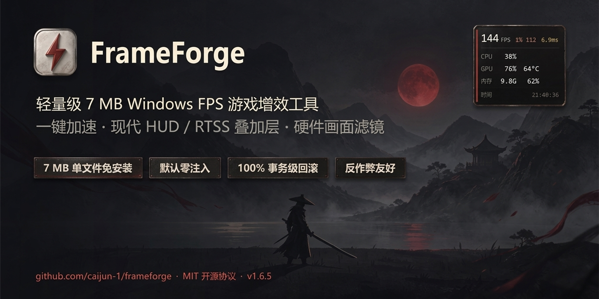</p>

---

## 为什么选择 FrameForge

| 对比维度 | FrameForge | 传统优化/监控组合（小飞机 / 游戏加加 / 加速软件） |
| --- | --- | --- |
| **体积与部署** | 单文件 ~7 MB，免安装绿色便携，无后台服务残留 | 通常数十至数百 MB，需安装多套驱动/服务 |
| **反作弊兼容性** | **默认零 DLL 注入**（ETW 采集帧率），可选 RTSS | 多数需注入渲染钩子，易与部分反作弊冲突 |
| **系统改动安全** | **SCTL v2 事务日志**，崩溃/强杀后自动或一键全量回滚 | 改完注册表/电源计划常无事务记录 |
| **功能集成度** | 加速 + 实时监测 + 现代 HUD + 硬件滤镜/ICC + 赛后报告 | 往往需要同时开 2~3 个软件 |
| **开源与隐私** | MIT 全量开源（可 `build.ps1` 自编译），零遥测零广告 | 闭源、常带广告/弹窗或账号体系 |

---

## 目录

- [功能](#功能)
- [截图](#截图)
- [系统要求](#系统要求)
- [快速开始](#快速开始)
- [加速做了什么](#加速做了什么)
- [系统优化](#系统优化)
- [帧率从哪来](#帧率从哪来)
- [画面滤镜](#画面滤镜)
- [赛后报告与战绩](#赛后报告与战绩)
- [快捷键](#快捷键)
- [数据与隐私](#数据与隐私)
- [从源码构建](#从源码构建)
- [项目结构](#项目结构)
- [已知限制](#已知限制)
- [更新日志](#更新日志)
- [English (README.en.md)](README.en.md)

---

## 功能

| 模块 | 能力 |
| --- | --- |
| 一键加速 | 进程优先级、高性能电源计划、系统计时器 1 ms、关闭 Game DVR 与全屏优化、内存整理、进阶：暂停后台无窗口占用大户（二次确认）、独占物理核心、设备中断避让、按游戏记忆策略 |
| 实时监测 | 汇聚在加速页的监控仪表：CPU / GPU 占用环形表、五维雷达图（CPU / GPU / 内存 / 频率 / 温度）、内存弧表，以及 GPU 温度 / 频率 / 功耗 / 显存四联指标 |
| 游戏识别 | 进程名 → 真实游戏名三层识别（用户 `games.ini` → 内置 200+ 游戏库 → 安装目录 / 文件版本信息），Unreal 的 `*-Win64-Shipping` 这类通用进程名不会再把进程名当成游戏名（旧版本已归档的记录保持原样） |
| 游戏检测 | 四层兜底不漏检：前台游戏窗口 → 后台铺满屏幕的游戏窗口 → 已知游戏进程扫描（窗口化 / 小窗口也算）→ 游戏平台安装目录（Steam / Epic / GOG / Xbox / WeGame 等）辅助识别；我的世界基岩版按进程、Java 版按窗口标题识别 |
| 我的游戏 | 自动扫描 Steam / Epic / GOG、卸载注册表与本机常见安装目录（含 WeGame、米哈游启动器），把装过的游戏列在一起：双击启动、锁定为加速目标、移除条目、手动添加 `.exe`；扫描结果本地缓存，不用每次开机重扫 |
| 画面滤镜 | 15 组通用预设（含冷色、暖色、雾天增强、竞技、二次元等）+ 8 款游戏专用预设（三角洲行动、无畏契约、原神、Apex、CS2、PUBG、永劫无间、英雄联盟）+ 强度 / 对比度 / 暗部平衡 / 饱和度 / 数字振动 / 色温 六维微调（独占全屏下自动改用 gamma LUT，饱和度由 NVIDIA 数字振动补上），16:9 实时预览支持拖动分界线对比原图；亮度滑块直接调显示器硬件背光 |
| 游戏内叠加层 | 现代半透明 HUD 置顶小窗，支持横向 / 竖向 / 简洁三种排版、现代 HUD / 轻透 / 无底板三档底板与五套配色主题（朱砂 / 翠绿 / 粉紫 / 青蓝 / 极简），FPS 主视觉放大突出，10 种指标（FPS / 5 秒 1% Low / 帧时间 / CPU / GPU / GPU 温度 / 内存 / 内存% / 时钟 / 时长）可自选；位置可选屏幕四角或自由拖动，可缩放、可锁定；跟随游戏所在显示器并以每秒看门狗恢复置顶；独占全屏下可交给 RTSS 同步配色与分级字号绘制，RTSS 没运行时由自带分层窗口绘制 |
| 赛后报告 | 退出游戏自动弹出性能报告：平均 / 最高 / 最低帧率、1% Low、CPU / GPU / 温度 / 内存 / 显存 / 功耗，以及耗时电量与碳排估算 |
| 战绩历史 | 每局自动归档（最多 300 条），可回看任意一局详情（含帧率折线图）、删除单局、清空或导出 CSV，名字与图标取自游戏本体 |
| 系统优化 | 「优化」页逐项列出会影响帧率的设置（管理员权限、VBS、硬件加速 GPU 计划、窗口叠加 MPO、Game DVR、全屏优化、窗口化游戏优化、电源计划、MSI 中断、显卡与驱动），每项标明游戏时的推荐状态，开关 / 分段选择直接改；顶部「游戏优先」「日常均衡」一键套用，「游戏体检」可查看每一项的实际取值与改动记录 |
| 其他 | 中英双语、深浅双主题、托盘常驻、开机自启、内存阈值自动整理、三档保护名单（系统与自启项永久保护 / 小内存自动保护 / 手动添加）、可选「检查更新」 |

所有加速项都是**可回滚**的系统设置，点「还原设置」或关闭游戏后逐项恢复原状。

## 截图

以下为 v1.5.0 的武侠双主题界面：白昼是宣纸水墨，夜晚是影刃；所有卡片统一为毛玻璃，表盘、雷达与核心条使用朱砂强调色。加速页的核心条只在真正参与加速时点亮，未加速时保持中性灰。

| 加速（白昼） | 加速（夜晚 · 影刃） |
| --- | --- |
| 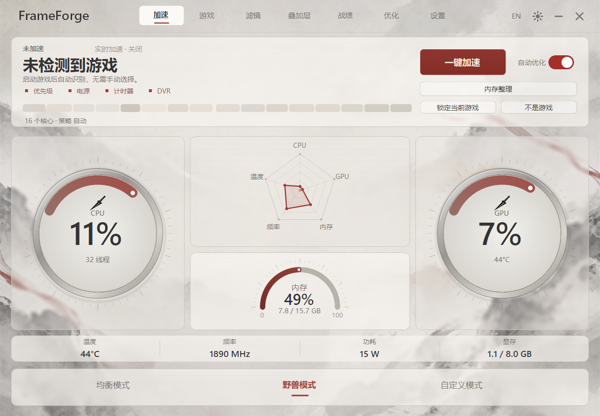 | 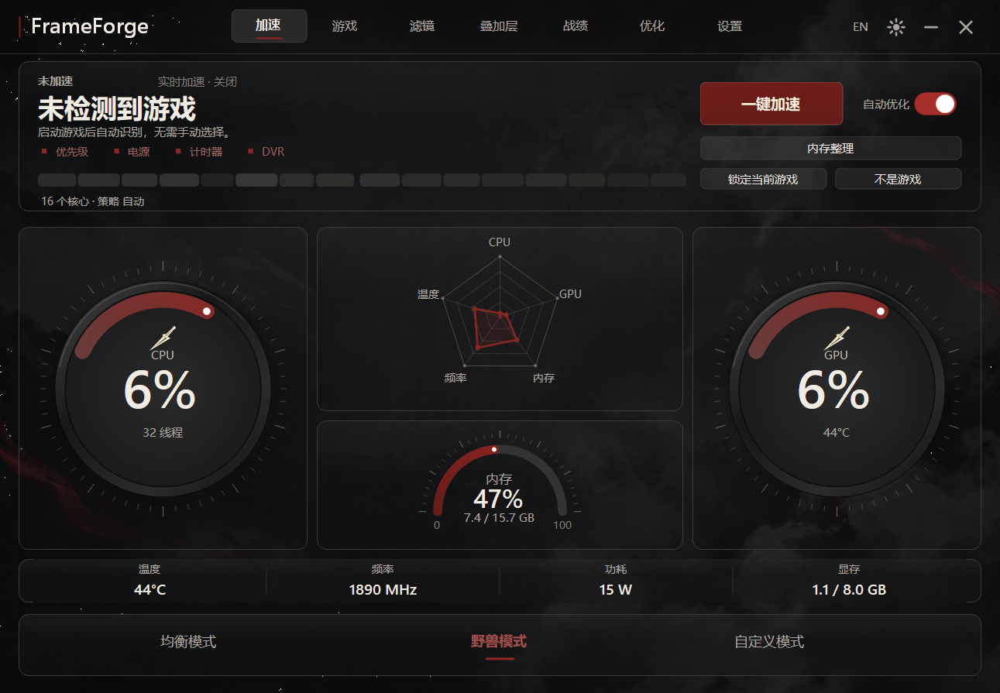 |

| 我的游戏 | 滤镜 |
| --- | --- |
| 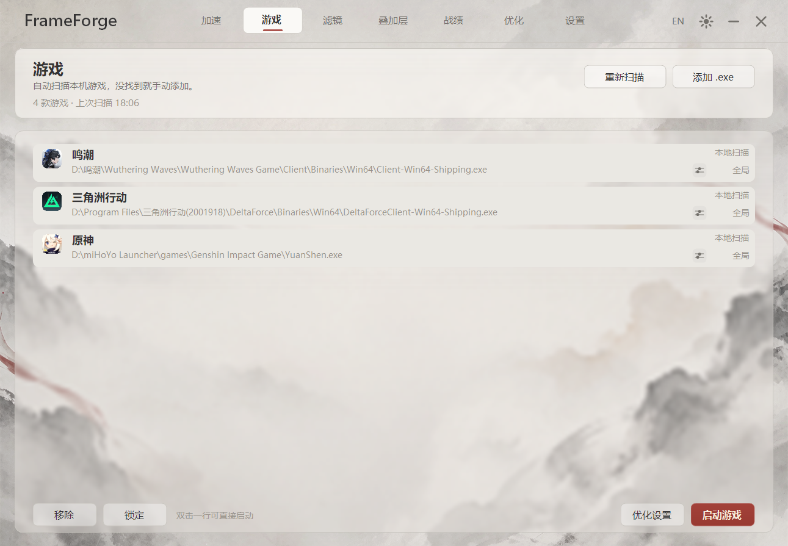 | 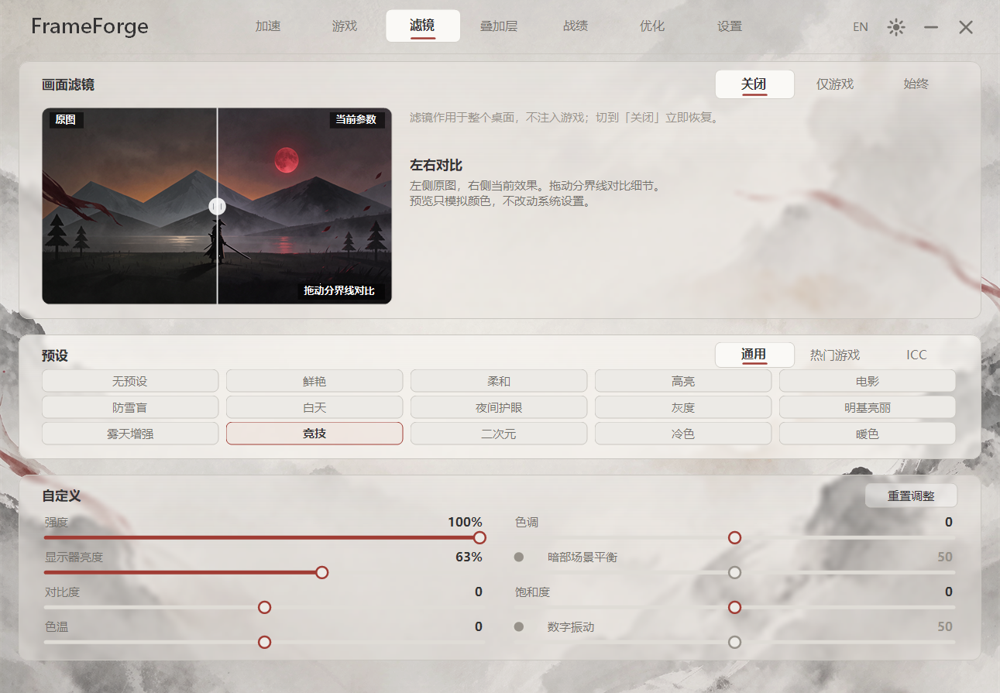 |

| 叠加层（v1.6.5 现代 HUD） | 战绩 |
| --- | --- |
| 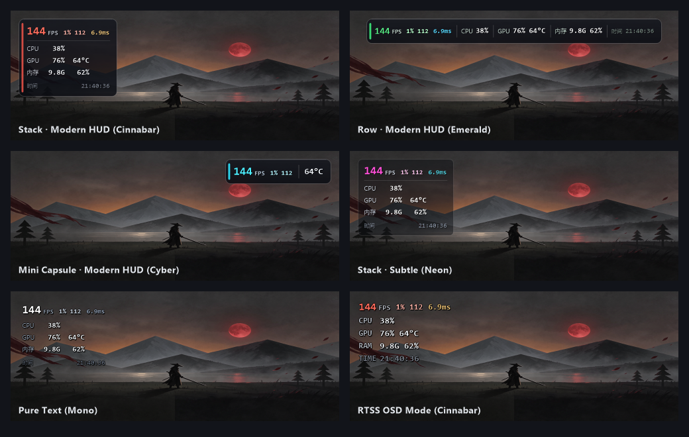 | 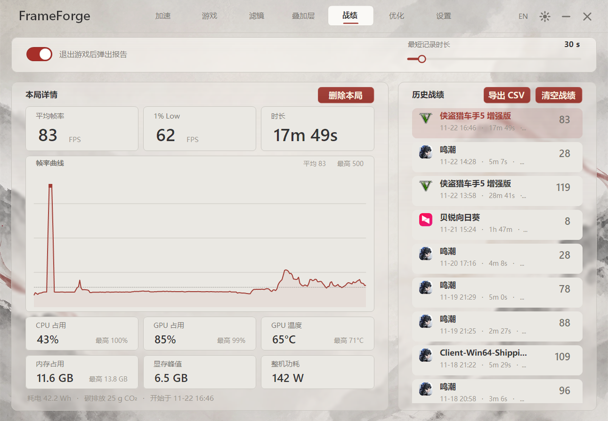 |

| 优化（系统体检） | 设置 |
| --- | --- |
| 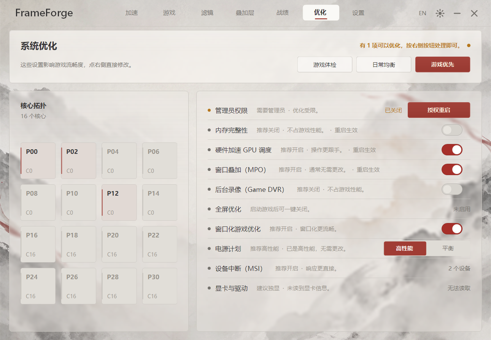 | 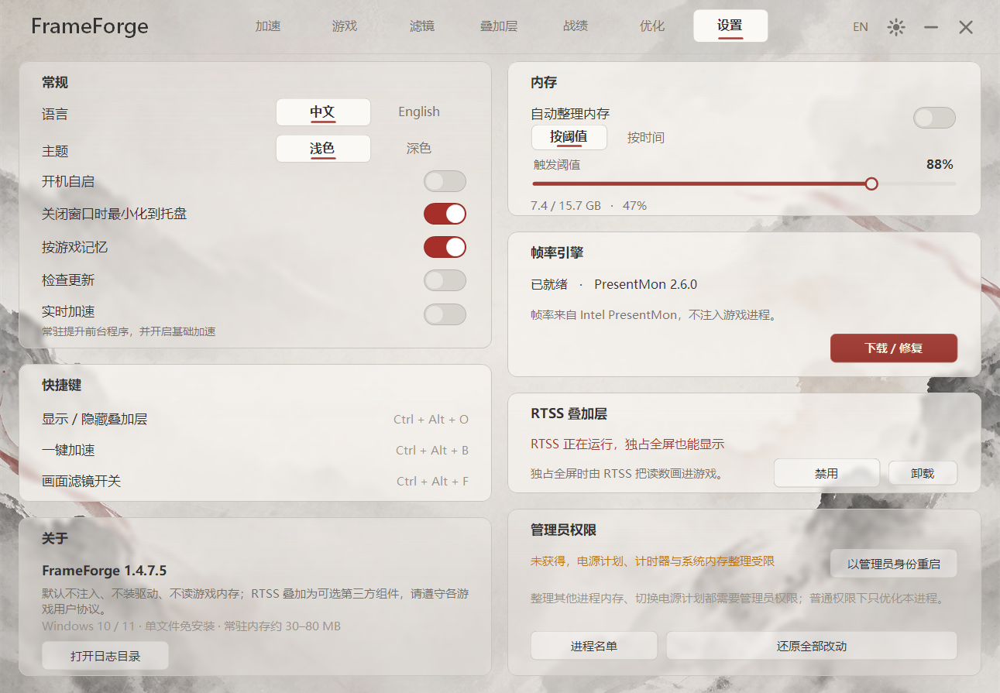 |

<details>
<summary>旧版界面（v1.1.1，对比用）</summary>

| 加速 | 监测 |
| --- | --- |
| 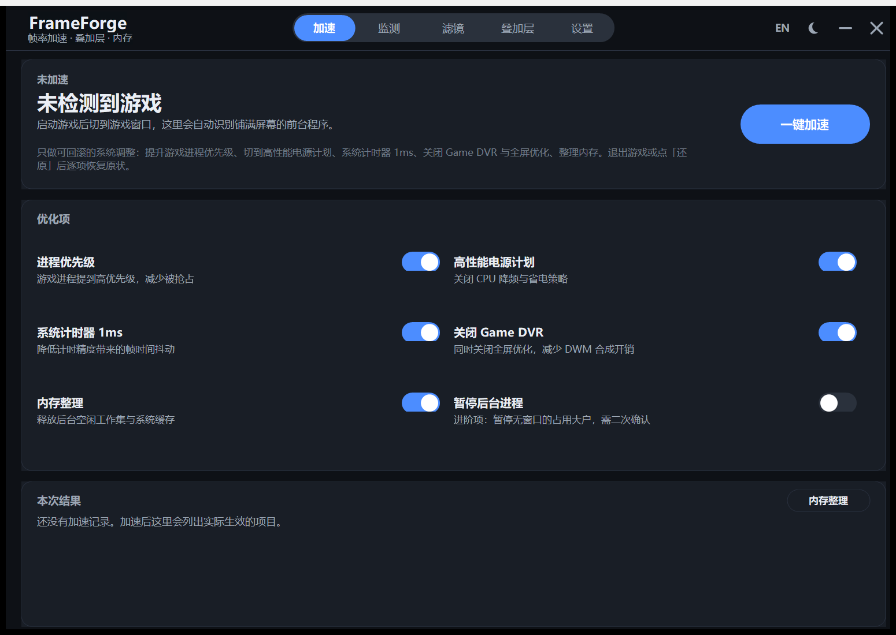 | 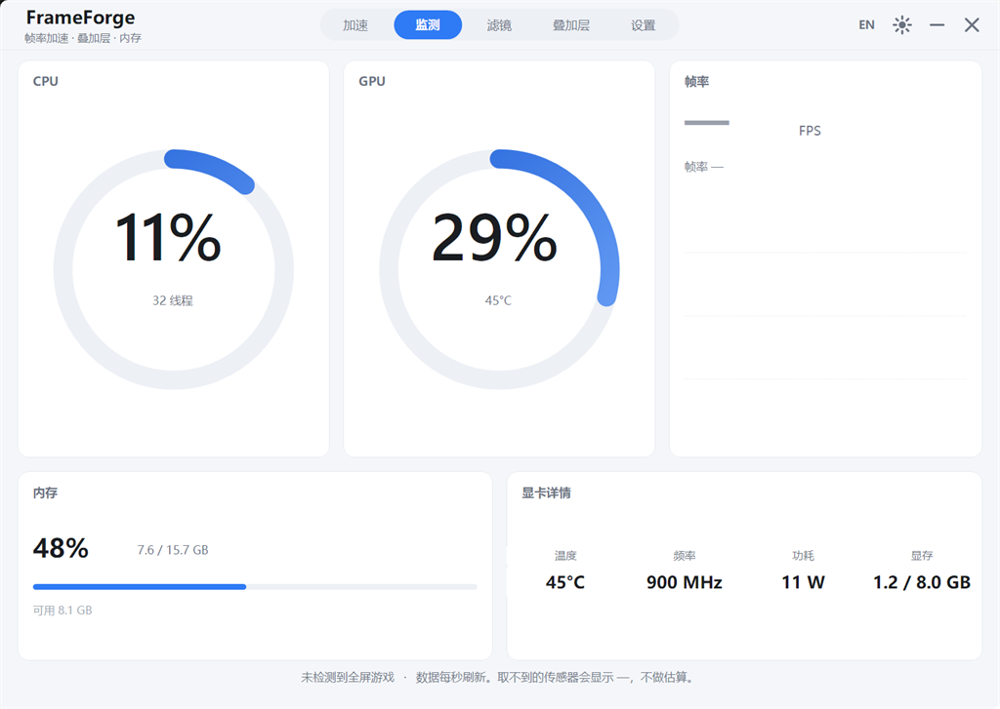 |

| 滤镜 | 叠加层 |
| --- | --- |
| 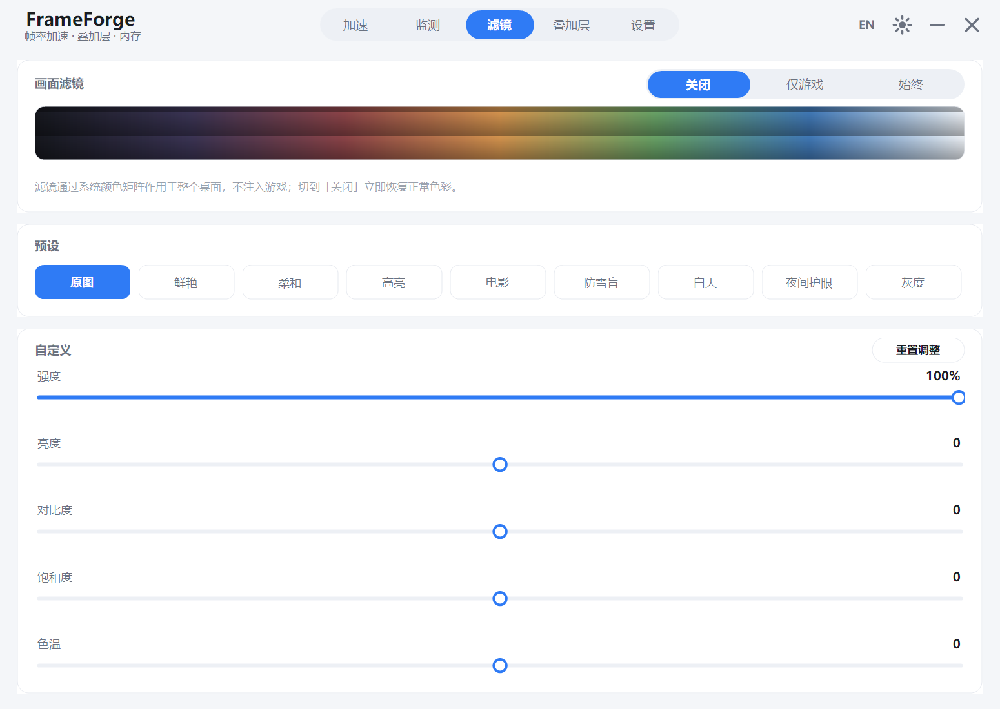 | 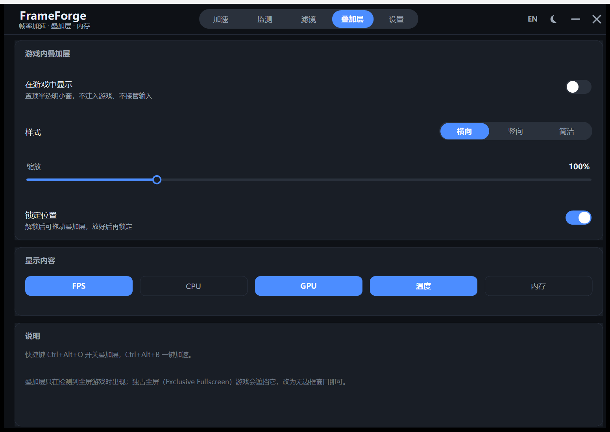 |

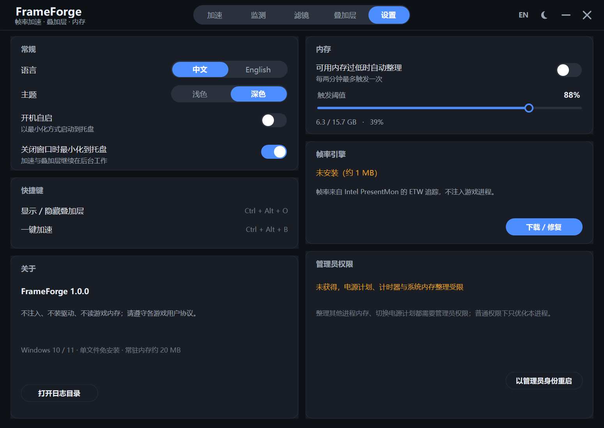

</details>

## 系统要求

- Windows 10 1809 及以上 / Windows 11（x64）
- .NET Framework 4.8（Windows 10 1809 起为系统自带）
- 帧率功能需要管理员权限并首次在「设置 → 帧率引擎」下载 Intel PresentMon（约 1 MB）
- 显卡传感器：NVIDIA 走 NVML，AMD 走驱动自带的 ADL；两者都不可用时改用系统计数器，只测不到温度 / 频率 / 功耗的部分显示 `—`

## 快速开始

1. 下载 `FrameForge.exe`，双击运行，无需安装。
2. 启动游戏并切到游戏窗口，加速页会自动识别铺满屏幕的前台程序。
3. 点 **一键加速**；退出游戏或点 **还原设置** 即可回滚。
4. 想要帧率数字：设置 → 帧率引擎 → 下载 / 修复，然后以管理员身份重启本程序。

## 加速做了什么

| 项目 | 具体动作 | 如何还原 |
| --- | --- | --- |
| 进程优先级 | 游戏进程设为 `HIGH_PRIORITY_CLASS`；写入后回读确认，被反作弊拒绝时明确提示，不谎报成功 | 恢复原优先级 |
| 理想处理器软引导 | 加速开始时、以及之后每 2 分钟，采样各逻辑核占用，把游戏**主线程**的 `SetThreadIdealProcessor` 指向当前最空闲的核心；只给调度提示，不锁亲和性 | 指回「任意核心」（`MAXIMUM_PROCESSORS`） |
| 高性能电源计划 | 切换到系统「高性能」方案 | 切回原方案 GUID |
| 系统计时器 1 ms | `timeBeginPeriod(1)` | `timeEndPeriod(1)` |
| 关闭 Game DVR | 写入 `GameDVR_Enabled=0`、关闭全屏优化 | 恢复原注册表值 |
| 内存整理 | 对空闲进程 `EmptyWorkingSet` + 清系统工作集 | 无需还原（缓存会自行重建） |
| 暂停后台进程 | 挂起无窗口且占用靠前的后台进程；反作弊组件（ACE / EAC / BattlEye / Vanguard 等）永远不碰 | 自动恢复线程 |
| 独占物理核心 | 按 CPU 拓扑把游戏绑到一半完整物理核心，其他进程挪到剩余核心 | 恢复各进程原亲和性掩码 |
| 设备中断避让 | 把网卡 / 显卡的 MSI 中断亲和性指向非游戏核心 | 恢复原注册表值，重启后生效 |
| 按游戏记忆 | 每个游戏单独保存加速项，下次检测到该游戏时自动套用 | 仅写本地配置，无需还原 |
| 保护名单 | 名单内的程序（如直播、语音、录制软件）与反作弊组件一律不暂停、不整理内存 | 仅写本地配置，无需还原 |

> 进阶项「暂停后台进程」会先列出候选进程并要求二次确认，只挂起、不结束。
> 自动套用只应用安全项（暂停后台进程与中断避让不自动执行）。

## PCBoost 的两层加速原理

FrameForge 的加速逻辑按 PCBoost 的思路拆成两层，一层管「马上抢到算力」，一层管「持续待在对的核心上」。

### 1. 瞬时响应：高优先级与前台特权

后台监控每秒采样一次前台窗口与窗口句柄。识别到游戏后，立刻把游戏进程的 CPU 优先级提到 `HIGH_PRIORITY_CLASS`，打破 Windows 默认的平衡调度，让鼠标输入、键盘响应和游戏主线程优先拿到时间片。写入后会回读确认；被反作弊拒绝时会在界面明确提示，不会假装成功。

### 2. 动态负载平衡：每 2 分钟的理想处理器软引导

加速开始时做第一次引导，之后每 120 秒重新评估一次：用 `NtQuerySystemInformation` 取每个逻辑核的累计 idle / busy 时间，采样两次算出单核占用率，挑出当前最空闲的核心，再对游戏**主线程**（进程内 TID 最小的线程）调用 `SetThreadIdealProcessor`。

- **软引导，不是硬隔离**：`SetThreadIdealProcessor` 只是给调度器的「首选核心」提示，不修改亲和性掩码。游戏需要多核爆发时，依然可以自由调用包括 CPU 0 在内的所有核心，不会浪费算力。
- **为什么能变相避开 CPU 0**：CPU 0 默认承担网卡、鼠标、显卡等硬件中断和大量系统底层服务，绝大多数时间里占用率都不是最低的。按「选最闲」的规则挑选时，它大概率不会被选中，于是主线程自然与系统杂务核心错峰运行——这是一种动态、无副作用的方式，而不是写死「禁用 CPU 0」。
- **负载相同怎么办**：两次采样差值在 0.05% 以内时优先编号非 0 的核心，把 CPU 0 留给中断。
- **与其他项的配合**：启用了「独占物理核心」时，只在分配给游戏的核里挑；界面里的「理想处理器」开关是「全部线程」实验项，与这里的自动软引导互不影响。
- **还原**：还原加速时把主线程指回 `MAXIMUM_PROCESSORS`（交给调度器自己挑），不做任何持久化修改。

## 游戏识别

识别不靠单一关键词，而是「硬性排除 + 多信号评分 + 进程级证据 + 记忆」四层组合，目标是既不漏掉窗口化 / 改了窗口标题 / 换了分辨率的游戏，也不把桌宠、虚拟键盘、加速器、启动器当成游戏。

- **硬性排除窗口**：不可见、最小化、DWM cloaked、带 `WS_EX_TOOLWINDOW / LAYERED / TRANSPARENT / NOACTIVATE`、有 Owner 的窗口直接不看——桌宠、虚拟键盘（触摸键盘 / Onboard）、加速器与监控软件的悬浮窗、截图层都属于这类；
- **窗口尺寸下限**：小于 320×240、或面积不足屏幕 8% 的窗口不参与评分；
- **多信号评分**（满分超过 100，达到 50 即判定为游戏）：游戏库命中 +70、平台目录（Steam / Epic / Xbox 等）+55、仅引擎特征 +35；游戏窗口类 +30、铺满屏幕 +20、位于前台 +10、分辨率达到 640×360 +5；**该进程 GPU 3D 引擎占用 ≥10% +50 / ≥3% +40 / ≥1% +15**；已经确认过的进程 +40；
- **进程级 GPU 证据**：从 PDH 的 `\GPU Engine(*)\Utilization Percentage` 实例名里解析出 pid 和 `engtype_3D`，按 pid 聚合。这是识别「从没见过的窗口化游戏」最硬的一条证据，也是游戏加加、微星小飞机那类工具判断「谁在真正渲染」的办法；
- **持续跟踪**：每 1.5 秒全量重扫一次窗口；前台进程一变立刻单独评估；识别成功后记住句柄和进程，切窗口、读条、回主菜单时状态不会来回跳；
- **排除名单**：进程名与安装目录双重过滤反作弊组件、启动器、桌宠、虚拟键盘、加速器 / 监控工具、3D 与剪辑软件（Blender、Photoshop、Unity 编辑器等）；
- **叠加层跟随游戏**：记住游戏主窗口句柄（DWM 扩展边界优先），窗口化时叠加层限制在游戏窗口内，铺满屏幕时用显示器边界——不管游戏是不是前台、在哪块屏，都贴在游戏上面。

## 系统优化

「优化」页把「哪些设置正在拖慢帧率」做成一张可操作的清单，不再只给一个分数：

- 逐项检查：管理员权限、VBS 虚拟化安全（`DeviceGuard`）、硬件加速 GPU 计划（HAGS）、窗口叠加 MPO、Game DVR 后台录制、全屏优化、窗口化游戏优化、电源计划、网卡 / 显卡 MSI 中断亲和性、显卡与驱动状态；
- 每项都写清「为什么会影响帧率」，能直接改的右侧给开关或高性能 / 平衡分段选择，改完立即写回系统；
- 顶部两个预设一键套用：**游戏优先**（高性能电源 + HAGS 开 + Game DVR 关）、**日常均衡**（平衡电源 + HAGS 开 + Game DVR 开）；
- 改动前先把原值写进 `tune.journal`，需要回溯时可按记录逐项写回，不依赖记忆；
- 需要管理员的项会明确提示「提权重启」，不会假装成功；VBS、HAGS 改完标注重启后生效，关闭内存完整性前还有二次确认；
- 全程在本机完成，不联网、不上传任何结果。

## 帧率从哪来

通过 **Intel PresentMon** 的 ETW 会话读取前台游戏进程的呈现事件，计算平均 FPS 与 1% Low。
PresentMon 是在运行时按需下载的独立 exe（MIT 协议），不随本项目分发，也不注入游戏。

## 画面滤镜

滤镜走 Windows 放大镜 API 的全屏颜色矩阵（`Magnification.dll`），作用于整个桌面输出：

- 不注入游戏、不安装驱动、不修改游戏文件（只有可选「交给 RTSS 显示叠加层」时，由 RTSS 注入它自己的 OSD 文字）；
- **独占全屏也能生效**：独占全屏时 DWM 被绕过，放大镜的矩阵看不到画面。此时把矩阵拆成两半——显示器 gamma LUT（`SetDeviceGammaRamp`）负责亮度、对比度、色温、暗部这些逐通道增益，跨通道的饱和度交给 NVIDIA 驱动自身的数字振动（NVAPI 的 DVC 接口，零注入），S 曲线近似只作为非 NVIDIA 显卡的兜底。两者同时生效时正好还原整张矩阵，只有 LUT 生效时也不会丢掉亮度类效果。离开独占全屏先还原原始 LUT 与驱动数值，再切回放大镜，避免重复调色。游戏切分辨率、重新进入独占全屏、驱动重置都会把 LUT 冲回默认值，程序每 2 秒按上次的矩阵补写一次，滤镜不会「过一会儿自己没了」；
- **预览是真实画面**：预览框里是一帧合成的游戏场景（天空、远山、地面、人物剪影、准星与血条），直接套用当前颜色矩阵，不再用抽象色带，色温、暗部、肤色和 UI 是否会变色都能一眼看出来；
- 「仅游戏」模式下只在检测到全屏游戏时生效；
- 远程桌面等不支持的环境会给出提示并保持原色；
- 15 组通用预设：原图、鲜艳、柔和、高亮、电影、防雪盲、白天、夜间护眼、灰度、明基亮丽、雾天增强、竞技、二次元、冷色、暖色；
- 8 款游戏专用预设：三角洲行动、无畏契约、原神、Apex 英雄、CS2、PUBG、永劫无间、英雄联盟，每款都针对该作场景单独调过；
- 六维微调：强度、对比度、**暗部平衡**（压高光 + 抬黑位，暗处看得更清）、饱和度、**数字振动**（类似 NVIDIA 数字振动，提升色彩浓艳度）、色温；
- 亮度滑块直接调硬件背光：外接显示器走 DDC/CI（VCP 0x10），笔记本内置屏改走 WMI 背光接口；不进滤镜矩阵，也不会出现在截图 / 录屏里；两者都不支持时滑块置灰并给出提示；
- **A/B 对比**：按预览图上的按钮（或长按）即可临时查看未加滤镜的原图，随手对比效果；
- **ICC 配置文件**：预设分组里单开一页「ICC」，点右上角的 **+** 从文件导入显示器 / 校色仪提供的 `.icc` / `.icm`，导入时可以自己起名字；之后点条目应用、再点一次取消，右键条目或点「重命名」可随时改名；矩阵型（`rXYZ`/`gXYZ`/`bXYZ` + TRC）和 LUT 型（`mAB `/`mBA `，曲线 + 3×3 矩阵 + CLUT）都能解析，屏幕校正取 B2A 方向并在 9×9×9 sRGB 网格上拟合成 3×3 + 偏移；**ICC 与预设滤镜互斥**：ICC 生效时只用 ICC 校色，预设与自定义六维参数不参与计算，避免两层颜色变换叠在一起导致偏色，点任意预设即可切回；解析全程在本机完成，文件不可用时明确报错而不是硬套一个错误矩阵。

## 赛后报告与战绩

- 检测到游戏进程后自动开始计时，退出游戏时结算这一局；
- 时长达到「最短记录时长」（默认 30 秒，可在战绩页 5–300 秒之间调整）才会计入，避免误触启动器刷屏；
- 结算时默认弹出报告卡：平均帧率、1% Low、时长三联，CPU / GPU / GPU 温度 / 内存 / 显存峰值 / 整机功耗六格，各带「最高」小字，底部给出一局的耗电量（Wh）与碳排估算（按 0.581 kg CO₂/kWh）；
- 「战绩」页保存最近 300 局，可逐局查看同样的明细、删除单局、清空全部或一键导出 CSV；
- 报告弹窗与自动弹出都可以在战绩页关闭。

## 快捷键

| 按键 | 作用 |
| --- | --- |
| `Ctrl + Alt + O` | 显示 / 隐藏叠加层 |
| `Ctrl + Alt + B` | 一键加速 / 还原 |
| `Ctrl + Alt + F` | 开启 / 关闭画面滤镜（记住上次使用的预设） |

## 数据与隐私

- 配置：`%LOCALAPPDATA%\FrameForge\settings.ini`，按游戏策略在同目录的 `profiles.ini`
- 游戏名映射：同目录的 `games.ini`，可自行添加「进程名=游戏名」
- 战绩：同目录的 `sessions.dat`（纯文本，一行一局，可直接编辑或删除）
- 日志：`%LOCALAPPDATA%\FrameForge\log.txt`（超过 1 MB 轮转一份）
- 默认不联网、不上传任何数据。网络请求只有两项且都由你触发：下载 PresentMon、打开「设置 → 检查更新」后查询 GitHub 最新版本号（只读版本号与发布页链接，不发送任何本地数据）。

## 从源码构建

只需要 Windows 自带的 .NET Framework 编译器，无需 Visual Studio / .NET SDK：

```powershell
powershell -ExecutionPolicy Bypass -File .\build.ps1
```

输出 `FrameForge.exe`。自检（不需要开界面）：

```powershell
.\FrameForge.exe --selftest   # 结果写入 %TEMP%\frameforge_selftest.log
```

自检覆盖：传感器采样、显卡识别、游戏检测、游戏名识别与回退、电源方案、后台进程候选、设置映射、三档加速模式、保护名单归一化、加速日志回滚、CPU 拓扑与核心掩码、按游戏策略读取、中断设备枚举、PresentMon 状态、叠加层初始化、系统体检项与页面绘制、战绩序列化与能耗估算。

> 代码保持 C# 5 语法（随系统分发的 `csc.exe` 只认 C# 5），请勿使用插值字符串、`?.`、表达式体成员等新语法。

## 项目结构

```
frameforge/
├── build.ps1              # 一键编译（csc + app.manifest + app.ico）
├── app.manifest           # DPI 感知、UAC 清单
├── app.ico                # 多尺寸程序图标（16–256px）
├── src/
│   ├── Program.cs         # 入口、单实例、--selftest
│   ├── Settings.cs        # 配置读写
│   ├── Theme.cs / I18n.cs # 配色与中英文案
│   ├── Util.cs / Native.cs# 日志、P/Invoke 声明
│   ├── Overlay.cs         # 分层窗口叠加层
│   ├── Sys/
│   │   ├── Monitor.cs     # CPU / 内存 / GPU 采样
│   │   ├── Pdh.cs / Nvml.cs   # 性能计数器与显卡传感器
│   │   ├── Fps.cs         # PresentMon 下载与帧率读取
│   │   ├── GameDb.cs      # 进程名 → 真实游戏名识别
│   │   ├── Sessions.cs    # 单局战绩采集、归档与 CSV 导出
│   │   ├── Boost.cs       # 加速项与回滚
│   │   ├── BoostJournal.cs# 加速前原值落盘，崩溃后自动还原
│   │   ├── Health.cs      # 系统设置检查（VBS / HAGS / MPO / Game DVR / 全屏优化 / 电源 / MSI / 显卡）
│   │   ├── Compat.cs      # 兼容性标记：按游戏关闭全屏优化、窗口化游戏优化
│   │   ├── Tune.cs        # 设置调节与原值日志（预设、推荐值）
│   │   ├── Display.cs     # 显示器硬件亮度（DDC/CI）
│   │   ├── Update.cs      # 只读查询 GitHub 最新版本
│   │   ├── Topology.cs    # CPU 物理核心拓扑
│   │   ├── Affinity.cs    # 核心独占与其他进程避让
│   │   ├── Interrupts.cs  # 网卡 / 显卡中断亲和性
│   │   ├── Profiles.cs    # 按游戏保存的加速策略
│   │   ├── MemEngine.cs   # 内存整理与提权
│   │   ├── Filter.cs      # 全屏颜色矩阵滤镜
│   │   ├── NvApi.cs       # NVAPI 数字振动（独占全屏下补饱和度）
│   │   ├── Rtss.cs        # RTSS 共享内存 OSD 写入
│   │   └── Icc.cs         # ICC 配置文件解析与矩阵拟合
│   └── UI/
│       ├── MainForm.cs        # 外壳：标题栏、导航、托盘
│       ├── MainForm.Actions.cs# 业务动作：加速、叠加层、热键
│       ├── Pages.cs           # 七个页面（加速 / 我的游戏 / 滤镜 / 叠加层 / 战绩 / 优化 / 设置）
│       ├── HealthPage.cs      # 优化页：逐项调节、推荐状态与预设
│       ├── AuditDialog.cs     # 优化页的「配置审计」弹窗（实际取值与改动记录）
│       ├── TrayMenu.cs        # 自绘托盘菜单（显示主界面 / 退出）
│       ├── WhitelistDialog.cs # 保护名单：勾选不参与加速的程序
│       ├── UpdateDialog.cs    # 检查更新弹窗
│       ├── BoostDialog.cs     # 自定义模式的「编辑选项」弹窗
│       ├── ReportForm.cs      # 赛后性能报告弹窗
│       ├── Controls.cs / Widgets.cs # 自绘控件库
└── docs/
    ├── FEASIBILITY.md     # 技术选型与取舍
    └── screenshots/
```

## 已知限制

- 独占全屏（Exclusive Fullscreen）游戏会遮挡叠加层：自己画的分层窗口在独占全屏下必然看不见，程序检测到后会提示改用无边框窗口；装了 RTSS 并让它接管叠加层时独占全屏也能显示，代价是 RTSS 会向游戏注入文字，被反作弊拦截的游戏仍然不显示；
- 独占全屏下的数字振动依赖 NVIDIA 驱动（NVAPI）；AMD / Intel 显卡在独占全屏下只能用 gamma LUT 的 S 曲线近似饱和度，效果弱于窗口化模式；
- 部分带反作弊的游戏会拒绝修改自身进程优先级，此时该项会明确标为「被游戏拒绝」，其余加速项照常生效；
- 帧率 / 电源计划 / 系统内存整理需要管理员权限，普通权限下只优化本进程；
- 滤镜为桌面级后处理，HDR 与广色域显示器上的观感会与 SDR 略有差异；
- 显卡温度 / 频率 / 功耗依赖厂商传感器：NVIDIA 需要较新的驱动（`nvml.dll`），AMD 需要驱动自带的 `atiadlxx.dll` 且显卡支持 Overdrive；APU 核显等不提供这些接口的机型只显示占用与显存，其余项显示 `—`。AMD 卡读不到时先运行 `FrameForge.exe --gpudiag`，日志会写明 `atiadlxx.dll` 是否加载、各接口的返回码。
- 仅支持 Windows；Linux / macOS 不在计划内。

## 更新日志

### v1.6.6

> 稳定性、状态回滚闭环与工程安全全面加固版本：修复多屏 HDR 探测结构体对齐、硬件 Gamma LUT / NVIDIA DVC 崩溃兜底恢复、DVR 与事务日志原子化回滚、PresentMon 启停竞态、更新器签名校验与托盘待机零反射，中英词条扩充至 659/659 键一致。

- **显示、滤镜与叠加层**：补齐 `Display.PathTargetInfo` 缺失的 8 字节字段；Gamma LUT 与 NVIDIA DVC 原值原子落盘并支持崩溃启动恢复；`WM_DISPLAYCHANGE` 时自动刷新显示器 HDC；修复 RTSS 64 位 `ZeroMemory`、`OpenFileMapping` 回退掩码与 ANSI 字符截断；`Overlay.Render()` 复用 1×1 探针位图。
- **状态回滚与并发性能**：`Tune.AllowedJournalKey()` 补全 `SYSTEM\GAMECONFIGSTORE`，`RestoreAll()` 保留失败项，写入全面切换 `SafeFile.WriteAllText`（唯一 `.tmp` + `WriteThrough`）；`BoostEngine` 与 `BoostJournal` 补全 `AFFINITY_MASK` 异常确认与 `Revertible` / `StartTime` 守卫；`SystemResourceArbiter` 新增 `BusyToken` 代际计数；`FpsEngine` 启停纳入 `startGate` 锁；托盘最小化跳过轮询且取消每 tick 反射。
- **更新安全与桌面体验**：更新脚本使用随机 GUID 文件名并校验发布者签名证书；`schtasks` 开机自启移至后台线程；语言/主题切换重建托盘菜单；自绘控件补全动画定时器释放与键盘焦点导航；`--selftest` 新增 HMAC 篡改、缺 `sum=` 与 `v=99` 隔离回归测试。

### v1.6.5

> 叠加层 HUD 视觉重构与可靠性加固版本：重做游戏内自绘与 RTSS 叠加层的整体视觉体系，新增现代毛玻璃 HUD 底板与五套统一配色主题，设置页预览与实机共享同一绘制管线；同时修复双加速资源移交落盘、并发软引导、通用进程名缓存与高 DPI 预览等一批细节问题。

**叠加层视觉与体验**

- 新增现代半透明 HUD 底板（默认）：圆角深色纵向渐变暗底、细玻璃描边、顶部微高光与左侧主题色竖条点缀；支持在设置页自由切换 `现代 HUD` / `轻透` / `无底板`（`overlayBackdrop=hud|subtle|none`）。
- 新增五套统一配色主题：朱砂（水墨默认）、翠绿、粉紫、青蓝、极简（`overlayTheme=cinnabar|green|pink|cyan|mono`），自绘叠加层、RTSS 输出与设置页预览三处联动；旧版 `rtssColor` 配置自动无损迁移。
- 拉开信息视觉主次：FPS 数值放大加粗突出，`FPS` 单位缩小对齐基线；竖向模式在 FPS 主行与硬件行之间增加细水平分隔线，横向与简洁胶囊模式增加细竖线分隔；时间/时长等环境行独立右对齐，不再撑宽硬件数值列。
- RTSS 叠加层同步升级：复用同一套主题色板，利用 `<S=...>` 内嵌字号实现 FPS 主视觉放大，逐行模式定宽对齐设备标签，单行模式以 `|` 分隔各组指标。
- 设置页预览改由 `Overlay.PaintPreview` 与实机共用同一测量与绘制管线，并按系统 DPI 等比缩放，消除预览与游戏内观感差异。

**可靠性与修正**

- 双加速同开且一键加速先退出移交电源/计时器所有权给实时加速时，实时加速立刻将新 ownership 落盘，防止随后强杀导致电源方案无法还原。
- 实时加速先开、一键加速以 SHARED 叠加时，一键加速事务日志优先记录仲裁者保存的原始电源方案，不再误记高性能 GUID。
- 后台软引导线程增加事务代际校验，还原加速后不会再回写幽灵日志；非 Auto 策略再平衡时同步记录理想核心变更。
- 通用进程名（如 `Client-Win64-Shipping.exe`）命中目录或文件版本后不再写入永久纯进程名缓存，切换同类 Unreal 游戏不再沿用上一款游戏的名称。
- 字体池回收移至帧边界执行，避免拖动缩放滑杆时在渲染中途释放活跃 GDI+ 字体；保存设置后立即失效核心调度配置缓存。
- 修正 `Settings.Sanitize()` 加载时覆盖 `overlayBackdrop=hud`、简洁模式未按勾选字段过滤、桌面切换「锁定位置」未即时显隐叠加层、快捷键 `Ctrl+Alt+O` 未同步自绘开关以及退出收尾未停止预热/更新定时器等问题。
- 自检新增叠加层全主题/全底板/全样式及 RTSS 标签闭合校验（中英词条键 650/650 一致）。

### v1.6.2

> 稳定性与可读性版本：按遗留缺点评审修掉资源仲裁、事务日志密钥、退出收尾、游戏库缓存与看门狗的一批边界问题；叠加层改为等宽数字 + 字段角色配色，读数不再跳列，并能一眼区分帧率、1% Low、帧时间与环境信息。

**资源与事务**

- 仲裁器在 SHARED 分支也登记 owner 指针：持有者先退出时，剩余的叠加用户能立即接手恢复责任，不再出现“无人还原”的空档。
- 锁外 I/O 的 Busy 标志改由 try/finally 保证清除并唤醒等待者；等待增加 30 秒上限，异常遗留的 Busy 会被强制清除并写日志。
- 事务日志密钥改为进程内串行 + 临时文件原子发布 + 回读校验；并发启动时后到者读回先到者的密钥，绝不覆盖。长度异常的密钥文件移走保留现场。
- HMAC 不匹配不再一律按伪造静默隔离：本次运行才新建密钥时，旧日志（换机、清理配置后）标记为 unverified 并写明显告警，文件保留供人工确认。
- 退出收尾链每一步独立捕获异常，一键加速的系统还原放进 finally——前面任何一环失败，桌面都不会留在加速状态。
- 游戏库缓存全部换成并发字典，用户库改为双重检查锁并“先填好再发布”；监控线程与界面同时查询不再互相撕裂。
- 看门狗额外校验父进程启动时刻：PID 被复用时不会等错对象，仍会执行遗留事务恢复。
- `--restore` 明确退出码：0 全部还原、1 仍有未决项、2 无待还原，便于脚本与批处理判断。

**叠加层可读性**

- 数值改用等宽字体（Consolas），列宽按字符数取整；帧率从 9 跳到 144 时整块 OSD 不再左右抖动。
- 按字段角色分层配色：FPS `#FF4FD8`、1% Low `#FFC7EE`、帧时间 `#4FD8E8`、设备标签 `#CED6E2`、时间/时长 `#9AA6B8`；自绘、RTSS 与设置页预览共用同一套色值。
- GPU 温度按阈值变色：默认 ≥70°C 变黄、>83°C 变浅红，两个阈值可在配置中调整（0 关闭该档）。
- 简洁样式统一为 `144 FPS · 64°C`，去掉中英混排的“1%·5秒”前缀，1% Low 固定写作 `1% 58`。
- RTSS 输出改为按段着色并逐段闭合，长文本仍受 RTSS 长度上限保护；标签与数值不再整行同色。
- 新增两个可选配置：`overlayBackdrop=subtle` 在文字带下铺极淡黑底（无圆角描边，默认关闭），`overlayKeepPos=true` 在切换样式/贴角时保留拖动后的位置。

**修正**

- 报告页 CPU/GPU 占用数字与平均值、最大值不再重叠（1.6.0 构建中的排版回归）。
- 自检新增中英词条键一致性（当前 640/640）与损坏日志隔离用例；损坏日志必须被移走且不得被当作有效事务还原。

### v1.6.0

> 质量与安全版本：在 1.5.1 的一批 P0/P1 热修之上，完成仲裁器死锁、高 DPI 对话框、CPU 负载采样、文件缓存、NVAPI、HDR/ACM 检测与日志隐私等 1.6.0 架构项，并按评审参数重标定全部 23 套画面预设。

**画面滤镜**
- 颜色矩阵方向修正：内部按列向量计算，导出到 Win32 / GDI+ 前统一转置，预览与实屏不再相反。
- 23 套预设按新规范重标定（鲜艳、柔和、高亮、电影、防雪盲、白天、夜间护眼、灰度、明基亮丽、雾天增强、竞技、二次元及各游戏预设），索引顺序保持不变。
- 色温改为连续普朗克曲线，滑杆改用 Mired（±75），范围收紧到 2700–10000K；夜间预设落在暖色安全区。
- 饱和度正负半轴分别限幅（工作区 1.45、总上限 1.65），净黑位不超过 +0.055，强度只在最终合成后插值一次。
- 新增 HDR / 自动颜色管理探测：开启时明确提示系统会绕过色调调整，分辨率或刷新率变化后自动重测。

**安全**
- 所有系统程序改用 System32 绝对路径；启动时把 DLL 搜索目录锁定到 System32。
- RTSS 安装包每次落到随机目录并强制 SHA-256 校验；自更新包在启动前复核哈希；PresentMon 要求 Intel 签名。
- 加速日志增加 HMAC 签名，防手工伪造还原；优化项读取改为白名单键，电源方案校验 GUID。
- 配置文件加载即钳位：滤镜参数、ICC 路径（拒绝 UNC、相对路径与超长路径）和叠加层缩放全部限幅。
- NVAPI 只绑定签名明确的 SetDVCLevel，移除会破坏调用栈的 Ex 变体，以及 Optimus 机器上会写错显示器的物理 GPU 句柄，退出时补 NvAPI_Unload。

**稳定与性能**
- 资源仲裁者重构：锁内只做状态转移，读原值、写系统、写回与 owner 回调全部移到锁外，消除一键加速与实时加速之间的 AB-BA 死锁；holder 转移时立即落盘归属。
- 混合架构核判定增加频率比兜底：P/E 核频率差达到 10% 才判混合，同构平台保持原判定。
- CPU 负载采样改为「内核时间 − 空闲时间 + 用户时间」，空载核心不再显示成半忙。
- 理想处理器不再把所有线程塞进同一颗核，改为按可用核轮流分配，并在循环结束后只落盘一次。
- 实时加速每 5 秒的进程扫描由 13 次按名查询合并为一次全表枚举；提权失败的 PID 进入 5 分钟冷却，不再反复写盘；动作记录超过上限时优先裁剪已还原项。
- 内存清理只在全屏游戏时执行，并与实时加速共享 30 秒节流；进程裁剪改为按工作集降序。
- 系统文件缓存清理改用 SetSystemFileCacheSize，旧实现传入空缓冲永远返回失败。
- 中断优化只删除自己写入的注册表值，不再整键删除；未显式开启 MSI 的设备不再被当作已开启。
- MPO 开关逻辑修正（开启时删除覆盖值）；关机或注销时先撤滤镜与背光；高 DPI 下对话框按正文实际高度撑开，危险确认对话框回车等于取消。
- 主题按钮按当前主题显示太阳或月牙，切换主题立即刷新。

**隐私与日志**
- 日志分级（INFO / WARN / ERROR，可用 FRAMEFORGE_LOG_LEVEL 过滤）、单行化、路径与用户名脱敏、跨进程命名互斥；单实例互斥量从 Global\ 改为 Local\。

**自检**
- 新增滤镜灰度中性、行向量导出、夜间亮度、CS2 暗部四项检查，HDR/ACM 探测信息，以及双 owner 反复抢占计时器的并发回归（60 次往返无死锁）。

### v1.5.0

> v1.5.0 是一次大版本更新：加速内核改为事务化并可崩溃自愈，新增核心调度策略、系统资源仲裁、单游戏策略与诊断式优化页；界面同时升级为武侠双主题毛玻璃风格，并修复多处透明割裂、明显提速。

**加速与回滚**
- 一键加速改为事务化：9 类系统改动先记录原值、再执行、逐项确认后原子落盘，失败只回滚已执行的部分。
- 崩溃自愈：加速期间崩溃、断电或被结束，下次启动会按日志自动对账还原；新增看门狗进程跟随主程序，异常退出后自动接管还原。
- 新增 `--restore` 命令行入口，可手动触发一次完整对账；旧版加速日志自动迁移到 v2，损坏或未知版本会被隔离，不会误还原。
- 进程身份改为「进程名 + 启动时间 + 完整路径」三重校验，避免 PID 复用改错进程。
- 被强制挪走亲和性的其它进程会补记原掩码到同一事务，退出时一并还原。

**核心调度**
- 新增核心调度策略：自动 / P 核优先 / 单 CCD，可在设置中选择。
- 再平衡周期（15–120 秒）与负载差滞后阈值（默认 2%）可调，避免核心来回迁移造成抖动。
- 拓扑快照提供 CCD / NUMA / SMT / LLC 信息，界面核心图按真实拓扑展示。

**资源仲裁与内存整理**
- 电源计划、系统计时器等全局资源改为引用计数仲裁：一键加速与实时加速共享同一份原值，最后一个释放时才还原，两者不再互相覆盖。
- 内存整理增加节流，短时间内不会反复触发。

**单游戏策略**
- 新增「单游戏优化设置」弹窗，可为每个游戏保存一份独立策略（8 项开关 + 理想核心展示）。
- 进程主键统一为小写进程名，兼容旧版按显示名保存的策略，并在保存 / 删除时自动迁移清理；加速时自动套用对应游戏的策略。

**优化页（诊断工作区）**
- 改为诊断工作区：顶部汇总状态，左侧只读硬件拓扑（P / E 核、SMT、LLC），右侧逐项系统设置。
- 宽屏左右分栏、窄屏上下排列，低高度可滚动；行高统一 36px，窄行自动换行不叠字。

**战绩与自检**
- 战绩报告新增本局帧率曲线：淡色平涂 + 细折线 + 平均线。
- 自检扩展到 70 多项，覆盖事务往返与 v1→v2 迁移、双引擎共享仲裁、冲突 / 缺失 / 挂起事务对账、核心调度策略等。

**视觉**
- **全新双主题**：白昼武侠版的宣纸水墨背景、夜晚影刃版的暗色水墨背景；标题栏、页面与卡片共用同一张底纹，缩放和滚动时纹理保持连续。
- **毛玻璃卡片**：整卡一次合成「模糊底图 + 奶白 / 烟灰薄层 + 顶部反光」，卡片内的控件与卡面完全同源，不再出现亮块和直角色块。
- **新仪表盘**：金属外圈 + 大内盘 + 朱砂渐变进度弧 + 端点白点，60 格细刻度；读数统一使用软件原有的无衬线数字体。
- **剑形图标与核心条**：CPU / GPU 表盘上方改用剑形图标（夜间自动提亮）；核心拓扑按策略显示全部线程与 CCD 归属，核心条只在加速生效时点亮实际参与的核心。
- **雷达与信息条**：五维雷达改为 CPU / GPU / 内存 / 频率 / 温度；内存弧表、信息条与底部模式条按新比例重排。
- **全局控件换肤**：导航胶囊、分段选择器、开关、按钮、滑杆、进度条与提示气泡统一为朱砂 + 毛玻璃风格。
- **新应用图标**：白色皮质底 + 朱砂闪电，同步到 exe、窗口、托盘与 README。

**修复**
- 卡片内每个标签 / 按钮各自叠加一层玻璃，导致局部偏亮、边缘出现矩形硬边。
- 分段选择器在卡片内绘制页面背景，形成一块清晰直角底。
- 「优化」页滚动容器用纯色铺底，整页被一块不透明矩形盖住。
- 「管理员权限」卡里的按钮被状态文字遮住，只剩上下两条白线。
- 去掉卡片四角过重的朱砂斜杠标记。

**改进**
- 滤镜页与叠加层页的预览换成内置水墨游戏画面，按控件比例居中裁剪，不再拉伸变形；滤镜页保留拖动分界线对比原图。
- 加速页主卡重新排布状态行、标题、副标题、标签、核心条与说明行，间距统一；次级按钮改为半透明白，卡面纹理可透出。

**性能**
- 卡片外观整卡缓存，页面切换时每张卡只贴一次图。
- 滤镜 / 叠加层预览图按尺寸缓存，不再每帧缩放 1024px 原图（此前卡顿的主因）。
- 表盘与内存弧改为一次渐变描边，替代上百段圆弧。
- 启动后自动预建其余页面并预生成卡片外观；静态页面刷新从 1 秒降到 2 秒。

### v1.4.7.5

> 稳定性与可控性更新：加速状态在崩溃/强杀后能自愈，实时加速与一键加速不再互相覆盖，并新增按游戏单独保存优化策略与核心调度策略。

**修复**
- **崩溃后自动还原更完整**：加速前的原始值改为「先落盘、再改动」的事务日志（v2），覆盖进程优先级、亲和性、中断、电源、计时器、DVR、挂起进程等全部加速项；程序被强杀或崩溃后，下次启动（或看门狗）会按当前系统值逐项对账还原，不再出现「后台进程被挂起后再也不动」。日志写入改为原子替换，损坏或版本不符的日志会被隔离而不会误还原。
- **实时加速与一键加速不再互相覆盖**：电源方案与计时器精度由单一仲裁者统一管理，谁先持有谁负责还原，关闭顺序不再影响结果。
- **理想处理器软引导不再被覆盖**：修正「每 2 分钟挑空闲核」与「全线程指定理想核」互相覆盖的问题；高核数机器上的核心采样不再退化为固定 CPU 0。

**新增**
- **我的游戏 · 单游戏优化设置**：每个游戏可单独保存一套加速策略（开关、核心数、优先级档位），在「我的游戏」列表直接配置，检测到该游戏时自动套用；支持「用全局填充 / 恢复推荐值 / 删除策略」，列表标出「专属 / 全局」。双击启动的行为不变。
- **核心调度策略（全局）**：新增 `auto / pcorefirst / singleccd` 三种核心分配策略与可配的再平衡周期，默认 `auto` 保持原有行为；仅在 CPU 受限时生效，避免为 GPU 受限的游戏做无用调度。
- **降级可见**：实时加速的电源/计时器若未真正生效，现在会显示「部分生效」及原因，而不是一律显示已开启。

> 说明：所有**设置类**加速项仍可回滚；内存整理为一次性优化，不涉及还原。

### v1.4.7

**改进**

- **实时加速更省资源**：前台窗口仍每秒检测，常用程序与同名进程统计改为每 5 秒一次；前台没变化时跳过重复的进程枚举与提权，常驻开销明显下降。
- **实时加速状态换位置**：从底部模式条移到加速页左上角「未加速」右侧，和加速状态同一行；关闭时显示「实时加速 · 关闭」，悬停可看开关位置。
- **界面去臃肿**：设置页开关改单行、叠加层说明卡去掉重复标题、优化页说明降为中性灰（仅异常标红）、「我的游戏」扫描按钮改用「扫描中…」。
- **文案精简**：加速、我的游戏、滤镜、叠加层、优化、设置的中英文说明统一缩短。

**新增**

- 叠加层新增「帧时间 ms」指标，「1% Low」标注 5 秒统计窗口。
- 滤镜预览常驻左右分屏，拖动分界线对比原图与当前效果，参数调整实时反映。

### v1.4.6

**改进**

- **界面去噪**：环形与弧形仪表去掉外发光、同色渐变弧和「表盘玻璃」内圈，改为一档实心色 + 一个针尖亮点；读数只在载荷超过 80% 时变红，平时回到正文色，温度 / 频率 / 功耗 / 显存四列同样不再整行飘红。
- **卡片与按钮收敛**：主按钮、导航选中胶囊、模式条下划线、预设胶囊统一为实心色面，去掉渐变高光与彩色投影；普通按钮从全胶囊改为 10px 圆角。
- **核心条重做**：未分配的核心改为中性灰刻度，只有真正被加速的核心才上色，不再整条粉色装饰；雷达图去掉外发光与径向渐变，改为平涂数据面。
- **新图标**：应用图标换成银色圆角底 + 白色闪电，生成 16 / 20 / 24 / 32 / 40 / 48 / 64 / 128 / 256 共九档，标题栏与托盘同步使用，16px 下仍可辨认。

### v1.4.5.1

**新增**

- **实时加速**：设置页新增「实时加速」开关，开启后常驻后台，把**当前前台程序**提到高优先级，并把它的同名进程（浏览器 / QQ / 微信这类多进程应用的后台进程）提到高于正常——切到浏览器就加速浏览器，切到微信就加速微信，不用先选游戏再点加速。常用浏览器与聊天软件即使不在前台，同名进程也提到高于正常，后台消息拉取更跟手；同时开启系统级基础加速（高性能电源计划 + 1ms 系统计时器精度），可用内存低于 20% 时清理系统文件缓存与待命内存（不动各进程工作集）。关闭开关或退出程序时逐项还原优先级、计时器精度与电源计划；加速页模式卡顶部新增常驻状态行，显示是否开启、当前加速的程序和进程数。

### v1.4.5

**新增**

- **RTSS 叠加层（可选）**：装了 RTSS（RivaTuner Statistics Server）的机器，叠加层可以整个交给 RTSS 的 OSD 绘制——它把文字送进游戏的呈现链，**独占全屏下也能显示**。叠加层页与设置页都能看到状态（运行中 / 装了没开 / 未安装）：没装可以直接在程序里下载安装，装了没开一键启动；字号、颜色（白 / 粉 / 绿 / 黄 / 青）、排版（逐行 / 单行）在界面里调，实时写进 OSD 文字，不用再打开 RTSS 设置。RTSS 没在运行时仍然用自带的分层窗口绘制，完全不注入游戏。
- **独占全屏下的数字振动**：接入 NVIDIA 驱动的 NVAPI，按当前预设的饱和度直接抬升驱动的数字振动（DVC），**零注入**拿到跨通道饱和度，独占全屏的滤镜不再只能靠 S 曲线近似。量程按本机实际值换算（0–63 与 0–100 都支持），只升不降，退出游戏后还原成原值。
- **「我的游戏」扫描结果缓存**：扫描一次后记下时间，下次启动直接读本地列表，不再每次开机全盘重扫；需要时仍可手动重扫。
- **原神**：内置库补充 `Genshin Impact Game` / `yuanshen` 等目录名，并扫描 `<盘符>\miHoYo Launcher\games`，通过米哈游启动器安装的原神也能进「我的游戏」并显示中文名。
- 滤镜预设新增 **冷色 / 暖色** 两组通用预设（追加在列表末尾，已保存的预设不会错位）。

**改进**

- 独占全屏的滤镜拆成两层协作：gamma LUT 承担亮度 / 对比度 / 色温 / 暗部（逐通道增益），跨通道的饱和度交给数字振动；只有 LUT 生效时也不会丢亮度类效果，两者同时生效时正好还原整张矩阵，不会重复调色。
- 滤镜不再「过一会儿自己没了」：切分辨率、重新进入独占全屏、驱动重置都会把 LUT 顶回默认值，现在每 2 秒按上次的矩阵补写一次；NVIDIA App 重放显示设置时也会补写数字振动。
- 叠加层页在 RTSS 运行时自动切到 RTSS 卡片（只留 OSD 样式），并新增状态行说明读数由谁绘制。
- 设置页新增「RTSS 叠加层」卡片：安装进度、启动 / 停止、卸载（卸载后提示重启才能彻底清掉显示钩子）。
- 隐私说明改为准确表述：默认不注入、不装驱动、不读游戏内存；RTSS 叠加是可选第三方组件，非注入路径始终可用。

**修复**

- **误判独占全屏导致饱和度整块丢失**：原来只要系统报告「有全屏程序」就把放大镜卸掉，全屏优化、独立翻转误报都会踩中，表现出来就是「开了滤镜没反应」。现在按矩阵拆分处理，误报时画面依旧正确。
- 滤镜在切分辨率 / 切全屏后一段时间失效。

### v1.4.4.2

**修复**

- **AMD 显卡上温度 / 频率 / 功耗仍然是 —**：AMD 驱动不同版本提供的接口不一样，1.4.4.1 只试了带 context 的 `ADL2_Overdrive6_*`，失败就整段放弃。现在按 `ADL2_*` → 老式 `ADL_*` 两套接口、每条数据再按 Overdrive6 → Overdrive5 → OverdriveN 逐条回退，任何一条能读出数值就会显示。
- **开机自启时驱动还没就绪**：读不到数不再永久放弃，每 30 秒重新探测一次，驱动起来后自动恢复。
- **健康检查不再谎报**：只有真正读到过数值才标为正常；AMD 卡读不到时提示安装官方 Adrenalin 驱动。

**新增**

- 命令行显卡诊断：`FrameForge.exe --gpudiag` 会把 `atiadlxx.dll` 的加载路径、导出函数是否齐全、每次 ADL 调用的返回码与原始数值写进 `gpudiag.log` 并弹窗显示，读不到数据时可直接定位。

### v1.4.4.1

**新增**

- AMD 显卡传感器：接入 AMD 驱动自带的 ADL（`atiadlxx.dll`），RX 6000 / 7000 系列（例如 RX 6750 GRE）现在能读到显卡温度、核心频率、显存频率与功耗，不再只有 NVIDIA 显卡才有数值。
- 显存兜底：显存总容量从显示适配器注册表读取，已用量用 WDDM 的「专用显存」计数器，NVIDIA / AMD / Intel 三种显卡都能显示。
- 「健康检查」显示完整显卡型号，并标注数据来自 NVML（NVIDIA）还是 ADL（AMD）。

**修复**

- 部分机型「温度 / 频率 / 功耗 / 显存」全是 —：NVIDIA 以外的显卡 NVML 完全不认，之前直接放弃采集；现在改走 ADL，两者都不可用时再退回系统计数器。
- 自检新增显卡温度检查项，温度读不到时会明确写出是传感器缺失还是驱动没返回。

### v1.4.4

**新增**

- 「我的游戏」页面：自动扫描 Steam、Epic、GOG、卸载注册表和本机常见安装目录，把装过的游戏列在一起；双击启动、锁定为加速目标、移除条目，没扫到的可以手动添加 .exe。
- 新游戏也能认出来：内置游戏目录名匹配（含 WeGame 的 `三角洲行动(2001918)` 目录、`WeGameApps\rail_apps` 与腾讯系两层安装路径）、卸载注册表「安装体积 ≥ 3 GB + 引擎特征 exe」兜底，以及各固定盘常见位置的补扫。
- 列表显示游戏真名：`Client-Win64-Shipping.exe` → 「鸣潮」、`DeltaForceClient-Win64-Shipping.exe` → 「三角洲行动」，并去掉 WeGame 目录名后面的 `(2001918)`。
- 页面细节：行悬停高亮、底部「双击一行可直接启动」提示、扫描中状态与新增数量提示。

**修复**

- 反作弊与启动器被当成游戏：`AntiCheatExpert`、`BattlEye`、`EasyAntiCheat`、运行库目录整棵跳过，`ACE-Setup64.exe`、`launcher.exe`、`*launcher` 不再作为主程序，名字就是反作弊组件的卸载项直接忽略。
- 深层目录主程序漏检：扫描递归深度 3 → 5 层，`<游戏根>\xx Game\Client\Binaries\Win64\` 下的真主程序能选中。

### v1.4.3.6

**新增**

- 按 PCBoost 原理实装「理想处理器软引导」：加速开始时、以及之后每 2 分钟，采样各逻辑核占用，把游戏主线程引导到当前最空闲的核心；只调 `SetThreadIdealProcessor`，不锁亲和性，需要多核时仍可用全部核心。CPU 0 承担系统中断与杂务，按「选最闲」的规则通常会被自然避开。
- 新增「游戏识别」说明：硬性窗口样式排除、多信号评分、进程级 GPU 3D 证据、1.5 秒重扫与已确认进程记忆。

**修复**

- 游戏漏检与误检：重写识别逻辑，不再「进程名命中就当游戏」。桌宠（Shimeji / Live2D 等）、虚拟键盘（触摸键盘 / Onboard）、加速器与监控悬浮窗（UU / 迅游 / BoosterX / 小飞机等）、启动器、编辑器与剪辑软件都会被排除；窗口化、改标题、换分辨率的游戏改由 GPU 3D 占用与窗口特征共同识别。
- 窗口变化后检测失效：每 1.5 秒全量重扫窗口，前台进程一变立刻评估，并记住游戏窗口句柄，切窗口 / 读条 / 回主菜单不再丢失状态。
- 独占全屏滤镜无效：独占全屏时 DWM 被绕过，放大镜矩阵不生效；现在自动切到显示器 gamma LUT，退出独占全屏后还原原始 LUT 再切回放大镜，避免叠加。
- 滤镜预览「颜色太抽象」：抽象色带换成合成的真实游戏场景，按当前颜色矩阵渲染，调色差在哪一眼可见。
- 叠加层定位：改为跟随游戏主窗口（DWM 扩展边界），窗口化时限制在游戏窗口内，铺满屏幕时贴显示器边界，不再只看前台窗口所在屏幕。

### v1.4.3.5

**修复**

- 反作弊组件不再被当成游戏：BattlEye Launcher、ACE-Helper、EasyAntiCheat、ACE-Guard 等进程会弹全屏窗口、又装在游戏目录下，之前会被记进战绩并被自动加速；现在从进程名和安装目录两条路都排除，旧版本已写进战绩的历史记录读取时直接丢弃。
- 显卡驱动异常时不再带崩 FrameForge：驱动复位或驱动自身出错时 `nvml.dll` 会直接抛访问违例，普通 `catch` 接不住；现在捕获后停用显卡数据采集（界面显示 —），帧率、加速、内存等功能不受影响。
- 帧率长时间不显示：界面心跳里对已释放的进程对象读 `HasExited` 会抛异常并中断刷新；同时多个采集看门狗线程会互相杀掉对方刚启动的 PresentMon、反复拆建 ETW 会话，导致一直采不到第一行数据。现在旧看门狗会自动退出，失败按 10/20/40 秒退避，连续 6 次仍无数据才停手并记日志。

### v1.4.3.1

**新增**

- 自动内存整理支持两种触发方式：**按阈值**（占用达到设定值才整理，60–95%）与**按时间**（每隔 5–60 分钟整理一次），在「设置 → 内存」里切换；两种方式都会在游戏运行或加速中自动跳过。

**优化**

- 设置页「内存」卡片重新排版：触发方式选择移到标题下方左侧，不再和右上角开关重叠；阈值与间隔共用同一根滑杆，切换模式时量程、单位与标签一起变化。

### v1.4.3

**修复**

- 修复浏览器被当成游戏：360 国际版等 Chromium 浏览器（F11 全屏或无边框窗口）不再被识别为游戏、不再被自动加速；Chromium / 浏览器 / UWP 外壳的窗口类也一并排除。
- 游戏识别改为按证据判定：内置游戏库、Steam / Epic / WeGame 等游戏目录、Unreal / Unity / Godot 引擎特征命中即算游戏，与窗口大小无关，窗口化、小窗口、无边框、全屏都能识别；认不出的程序只有「铺满屏幕 + 读不到进程名或窗口类属于游戏引擎」时才按游戏处理。

**新增**

- 滤镜新增「**暗部场景平衡**」与「**数字振动**」的独立开关：滑杆默认 50、开关默认关闭；两者作为独立增强层叠加在预设或 ICC 之上，使用 ICC 校色时也能单独生效。
- 叠加层排版向小飞机（MSI Afterburner / RTSS）靠拢：同一台设备的数值合并到一行，设备名（CPU / GPU / 内存）只写一次，占用、温度等数值依次排在其后并按列右对齐；贴角边距从 24 px 收到 10 px，竖向行距与内边距压紧，同一组指标占的面积明显更小；默认改为「竖向 + 左上」，开箱就是贴角窄条。

**优化**

- 叠加层稳定性：绘制画布、预乘缓冲与 DIB 按尺寸复用，不再每 200 ms 分配几百 KB 内存；DIB 创建失败时直接跳过这一帧，不会往空指针里写导致进程被系统终止；渲染异常每分钟最多记一条日志；显示项与简洁样式的温度/帧率全部关闭时自动收起，不再留一条「-- FPS」挂在屏幕上。
- 叠加层去掉「**CPU 温度**」选项：AMD 笔记本（如拯救者 R9000P）不通过 ACPI 暴露 CPU 热区，WMI 与 PDH 都读不到，留着只会一直显示 `--`；CPU 占用、GPU 温度等其余指标不受影响。
- 页面排版统一：五个页面的页面边距与卡片内边距统一为 20 px，区块标题字号提到 10.2 pt（不再小于行标题），切换页面时内容左边缘不再左右跳动；加速页去掉多余的一层内缩与底部空档；健康页在最小窗口高度下十行指标也能完整显示。

### v1.4.2

**新增**

- 新增「**加速排除**」名单：系统输入法与触摸键盘等界面进程始终排除，壁纸、OBS、Streamlabs、Discord 等常见叠加/直播程序默认排除；名单可在「设置 → 进程名单」的第二个标签页里逐项勾选，自动和手动加速都会跳过它们。
- 自定义优化项新增「**进程优先级档位**」：低 / 低于正常 / 正常 / 高于正常 / 高（默认高），并新增「**推荐值**」一键恢复默认勾选。
- 加速中在加速页显示目标进程名、PID、优先级档位与核心数，锁定时附带「已锁定」标记，方便核对加速对象。
- 自定义优化项新增实验开关「**线程理想处理器**」：仅建议游戏线程使用性能核，不修改亲和性掩码；默认关闭，自动加速不会启用。

### v1.4.1.3

**修复**

- 修复带反作弊的游戏切到后台就被判定「游戏结束」：读取进程名被拒绝时不再当作退出，并增加 5 秒宽限期，只有进程真正结束才还原并提示。
- 修复触摸键盘 / 手写面板被当成游戏：切回桌面时加速目标不再跳到 `TabTip`、`InputApp` 等系统外壳进程，回到游戏后仍继续加速原来的游戏。
- 频繁切换多个应用时不再反复弹出「加速结束」提示。

**新增**

- 加速页新增「**锁定当前游戏**」按钮：锁定后手动加速与自动加速都只认这个进程，切屏或回到桌面都不会改变目标；再次点击解除，锁定结果写入设置，重启后仍然有效。

### v1.4.1.2

**修复**

- 修复「检查更新」误报：四段版本号（如 1.4.1.1）之前被截成三段参与比较，已是最新也会一直提示发现新版本；现在保留修订号，正确判定。

### v1.4.1.1

**新增**

- 叠加层位置可选**屏幕四角**：自动 / 左上 / 右上 / 左下 / 右下；选固定角后紧贴该角，手动拖动会切回「自动」，两种方式都能用。
- 叠加层新增「**内存%**」显示项，和原有「内存」（已用容量）可分别开关。

**改进**

- 帧率数值改为 Afterburner / RTSS 风格的粉紫色，其他数值保持白色，右侧预览同步。
- CPU 温度与 GPU 温度拆成两个显示项，分别开关；CPU 温度读 ACPI 热区，取不到时显示 `--`，不编数字。
- 叠加层的时间精确到秒（`HH:mm:ss`）。
- 独占全屏检测更稳：部分系统只上报「有全屏程序」时也能识别并给出提示，提示文案明确为「窗口全屏（无边框）」。
- 优化页不再把「关闭全屏优化」标为推荐：关掉它会把游戏变成真独占全屏，叠加层反而无法覆盖。

### v1.4.1

**新增**

- 画面滤镜新增 **ICC 配置文件**：预设分组里单开「ICC」页，点右上角 **+** 从文件导入 `.icc` / `.icm`，导入时可自定义名字；左键点条目启用、再点一次取消，右键或「重命名」按钮可随时改名，不需要重新导入。
- 矩阵型（`rXYZ`/`gXYZ`/`bXYZ` + TRC）与 LUT 型（`mAB `/`mBA `，曲线 + 3×3 矩阵 + CLUT）ICC 都能解析；屏幕校正取 B2A 方向，在 9×9×9 sRGB 网格上拟合成 3×3 + 偏移。

**改进**

- ICC 与预设滤镜现在**互斥**：ICC 生效时只用 ICC 校色，预设与自定义六维参数不参与计算，避免两层颜色变换叠加导致偏色；点任意预设即可切回。
- 叠加层新增常驻状态行：未开启 / 等待游戏 / 正在显示（带游戏名）/ 独占全屏受限，一眼看出当前为什么没有画面。
- 叠加层会自愈：窗口被游戏顶掉、或清空全部显示项后再勾回来，会自动重新上屏，不必反复开关。
- 切换显示器、拔插副屏或修改分辨率后，叠加层按当前目标屏重新定位，不会再停在屏幕外。
- 锁定位置的叠加层每帧重新声明置顶，游戏反复抢占最前也能回来。

**修复**

- 修复无畏契约等**独占全屏**游戏里叠加层不显示的问题：程序检测到独占全屏后会提示改用「无边框窗口」，这是系统限制，不注入游戏无法绕过。
- 修复叠加层在切换全屏 / 修改分辨率后消失的问题。

## 许可

[MIT](LICENSE)。第三方组件声明见 [NOTICE](NOTICE)。

发布件由 CI 从 tag 构建后签名，校验方式与「不做什么」见 [SIGNING.md](SIGNING.md)；漏洞报告见 [SECURITY.md](SECURITY.md)。

---

## English

**FrameForge** is a portable Windows toolkit for FPS games: one-click boost, live frame-time monitoring, an in-game overlay, desktop-wide screen filters, and an automatic post-game performance report. It ships as a single ~7 MB executable (the two watercolor backgrounds and the preview artwork are embedded) with about 30–80 MB of resident memory. Nothing is injected into games and no driver is installed by default; the optional RTSS overlay is the only path that injects text, and you can leave it off.

### Highlights

- **One-click boost** — process priority, high-performance power plan, 1 ms timer resolution, Game DVR / fullscreen optimization off, working-set trim, plus opt-in advanced steps: suspend background hogs (with confirmation), reserve physical cores for the game, move NIC/GPU interrupts off those cores, and remember options per game. Every change is reversible.
- **Live monitoring** — a dashboard built into the Boost page: CPU/GPU rings, a five-axis radar (CPU / GPU / RAM / FPS / temperature), a RAM arc, and a GPU temperature / clock / power / VRAM strip.
- **Real game names** — a three-layer lookup (user `games.ini` → built-in library of 200+ titles → install folder / file version info) turns `client-win64-shipping.exe` into the actual game title instead of showing a raw process name.
- **My Games** — scans Steam, Epic and GOG plus the uninstall registry and common install folders (including WeGame and the miHoYo launcher), lists what is installed, and lets you launch a title, pin it as the boost target, remove it, or add an `.exe` by hand. The scan result is cached, so the disk is not swept on every start.
- **Screen filters** — fifteen general presets plus eight tuned per-game looks (Delta Force, VALORANT, Genshin, Apex, CS2, PUBG, Naraka, League of Legends), with intensity, brightness, contrast, shadow lift, saturation, digital vibrance and warmth sliders, applied through the Windows Magnification color matrix (game-only or always). In exclusive fullscreen the matrix is split in two: the display gamma LUT keeps brightness, contrast, warmth and shadow lift, while NVIDIA's own digital vibrance (NVAPI DVC, zero injection) supplies the cross-channel saturation a gamma ramp cannot express. A 16:9 live preview provides a draggable A/B divider for comparing the original and current settings. The brightness slider drives the monitor's hardware backlight (DDC/CI, or WMI on laptop panels), so it stays out of the color matrix and out of screenshots. You can also import an ICC profile (`.icc` / `.icm`) from its own **ICC** tab in the presets card — click **+** to import, name it while importing, click the entry to apply (click again to clear), and rename it any time via right-click or *Rename*. Both matrix profiles (`rXYZ`/`gXYZ`/`bXYZ` + TRC) and LUT profiles (`mAB `/`mBA ` — curves, 3×3 matrix and CLUT) are parsed; screen correction uses the B2A direction and is fitted to a 3×3 + offset on a 9×9×9 sRGB grid. ICC and preset filters are mutually exclusive: while an ICC profile is active it is the only filter applied, and presets plus the six manual sliders are left out of the math, so two color transforms never stack. Click any preset to switch back.
- **In-game overlay** — modern translucent HUD layered window with three layouts (Row / Stack / Mini), three backdrop modes (HUD / Subtle / None), and five unified colour themes (Cinnabar / Emerald / Neon / Cyber / Mono) with a larger hero FPS readout and ten selectable stats (FPS, 5-second 1% low, frame time, CPU, GPU, GPU temp, RAM, RAM %, clock, session), screen-corner presets or free dragging, scaling and position lock. It follows the monitor the game is on and uses a one-second watchdog to restore top-most, so games that grab the top spot cannot bury it; in exclusive fullscreen, it can hand the overlay to RTSS with the same colour themes and hero FPS sizing, while falling back to the built-in layered window whenever RTSS is not running.
- **Post-game report & records** — a report card pops up when a game exits with average/max/min FPS, 1% low, CPU/GPU/temperature/memory/VRAM/power, plus energy and CO₂ estimates. The Records page keeps the last 300 sessions with per-session detail (including an FPS chart), delete, clear, and CSV export.
- **System check-up** — the Optimize page lists the settings that quietly cost frames (admin rights, VBS, hardware-accelerated GPU scheduling, MPO overlay, Game DVR, fullscreen optimization, windowed-game optimization, power plan, MSI interrupt affinity, GPU driver) with the recommended state for gaming, inline toggles, two one-click presets, and a “PC check-up” view that shows the actual value and change journal for every row.
- **Compatibility first** — anti-cheat components (ACE, EAC, BattlEye, Vanguard…) are never suspended or memory-trimmed, and if a game rejects the priority change the app says so instead of claiming success. Anything on the protected list (OBS, Discord, recording tools…) is left alone too.
- Bilingual UI (Chinese / English), dark and light themes, tray mode, autostart, optional update check.

### Changelog

#### v1.6.5

> Overlay HUD redesign and reliability hardening release: overhauls both the built-in and RTSS overlays with a modern translucent HUD backdrop, five unified colour themes and a shared preview pipeline, while fixing resource-handover persistence, background steering races, generic process name caching and high-DPI preview scaling.

**Overlay visuals and UX**

- Added a modern translucent HUD backdrop (default): rounded dark vertical-gradient plate, thin glass border, subtle top sheen and a theme-coloured left accent bar; switchable in the UI between `HUD`, `Subtle` and `None` (`overlayBackdrop=hud|subtle|none`).
- Added five unified colour themes — Cinnabar (default), Emerald, Neon, Cyber and Mono (`overlayTheme=cinnabar|green|pink|cyan|mono`) — synced across the live overlay, RTSS output and settings preview, with automatic migration from legacy `rtssColor` settings.
- Improved visual hierarchy: enlarged bold hero FPS with a compact baseline-aligned `FPS` unit, subtle horizontal divider between FPS and hardware rows in stacked mode, vertical dividers between groups in horizontal and mini capsule modes, and right-aligned ambient rows (clock/uptime) that no longer widen hardware columns.
- Upgraded RTSS output to share the same colour themes, use `<S=...>` tags for a larger hero FPS readout, pad labels to fixed width in stacked mode, and separate groups with `|` in single-line mode.
- The settings preview now calls `Overlay.PaintPreview` directly with DPI-aware scaling, eliminating drift between the preview card and the live in-game HUD.

**Reliability and fixes**

- When one-click boost releases and hands PowerScheme/Timer ownership over to real-time boost, real-time boost now persists the updated ownership snapshot immediately so crash recovery always restores the power plan.
- When one-click boost overlays an active real-time boost as SHARED, its journal now captures the arbiter's original power plan instead of recording `SchemeHigh`.
- Background ideal-CPU steering now checks the active transaction generation before writing to disk so restoring a boost can never leave a stale ghost journal; non-Auto rebalance also records ideal-CPU updates in the journal.
- Generic process names (such as `Client-Win64-Shipping.exe`) resolved via folder or file info are no longer written to the permanent name-only cache, preventing wrong titles when switching between Unreal Engine games.
- Overlay font-pool cleanup now runs safely at frame boundaries instead of disposing active GDI+ fonts mid-render; `CoreConfig` cache is invalidated immediately when settings are saved.
- Fixed `Settings.Sanitize()` resetting `overlayBackdrop=hud`, mini mode ignoring field toggles, desktop position-lock toggle not showing/hiding the overlay immediately, `Ctrl+Alt+O` not syncing the self-drawn toggle switch, and shutdown not stopping the warm-up/update timers.
- Self-test now validates all 5 themes, 3 backdrops, 3 styles and balanced RTSS `<C>` tags (zh/en string parity 650/650).

#### v1.6.2

> Stability and readability release: fixes a set of edge cases in resource arbitration, journal key handling, shutdown cleanup, the game cache and the watchdog; the overlay now uses monospaced numbers and role-based colours so readings no longer shift columns and FPS, 1% low, frame time and ambient info are easy to tell apart.

**Resources and transactions**

- The arbiter now records owner pointers in the SHARED branch too, so when the holder leaves first the remaining overlay user immediately takes over the restore responsibility.
- Busy flags around out-of-lock I/O are cleared in try/finally with a 30-second wait cap; a stale flag is force-cleared and logged.
- Journal key handling is serialized, published atomically via a temp file, verified by read-back, and never overwrites a key created by a concurrent instance; malformed key files are moved aside for inspection.
- An HMAC mismatch is no longer silently treated as forgery: when the key was created during this run (after a reinstall or config cleanup) the old journal is tagged unverified with an explicit warning and kept for review.
- Every shutdown step catches its own exception, and the one-click restore runs in a finally block, so the desktop can never be left boosted if an earlier step fails.
- Game database caches are now concurrent dictionaries; the user database uses double-checked locking and publishes a fully built map.
- The watchdog also validates the parent's start time, so a reused PID cannot make it wait on the wrong process, while stale recovery still runs.
- `--restore` now returns 0 (all restored), 1 (unresolved items remain) or 2 (nothing to restore).

**Overlay readability**

- Numbers use a monospaced font (Consolas) with character-count column widths, so the OSD no longer jitters when FPS goes from 9 to 144.
- Role-based colours: FPS `#FF4FD8`, 1% low `#FFC7EE`, frame time `#4FD8E8`, device labels `#CED6E2`, clock/uptime `#9AA6B8` — shared by the live overlay, RTSS output and the settings preview.
- GPU temperature is colour-coded (≥70 °C amber, >83 °C light red by default; both thresholds configurable, 0 disables a tier).
- The mini style is now `144 FPS · 64°C`, and 1% low is written as `1% 58` instead of the mixed-script `1%·5s` prefix.
- RTSS output is coloured per segment with matching close tags and stays within the RTSS length cap.
- Two opt-in settings: `overlayBackdrop=subtle` adds a very faint black plate under the text band (no rounded corners or border, off by default), and `overlayKeepPos=true` keeps the dragged position when switching style or corner.

**Fixes**

- CPU/GPU usage no longer overlaps the average/max values on the report page (a layout regression in the 1.6.0 build).
- Self-test adds a zh/en string-key parity check (currently 640/640) and a corrupt-journal quarantine case: a bad journal must be moved aside and never restored as a valid transaction.

#### v1.6.0

> Quality and security release: on top of the 1.5.1 P0/P1 hotfixes, this version closes the 1.6.0 architecture items — arbiter deadlock, high-DPI dialogs, CPU load sampling, file cache, NVAPI safety, HDR/ACM detection and log privacy — and recalibrates all 23 picture presets.

**Picture filter**

- Fixed the colour-matrix orientation: matrices are built as column vectors internally and transposed once on export, so previews and the live screen no longer disagree.
- All 23 presets recalibrated (Vivid, Soft, Bright, Cinematic, Snow-blind, Day, Night, Grayscale, BenQ, Fog boost, Esports, Anime and the per-game presets); indices are unchanged.
- White balance now follows a continuous Planckian curve with a Mired slider (±75) clamped to 2700–10000 K.
- Saturation is limited separately on the positive and negative halves (1.45 working, 1.65 total), net black lift is capped at +0.055, and intensity is interpolated exactly once after composition.
- Added HDR / auto colour management detection with an explicit hint when Windows bypasses colour tweaks, re-probed on display changes.

**Security**

- System binaries are launched by absolute System32 path and the DLL search path is locked to System32 before any vendor DLL is resolved.
- RTSS installers always unpack into a random directory and must match SHA-256; update packages are re-hashed right before launch; PresentMon must carry a valid Intel signature.
- Boost journals are HMAC-signed to prevent forged restores; the optimization reader only accepts whitelisted keys and validates power-scheme GUIDs.
- Settings are sanitized on load: filter ranges, ICC paths (UNC, relative and overlong paths rejected) and overlay scale are all clamped.
- NVAPI now only binds the well-defined SetDVCLevel, drops the stack-corrupting Ex variant and the physical-GPU fallback that could target the wrong display on Optimus laptops, and calls NvAPI_Unload on exit.

**Reliability and performance**

- Reworked the resource arbiter: only state transitions happen under the lock; read, apply, restore and owner callbacks run outside it, removing the AB-BA deadlock between one-click and real-time boost; ownership is persisted immediately when the holder changes.
- Hybrid-core detection gained a frequency-ratio fallback (mixed only when P/E differ by 10% or more), leaving homogeneous CPUs on the previous decision.
- CPU load sampling now subtracts idle time from kernel time, so idle cores no longer look half busy.
- Ideal-processor assignment spreads threads across available cores instead of pinning every thread to one core, and writes the journal once per pass.
- The real-time boost's 5-second scan merges 13 name queries into a single process enumeration; PIDs that fail elevation enter a 5-minute cooldown instead of writing two journal entries every tick; reverted actions are pruned when the journal grows.
- Memory trimming only runs for fullscreen games and shares a 30-second throttle with the real-time engine; process trimming now starts from the largest working sets.
- System file-cache flushing uses SetSystemFileCacheSize (the old zero-buffer call always failed).
- Interrupt tuning only removes the values it wrote and never deletes the whole key; devices without an explicit MSI flag are no longer treated as MSI-capable.
- MPO toggling fixed (enabling removes the override), filters and backlight are dropped before shutdown or logoff, high-DPI dialogs size themselves to the actual body text, and Enter means Cancel on destructive confirmations.
- The theme button now shows a sun or a crescent moon for the current theme and repaints immediately when the theme changes.

**Privacy and logs**

- Logs are levelled (INFO / WARN / ERROR, filterable via FRAMEFORGE_LOG_LEVEL), single-line, redact paths and user names, and are guarded by a cross-process mutex; the single-instance mutex moved from Global\ to Local\.

**Self-test**

- Added filter checks (neutral gray, row-vector export, night luminance, CS2 shadow lift), an advanced-colour probe line, and a concurrent arbiter regression (60 acquire/release cycles across two owners without deadlock).

#### v1.5.0

**New**

- **Transactional boost**: all 9 kinds of system changes are recorded before they are applied, confirmed one by one and committed atomically; a failure rolls back only what already ran. If the app crashes, loses power or is killed mid-boost, the next start reconciles the journal and restores everything, and a watchdog process takes over if the main app exits unexpectedly. A `--restore` switch runs the reconciliation manually. Old v1 journals migrate to v2 instead of being dropped, and damaged or unknown-version journals are quarantined.
- **Core scheduling policies**: Auto / P-core first / Single CCD, with an adjustable rebalance interval (15–120 s) and load hysteresis (default 2%). The topology snapshot exposes CCD / NUMA / SMT / LLC.
- **Reference-counted resource arbiter**: the power plan and system timer are shared by the one-click boost and the real-time boost, so neither overwrites the other's original value; memory trimming is throttled.
- **Per-game profiles**: a new optimization dialog stores an independent policy per game (8 toggles plus the ideal core set). Process keys are normalized to lowercase names, old display-name profiles are migrated, and the matching profile is applied automatically.
- **Diagnostic Optimize page**: summary on top, read-only hardware topology (P/E cores, SMT, LLC) on the left and every system setting on the right; side-by-side on wide windows, stacked on narrow ones, 36 px row rhythm.
- **Session FPS chart** in the post-game report (soft fill + thin line + average line).
- Self-test grew to 70+ checks covering journal round-trip and migration, shared arbitration, conflict/missing/pending reconciliation and core policies.

**Visual**

- Wuxia dual theme (paper-ink day / shadow-blade night) sharing one continuous backdrop, glass cards composited once per card, new gauges (metal ring, big inner dial, vermilion gradient arc, 60 ticks) with the app's original sans-serif numerals, sword icons above the CPU/GPU dials, a five-axis radar (CPU / GPU / RAM / frequency / temperature), a restyled nav capsule, segmented control, toggles, buttons and sliders, plus a new white-leather-and-vermillion app icon.
- The core strip lights only the cores actually used by the active boost; when idle the whole strip stays neutral grey.

**Fixed**

- Child controls each stacking their own glass layer (bright patches and hard rectangular edges), segmented controls painting the page background inside cards, the Optimize page's opaque scroll host, the covered "Restart as administrator" button, and the heavy vermilion corner slashes.

**Improved**

- Filter and overlay previews use the built-in watercolor frame with cover cropping; the filter page keeps its draggable A/B divider. The boost hero card was re-spaced and secondary buttons are translucent.

**Performance**

- Whole-card appearance cache, per-size preview caches (no more rescaling the 1024 px source every frame), single-stroke gauge arcs, page pre-build after startup and a 2 s refresh for static pages.

#### v1.4.5

**New**

- **Optional RTSS overlay**: on machines with RTSS (RivaTuner Statistics Server) installed, the overlay can be drawn entirely by RTSS's OSD — it writes into the game's present chain, so **it keeps working in exclusive fullscreen**. Both the Overlay page and the Settings page show the state (running / installed but stopped / not installed): install it from inside the app, start it with one click, and set size, color (white, pink, green, yellow, cyan) and layout (stacked or single line) in the UI — the values are written into the OSD text itself, so RTSS never needs to be configured by hand. When RTSS is not running, the built-in layered window draws as before, with no injection at all.
- **Digital vibrance in exclusive fullscreen**: the app now talks to NVIDIA's NVAPI and raises the driver's digital vibrance (DVC) level according to the active preset — **zero injection** for the cross-channel saturation that a gamma ramp cannot express. The range is read from the machine (0–63 and 0–100 are both handled), values only go up, and the user's original level is restored when the filter is turned off.
- **Cached My Games scan**: the scan time is recorded, so the next start reads the local list instead of sweeping the disk again; a manual rescan is still one click away.
- **Genshin Impact**: added `Genshin Impact Game` / `yuanshen` folder names and a scan of `<drive>\miHoYo Launcher\games`, so installs made through the miHoYo launcher are listed with their Chinese title.
- Two new general filter presets, **Cool** and **Warm**, appended to the end of the list so saved preset indices do not shift.

**Improved**

- The exclusive-fullscreen filter is now split in two cooperating layers: the gamma LUT handles brightness / contrast / warmth / shadow lift (per-channel gains) while digital vibrance handles saturation. A LUT-only path no longer loses the brightness effects, and when both are active the original matrix is reproduced without double-grading.
- The filter no longer "fades away after a while": resolution changes, re-entering exclusive fullscreen and driver resets push the LUT back to default, so the matrix is rewritten every 2 seconds; digital vibrance is re-applied when NVIDIA App replays display settings.
- The Overlay page switches to the RTSS card automatically while RTSS is running (leaving only the OSD style) and adds a status line saying which renderer draws the numbers.
- The Settings page gained an **RTSS overlay** card: install progress, start / stop, and uninstall (with a reboot hint so the display hook is fully removed).
- The privacy note now says it accurately: no injection, no driver install and no game-memory reads by default; the RTSS overlay is an optional third-party component and the non-injection path always works.

**Fixed**

- **Saturation vanishing because of a fullscreen misdetection**: the Magnifier used to be dropped whenever Windows reported a fullscreen app, which fullscreen optimizations and independent-flip false positives trigger — the symptom was "I turned the filter on and nothing happened". The matrix split keeps the picture correct even when the report is wrong.
- The filter stopping after a resolution change or a fullscreen switch.

#### v1.4.4.2

**Fixed**

- **Temperature / clock / power still showing dashes on AMD cards**: AMD drivers expose different APIs depending on version, and 1.4.4.1 only tried the context-based `ADL2_Overdrive6_*` calls and gave up on any failure. It now tries both `ADL2_*` and legacy `ADL_*` entry points, and falls back Overdrive6 → Overdrive5 → OverdriveN per value, so whatever one call can read is displayed.
- **Driver not ready at autostart**: a failed read is no longer permanent — it retries every 30 seconds and recovers once the driver is up.
- **Health check no longer lies**: the GPU row is only marked OK after a real value was read, and AMD cards that expose no sensor are pointed at the official Adrenalin driver.

**New**

- Command-line GPU diagnostics: `FrameForge.exe --gpudiag` writes the `atiadlxx.dll` path, which exports exist, and the return code plus raw value of every ADL call to `gpudiag.log`, and shows it in a dialog.

#### v1.4.4.1

**New**

- AMD GPU sensors: the AMD driver's own ADL (`atiadlxx.dll`) is now used, so RX 6000 / 7000 cards (e.g. RX 6750 GRE) report GPU temperature, core clock, memory clock and power — previously only NVIDIA cards had numbers.
- VRAM fallback: total VRAM is read from the display adapter registry and usage from the WDDM "Dedicated Usage" counter, so NVIDIA, AMD and Intel GPUs all show it.
- The health check shows the full GPU model and whether the data comes from NVML (NVIDIA) or ADL (AMD).

**Fixed**

- "Temperature / clock / power / VRAM" showing dashes on some machines: NVML does not support non-NVIDIA cards and the app previously gave up. It now goes through ADL and falls back to system counters when neither is available.
- The self test now checks GPU temperature and states whether the sensor is missing or the driver returned nothing.

#### v1.4.4

**New**

- A "My Games" page: Steam, Epic, GOG, the uninstall registry and common local install folders are scanned automatically, listing every installed game. Double-click to launch, pin a game as the boost target, remove entries, or add a game manually via "Add .exe" — manual entries are treated as games by the detector.
- Coverage for newer titles: games with their own launcher or shipped through WeGame (Wuthering Waves, Delta Force) were missed when only platform folders were trusted. Added a built-in folder-name list (including WeGame's `三角洲行动(2001918)` folders, `WeGameApps\rail_apps` and two-level Tencent install paths), a ≥ 3 GB + engine-binary fallback for uninstall entries, and a final sweep of common locations on each fixed drive.
- Real game names in the list: `Client-Win64-Shipping.exe` shows as "鸣潮", `DeltaForceClient-Win64-Shipping.exe` as "三角洲行动"; the `(2001918)` appid suffix is stripped. Raw `.exe` or machine names no longer reach the UI.
- Page polish: hovered rows highlight, a "double-click a row to launch" hint sits at the bottom, the scan button reports progress, and a toast reports how many games were added.

**Fixed**

- Anti-cheat components and launchers detected as games: `AntiCheatExpert`, `BattlEye`, `EasyAntiCheat` and redistributable folders are skipped entirely; `ACE-Setup64.exe`, `launcher.exe` and `*launcher` are never chosen as the game binary; uninstall entries named after anti-cheat components are ignored.
- Game binaries missed in deep folders: executable discovery now recurses 5 levels instead of 3, reaching the real binary under `<game root>\xx Game\Client\Binaries\Win64\`.

#### v1.4.3.6

**New**

- Ideal-processor soft steering following the PCBoost model: on boost and every 2 minutes thereafter, per-logical-core load is sampled and the game's main thread is pointed at the least busy core via `SetThreadIdealProcessor`. Affinity is never locked, so the game can still burst across every core; because CPU 0 carries most interrupts and system housekeeping, "pick the idlest" usually steers away from it on its own.
- A new "Game detection" section documents the hard window-style exclusions, multi-signal scoring, per-process GPU 3D evidence, 1.5 s rescan and confirmed-process memory.

**Fixed**

- Missed and false game detections: detection no longer treats a process-name hit as a game. Desktop pets, virtual keyboards, accelerator/monitor overlays, launchers, editors and NLEs are excluded; windowed games, renamed windows and resolution changes are recognised by GPU 3D usage plus window traits.
- Detection dropping after a window change: a full window rescan runs every 1.5 s, foreground changes are evaluated immediately, and the game window handle is remembered so loading screens and alt-tabs keep the state.
- Filters not working in exclusive fullscreen: DWM is bypassed there, so the magnifier matrix never reached the screen. It now falls back to the display gamma LUT and restores the original LUT before switching back, avoiding double-grading.
- Abstract filter preview: the swatch strip is replaced by a synthetic game frame rendered through the active colour matrix.
- Overlay placement now follows the game's main window (DWM extended bounds) instead of the monitor of the foreground window.

#### v1.4.3.5

**Fixed**

- Anti-cheat components are no longer treated as games: BattlEye Launcher, ACE-Helper, EasyAntiCheat and ACE-Guard open full-screen windows and live under the game folder, so they used to be recorded as game sessions and auto-boosted. They are now excluded by both process name and install path, and stale entries already written to the records are dropped on load.
- A faulty GPU driver can no longer take FrameForge down with it: when the driver resets or misbehaves, `nvml.dll` can raise an access violation that a plain `catch` cannot intercept. The exception is now handled, GPU stats stop updating (shown as —), and FPS, boost and memory features keep working.
- FPS could stay blank for a long time: reading `HasExited` on a disposed process object threw inside the UI heartbeat and stopped the refresh, while several watchdog threads kept killing each other's PresentMon and tearing down the ETW session, so the first data row never arrived. Old watchdogs now retire, failures back off at 10/20/40 s, and collection stops with a log entry after six consecutive empty attempts.

#### v1.4.3.1

**New**

- Auto memory trim now supports two trigger modes: **Threshold** (trim only when usage reaches the configured 60–95%) and **Interval** (trim every 5–60 minutes), switchable under Settings → Memory. Both modes are skipped while a game is running or a boost is active.

**Improved**

- Reworked the Memory card on the Settings page: the trigger-mode selector now sits below the title on the left instead of overlapping the switch in the top-right corner, and threshold and interval share one slider whose range, unit and label follow the selected mode.

#### v1.4.3

**Fixed**

- Browsers are no longer mistaken for games: 360 Browser and other Chromium browsers (F11 fullscreen or borderless) are no longer detected or auto-boosted. Chromium, browser and UWP shell window classes are excluded as well.
- Game detection is now evidence-based: a match in the built-in game database, a Steam / Epic / WeGame library folder, or Unreal / Unity / Godot engine fingerprints is enough regardless of window size — windowed, small, borderless and fullscreen all work. An unknown app only counts as a game when it covers the screen *and* its process name is unreadable or its window class belongs to a game engine.

**New**

- Separate switches for **Shadow balance** and **Digital vibrance** (slider default 50, switches off by default). Both stack on top of presets or ICC profiles, so they also work while an ICC correction is active.
- Overlay layout now follows MSI Afterburner / RTSS: metrics from the same device share one row with the device name (CPU / GPU / RAM) printed once and its values (usage, temperature, ...) laid out in aligned columns; corner margin tightened from 24 px to 10 px, with tighter row pitch and padding, so the same metrics take noticeably less screen space. Defaults are now Stack + Top L.

**Improved**

- Overlay stability: the drawing canvas, premultiply buffer and DIB are reused by size instead of allocating hundreds of KB every 200 ms; a failed DIB allocation now skips that frame instead of writing through a null pointer (which would terminate the process); render errors are logged at most once a minute; the overlay collapses when every metric (including all Compact-style items) is switched off instead of leaving a "-- FPS" badge on screen.
- Removed the **CPU temperature** field from the overlay: AMD laptops (e.g. Legion R9000P) expose no ACPI thermal zone, so WMI and PDH both come back empty and the field could only ever show `--`. CPU usage, GPU temperature and the other stats are unaffected.
- Consistent page layout: page margins and card padding are unified at 20 px across all five pages, section headers moved up to 10.2 pt (no longer smaller than row titles), and the content edge no longer jumps when switching pages. The Boost page loses an extra inset and a bottom gap; the Health page fits all ten rows at the minimum window height.

#### v1.4.2

**New**

- **Boost exclude list**: input methods and touch-keyboard shell UIs are always excluded, while wallpaper engines, OBS, Streamlabs and Discord are excluded by default. Both manual and automatic boosts skip them; edit the list under Settings → App lists → Boost exclude.
- **Priority levels**: Low / Below normal / Normal / Above normal / High (default High) in the custom options dialog, with a warning when a low level is picked.
- **Visible boost target**: the Boost page now shows the target process, PID, priority level, core count and pin state while boosted.
- **Thread ideal CPU (experimental)**: hints game threads toward P-cores without touching affinity masks; off by default and never enabled by automatic boost.

**Improved**

- Hover descriptions for every custom option, plus a **Recommended** button to restore defaults.
- The app-lists dialog now has **Pause protection** and **Boost exclude** tabs.

#### v1.4.1.3

**Fixed**

- Games with anti-cheat are no longer treated as “exited” when sent to the background: a denied process-name read is no longer counted as exit, and a 5-second grace period is applied so tweaks are only restored when the process is really gone.
- The touch keyboard / handwriting panel are no longer mistaken for a game: switching to the desktop no longer retargets the boost to `TabTip`, `InputApp` or other shell processes, and returning to the game keeps boosting the same process.
- No more repeated “game exited” toasts when switching between several apps.

**New**

- A **Pin game** button on the Boost page: once pinned, both manual and automatic boosts target only that process, no matter how often you switch windows or return to the desktop. Click again to unpin; the choice is saved and survives restarts.

#### v1.4.1.2

**Fixed**

- Fixed a false update prompt: four-part versions (e.g. 1.4.1.1) were truncated to three parts before comparison, so the app kept reporting a new release even when already up to date. The revision number is now preserved.

#### v1.4.1.1

**New**

- **Screen-corner overlay placement**: Auto / Top Left / Top Right / Bottom Left / Bottom Right. A fixed corner keeps the overlay pinned there, and dragging it manually switches back to Auto — both ways stay available.
- New **RAM %** stat, switchable independently of the existing **RAM** (used capacity) stat.

**Improved**

- The FPS value now uses an Afterburner / RTSS-style pink, while other values stay white; the on-page preview matches.
- CPU and GPU temperatures are now two separate stats with individual toggles. CPU temperature comes from the ACPI thermal zone and shows `--` when unavailable instead of inventing a number.
- The overlay clock now shows seconds (`HH:mm:ss`).
- More reliable exclusive-fullscreen detection: systems that only report “a fullscreen app is running” are now handled, and the hint explicitly says “borderless (windowed) fullscreen”.
- The Optimize page no longer recommends turning fullscreen optimizations off: doing so turns the game into true exclusive fullscreen, where the overlay cannot draw on top.

#### v1.4.1

**New**

- **ICC profiles** in the screen-filter presets: a dedicated **ICC** tab with a **+** button to import `.icc` / `.icm` files and name them on import. Left-click an entry to apply, click again to clear; right-click or *Rename* to rename at any time without re-importing.
- Both matrix (`rXYZ`/`gXYZ`/`bXYZ` + TRC) and LUT (`mAB `/`mBA ` — curves, 3×3 matrix and CLUT) profiles are parsed; screen correction uses the B2A direction, fitted to a 3×3 + offset on a 9×9×9 sRGB grid.

**Improved**

- ICC and preset filters are now **mutually exclusive**: while an ICC profile is active it is the only filter applied — presets and the six manual sliders no longer stack on top of it, so two color transforms never double up. Click any preset to switch back.
- The overlay page now has a permanent status line: off / waiting for a game / showing (with the game name) / blocked by exclusive fullscreen.
- The overlay self-heals: if the game buries the window, or you re-enable all stats after clearing them, it comes back on screen without toggling the switch.
- After switching monitors, unplugging a second display or changing resolution, the overlay re-anchors to the current target monitor instead of staying off-screen.
- With position lock on, the overlay re-asserts top-most on every frame, so games that keep grabbing the top spot cannot bury it.

**Fixed**

- Fixed the overlay not showing in **exclusive fullscreen** games such as VALORANT: the app now detects exclusive fullscreen and asks you to switch to borderless windowed, which is the only way around this OS-level limitation without injecting into the game.
- Fixed the overlay disappearing after a fullscreen toggle or a resolution change.

### Requirements

Windows 10 1809+ / Windows 11 (x64) with .NET Framework 4.8. FPS readings require administrator rights and a one-time download of Intel PresentMon from inside the app.

### Build

```powershell
powershell -ExecutionPolicy Bypass -File .\build.ps1
.\FrameForge.exe --selftest
```

No Visual Studio or .NET SDK needed — the in-box `csc.exe` compiles the sources directly. Sources intentionally stay on C# 5 syntax.

### Data

Settings and logs live in `%LOCALAPPDATA%\FrameForge\`. Nothing is uploaded. The only network requests are user-triggered: the PresentMon download, and a read-only GitHub lookup of the latest release after you turn on **Check for updates**.

### License

[MIT](LICENSE). Third-party notices in [NOTICE](NOTICE). Release builds are
code-signed from CI — see [SIGNING.md](SIGNING.md); vulnerability reports go
through [SECURITY.md](SECURITY.md).