<p align="center"></p>

<h1 align="center">FrameForge</h1>

<p align="center"><b>轻量级 FPS 游戏增效工具 · A lightweight FPS toolkit for Windows</b><br>
一键加速 + 实时帧率监测 + 游戏内叠加层 + 画面滤镜 + 赛后性能报告 + 系统优化</p>

<p align="center">单文件 · 免安装 · 402 KB · 不注入游戏 · 不装驱动</p>

<p align="center">
  
  
  
  
  
  
</p>

<p align="center"><a href="https://github.com/caijun-1/frameforge/releases/latest">下载最新版</a> · <a href="#功能">简体中文</a> · <a href="#english">English</a></p>

---

## 目录

- [功能](#功能)
- [截图](#截图)
- [系统要求](#系统要求)
- [快速开始](#快速开始)
- [加速做了什么](#加速做了什么)
- [系统优化](#系统优化)
- [帧率从哪来](#帧率从哪来)
- [画面滤镜](#画面滤镜)
- [赛后报告与战绩](#赛后报告与战绩)
- [快捷键](#快捷键)
- [数据与隐私](#数据与隐私)
- [从源码构建](#从源码构建)
- [项目结构](#项目结构)
- [已知限制](#已知限制)
- [English](#english)

---

## 功能

| 模块 | 能力 |
| --- | --- |
| 一键加速 | 进程优先级、高性能电源计划、系统计时器 1 ms、关闭 Game DVR 与全屏优化、内存整理、进阶：暂停后台无窗口占用大户（二次确认）、独占物理核心、设备中断避让、按游戏记忆策略 |
| 实时监测 | 汇聚在加速页的监控仪表：CPU / GPU 占用环形表、五维雷达图（CPU / GPU / 内存 / FPS / 温度）、内存弧表，以及 GPU 温度 / 频率 / 功耗 / 显存四联指标 |
| 游戏识别 | 进程名 → 真实游戏名三层识别（用户 `games.ini` → 内置 200+ 游戏库 → 安装目录 / 文件版本信息），Unreal 的 `*-Win64-Shipping` 这类通用进程名不会再把进程名当成游戏名（旧版本已归档的记录保持原样） |
| 游戏检测 | 四层兜底不漏检：前台游戏窗口 → 后台铺满屏幕的游戏窗口 → 已知游戏进程扫描（窗口化 / 小窗口也算）→ 游戏平台安装目录（Steam / Epic / GOG / Xbox / WeGame 等）辅助识别；我的世界基岩版按进程、Java 版按窗口标题识别 |
| 画面滤镜 | 15 组通用预设（含冷色、暖色、雾天增强、竞技、二次元等）+ 8 款游戏专用预设（三角洲行动、无畏契约、原神、Apex、CS2、PUBG、永劫无间、英雄联盟）+ 强度 / 对比度 / 暗部平衡 / 饱和度 / 数字振动 / 色温 六维微调，按住可随时对比原图；亮度滑块直接调显示器硬件背光 |
| 游戏内叠加层 | 置顶半透明小窗，横向 / 纵向 / 简洁三种样式，8 种指标（FPS / 1% Low / CPU / GPU / 温度 / 内存 / 时钟 / 时长）可自选，可缩放、可锁定位置；跟随游戏所在显示器，并周期重申请置顶以对抗抢占置顶的游戏；检测到独占全屏时提示改用无边框窗口 |
| 赛后报告 | 退出游戏自动弹出性能报告：平均 / 最高 / 最低帧率、1% Low、CPU / GPU / 温度 / 内存 / 显存 / 功耗，以及耗时电量与碳排估算 |
| 战绩历史 | 每局自动归档（最多 300 条），可回看任意一局详情（含帧率折线图）、删除单局、清空或导出 CSV，名字与图标取自游戏本体 |
| 系统优化 | 「优化」页逐项列出会影响帧率的设置（管理员权限、VBS、硬件加速 GPU 计划、Game DVR、电源计划、MSI 中断、显卡与驱动），每项标明游戏时的推荐状态，开关 / 分段选择直接改；顶部「游戏优先」「日常均衡」一键套用 |
| 其他 | 中英双语、深浅双主题、托盘常驻、开机自启、内存阈值自动整理、三档保护名单（系统与自启项永久保护 / 小内存自动保护 / 手动添加）、可选「检查更新」 |

所有加速项都是**可回滚**的系统设置，点「还原设置」或关闭游戏后逐项恢复原状。

## 截图

以下为浅色主题界面，全部取自 v1.3.5。加速页的模式条为铺满整卡的三等分色块，「编辑选项」只在自定义模式下出现；战绩详情里可直接查看本局帧率折线。

| 加速（均衡模式） | 加速（自定义模式） |
| --- | --- |
| 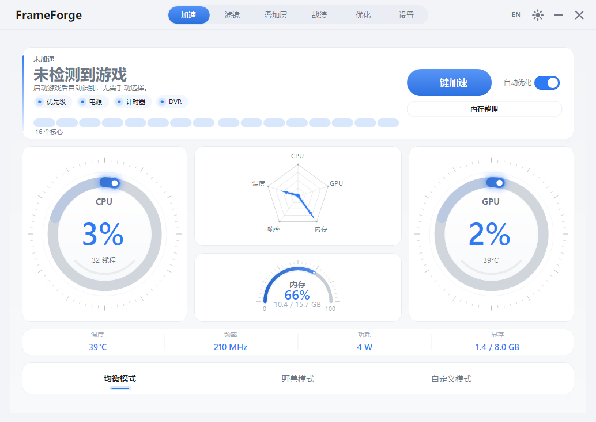 | 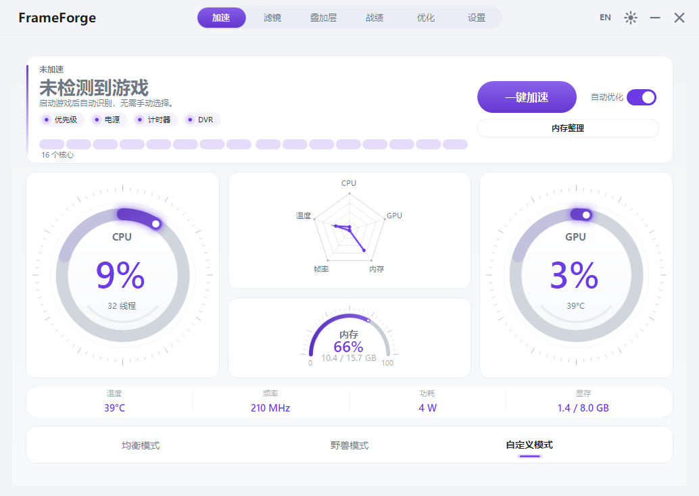 |

| 滤镜 | 叠加层 |
| --- | --- |
| 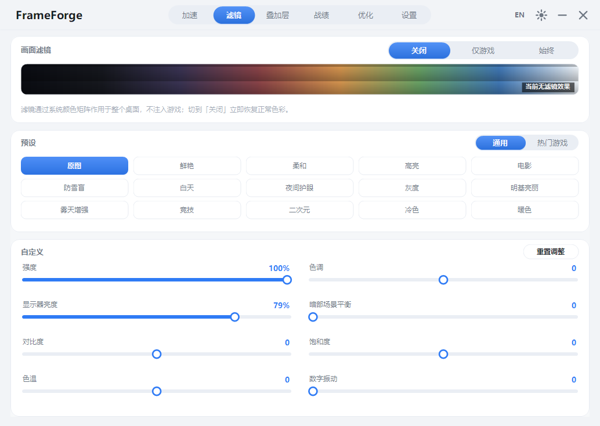 | 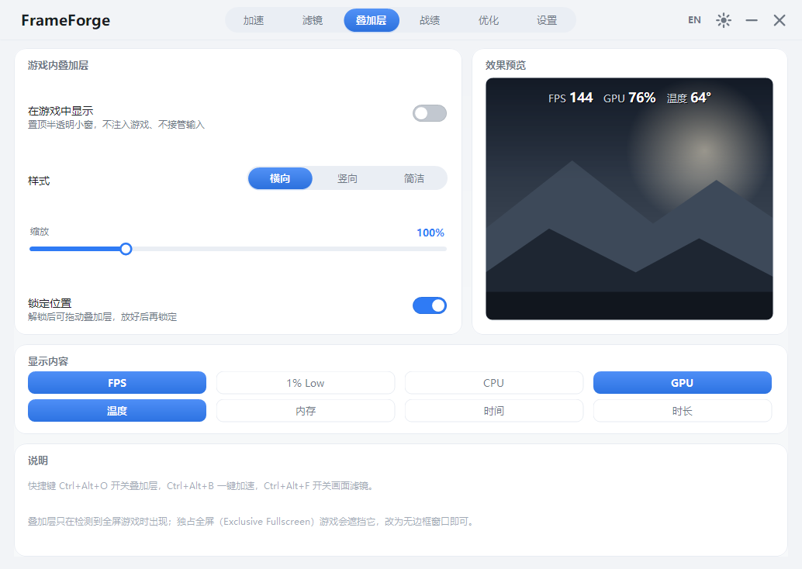 |

| 战绩 | 优化（系统体检） |
| --- | --- |
| 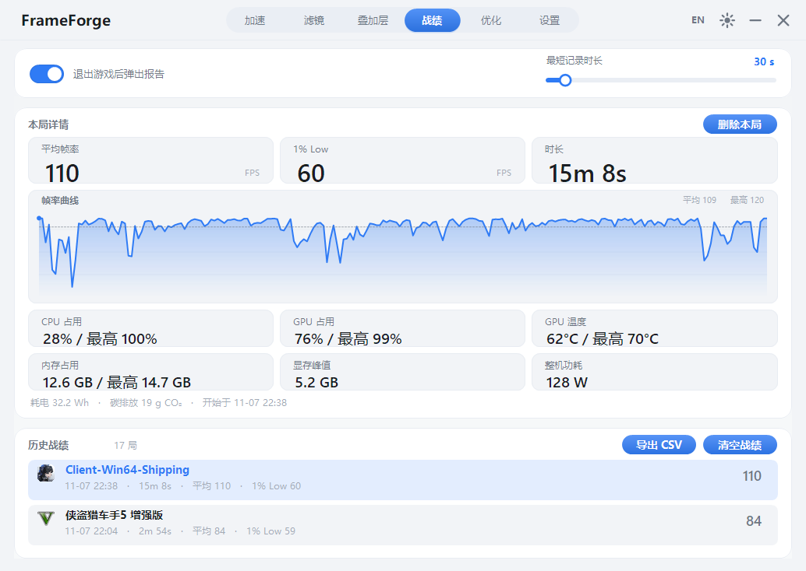 | 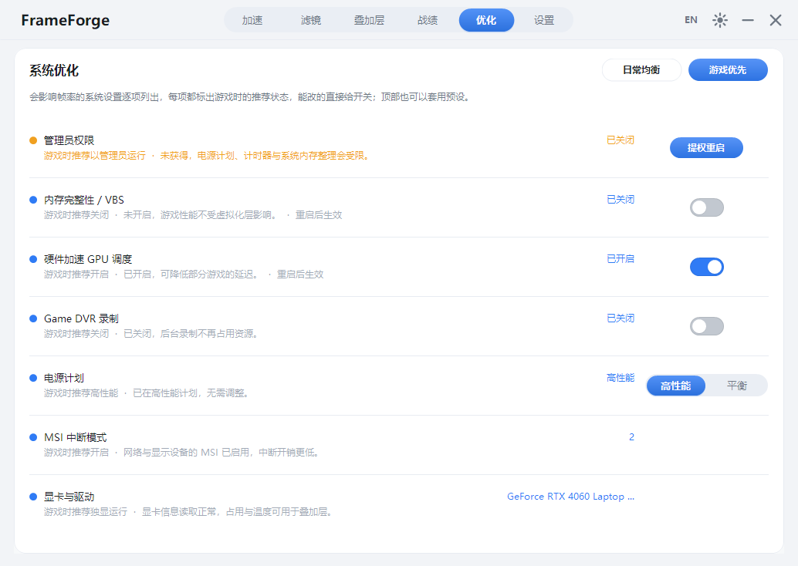 |

| 设置 |
| --- |
|  |

<details>
<summary>旧版界面（v1.1.1，对比用）</summary>

| 加速 | 监测 |
| --- | --- |
| 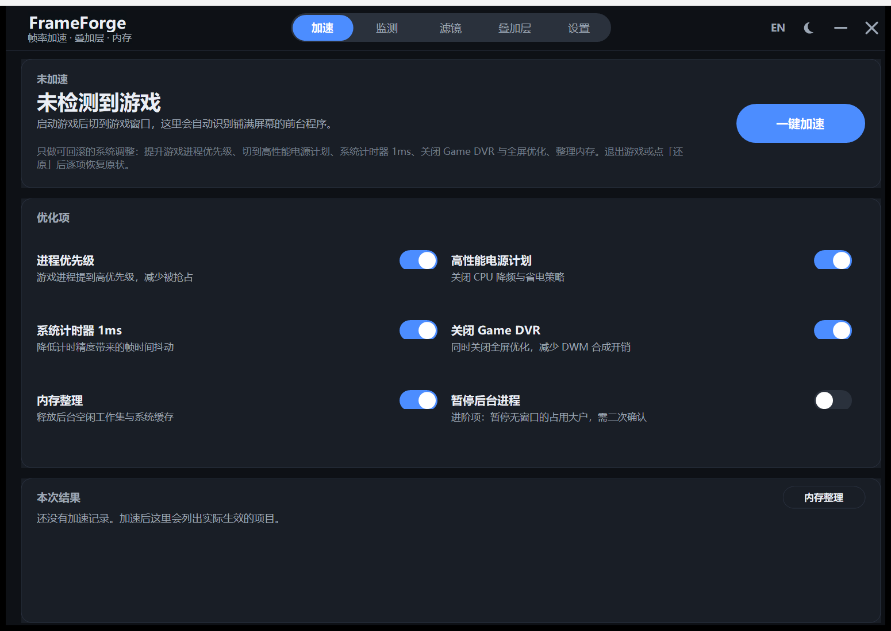 | 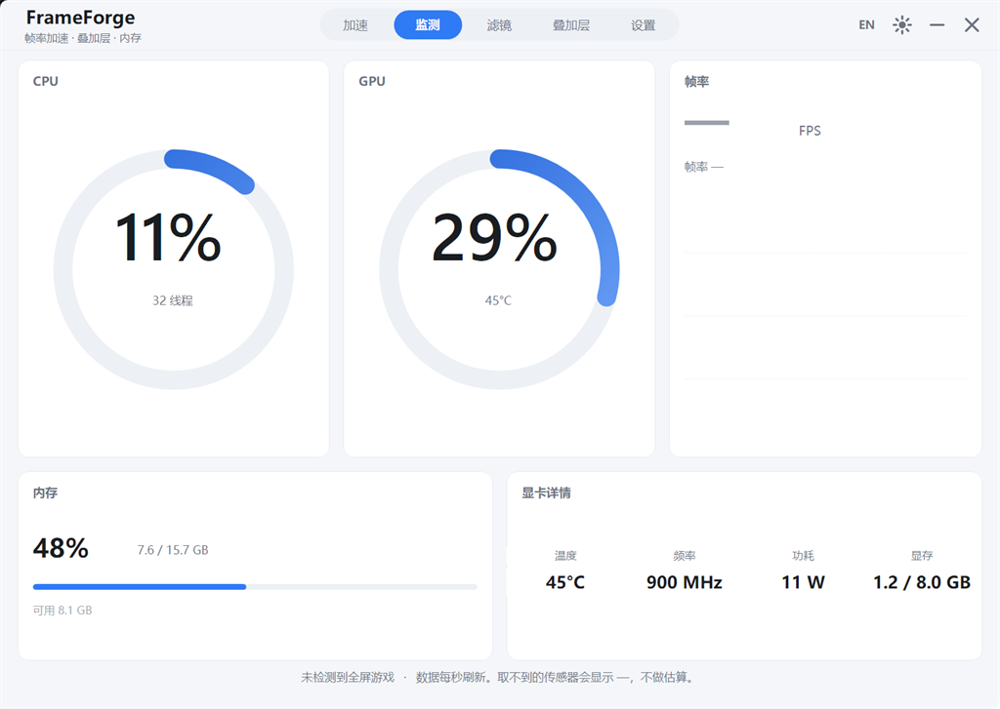 |

| 滤镜 | 叠加层 |
| --- | --- |
| 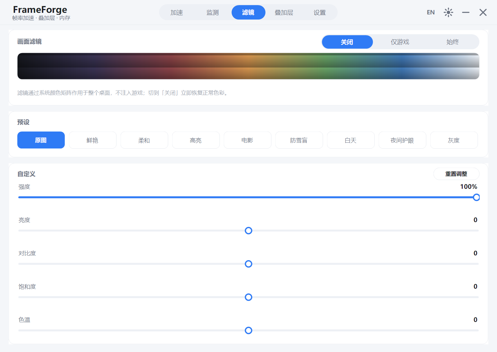 | 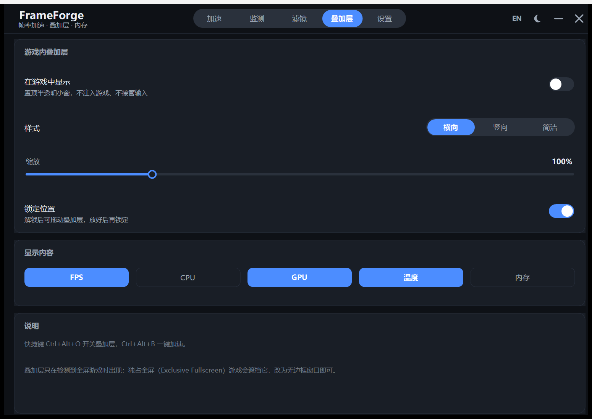 |

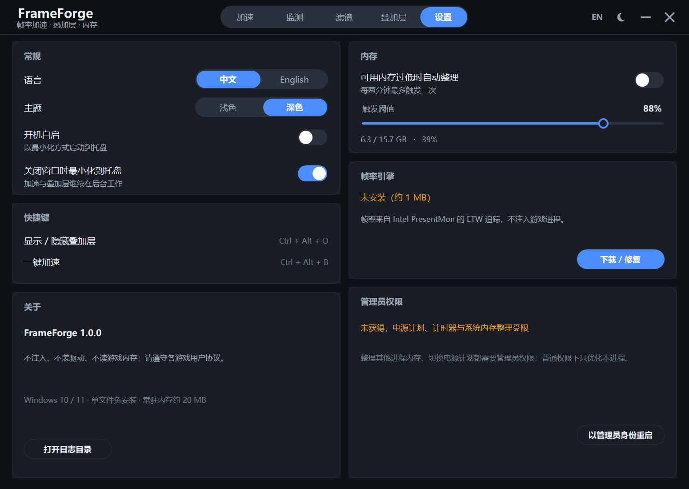

</details>

## 系统要求

- Windows 10 1809 及以上 / Windows 11（x64）
- .NET Framework 4.8（Windows 10 1809 起为系统自带）
- 帧率功能需要管理员权限并首次在「设置 → 帧率引擎」下载 Intel PresentMon（约 1 MB）
- 显卡传感器依赖 NVIDIA NVML；其余厂商的传感器读不到时显示 `—`

## 快速开始

1. 下载 `FrameForge.exe`，双击运行，无需安装。
2. 启动游戏并切到游戏窗口，加速页会自动识别铺满屏幕的前台程序。
3. 点 **一键加速**；退出游戏或点 **还原设置** 即可回滚。
4. 想要帧率数字：设置 → 帧率引擎 → 下载 / 修复，然后以管理员身份重启本程序。

## 加速做了什么

| 项目 | 具体动作 | 如何还原 |
| --- | --- | --- |
| 进程优先级 | 游戏进程设为 `HIGH_PRIORITY_CLASS`；写入后回读确认，被反作弊拒绝时明确提示，不谎报成功 | 恢复原优先级 |
| 高性能电源计划 | 切换到系统「高性能」方案 | 切回原方案 GUID |
| 系统计时器 1 ms | `timeBeginPeriod(1)` | `timeEndPeriod(1)` |
| 关闭 Game DVR | 写入 `GameDVR_Enabled=0`、关闭全屏优化 | 恢复原注册表值 |
| 内存整理 | 对空闲进程 `EmptyWorkingSet` + 清系统工作集 | 无需还原（缓存会自行重建） |
| 暂停后台进程 | 挂起无窗口且占用靠前的后台进程；反作弊组件（ACE / EAC / BattlEye / Vanguard 等）永远不碰 | 自动恢复线程 |
| 独占物理核心 | 按 CPU 拓扑把游戏绑到一半完整物理核心，其他进程挪到剩余核心 | 恢复各进程原亲和性掩码 |
| 设备中断避让 | 把网卡 / 显卡的 MSI 中断亲和性指向非游戏核心 | 恢复原注册表值，重启后生效 |
| 按游戏记忆 | 每个游戏单独保存加速项，下次检测到该游戏时自动套用 | 仅写本地配置，无需还原 |
| 保护名单 | 名单内的程序（如直播、语音、录制软件）与反作弊组件一律不暂停、不整理内存 | 仅写本地配置，无需还原 |

> 进阶项「暂停后台进程」会先列出候选进程并要求二次确认，只挂起、不结束。
> 自动套用只应用安全项（暂停后台进程与中断避让不自动执行）。

## 系统优化

「优化」页把「哪些设置正在拖慢帧率」做成一张可操作的清单，不再只给一个分数：

- 逐项检查：管理员权限、VBS 虚拟化安全（`DeviceGuard`）、硬件加速 GPU 计划（HAGS）、Game DVR 后台录制、电源计划、网卡 / 显卡 MSI 中断亲和性、显卡与驱动状态；
- 每项都写清「为什么会影响帧率」，能直接改的右侧给开关或高性能 / 平衡分段选择，改完立即写回系统；
- 顶部两个预设一键套用：**游戏优先**（高性能电源 + HAGS 开 + Game DVR 关）、**日常均衡**（平衡电源 + HAGS 开 + Game DVR 开）；
- 改动前先把原值写进 `tune.journal`，需要回溯时可按记录逐项写回，不依赖记忆；
- 需要管理员的项会明确提示「提权重启」，不会假装成功；VBS、HAGS 改完标注重启后生效，关闭内存完整性前还有二次确认；
- 全程在本机完成，不联网、不上传任何结果。

## 帧率从哪来

通过 **Intel PresentMon** 的 ETW 会话读取前台游戏进程的呈现事件，计算平均 FPS 与 1% Low。
PresentMon 是在运行时按需下载的独立 exe（MIT 协议），不随本项目分发，也不注入游戏。

## 画面滤镜

滤镜走 Windows 放大镜 API 的全屏颜色矩阵（`Magnification.dll`），作用于整个桌面输出：

- 不注入游戏、不安装驱动、不修改游戏文件；
- 「仅游戏」模式下只在检测到全屏游戏时生效；
- 远程桌面等不支持的环境会给出提示并保持原色；
- 15 组通用预设：原图、鲜艳、柔和、高亮、电影、防雪盲、白天、夜间护眼、灰度、明基亮丽、雾天增强、竞技、二次元、冷色、暖色；
- 8 款游戏专用预设：三角洲行动、无畏契约、原神、Apex 英雄、CS2、PUBG、永劫无间、英雄联盟，每款都针对该作场景单独调过；
- 六维微调：强度、对比度、**暗部平衡**（压高光 + 抬黑位，暗处看得更清）、饱和度、**数字振动**（类似 NVIDIA 数字振动，提升色彩浓艳度）、色温；
- 亮度滑块直接调硬件背光：外接显示器走 DDC/CI（VCP 0x10），笔记本内置屏改走 WMI 背光接口；不进滤镜矩阵，也不会出现在截图 / 录屏里；两者都不支持时滑块置灰并给出提示；
- **A/B 对比**：按预览图上的按钮（或长按）即可临时查看未加滤镜的原图，随手对比效果。

## 赛后报告与战绩

- 检测到游戏进程后自动开始计时，退出游戏时结算这一局；
- 时长达到「最短记录时长」（默认 30 秒，可在战绩页 5–300 秒之间调整）才会计入，避免误触启动器刷屏；
- 结算时默认弹出报告卡：平均帧率、1% Low、时长三联，CPU / GPU / GPU 温度 / 内存 / 显存峰值 / 整机功耗六格，各带「最高」小字，底部给出一局的耗电量（Wh）与碳排估算（按 0.581 kg CO₂/kWh）；
- 「战绩」页保存最近 300 局，可逐局查看同样的明细、删除单局、清空全部或一键导出 CSV；
- 报告弹窗与自动弹出都可以在战绩页关闭。

## 快捷键

| 按键 | 作用 |
| --- | --- |
| `Ctrl + Alt + O` | 显示 / 隐藏叠加层 |
| `Ctrl + Alt + B` | 一键加速 / 还原 |
| `Ctrl + Alt + F` | 开启 / 关闭画面滤镜（记住上次使用的预设） |

## 数据与隐私

- 配置：`%LOCALAPPDATA%\FrameForge\settings.ini`，按游戏策略在同目录的 `profiles.ini`
- 游戏名映射：同目录的 `games.ini`，可自行添加「进程名=游戏名」
- 战绩：同目录的 `sessions.dat`（纯文本，一行一局，可直接编辑或删除）
- 日志：`%LOCALAPPDATA%\FrameForge\log.txt`（超过 1 MB 轮转一份）
- 默认不联网、不上传任何数据。网络请求只有两项且都由你触发：下载 PresentMon、打开「设置 → 检查更新」后查询 GitHub 最新版本号（只读版本号与发布页链接，不发送任何本地数据）。

## 从源码构建

只需要 Windows 自带的 .NET Framework 编译器，无需 Visual Studio / .NET SDK：

```powershell
powershell -ExecutionPolicy Bypass -File .\build.ps1
```

输出 `FrameForge.exe`。自检（不需要开界面）：

```powershell
.\FrameForge.exe --selftest   # 结果写入 %TEMP%\frameforge_selftest.log
```

自检覆盖：传感器采样、显卡识别、游戏检测、游戏名识别与回退、电源方案、后台进程候选、设置映射、三档加速模式、保护名单归一化、加速日志回滚、CPU 拓扑与核心掩码、按游戏策略读取、中断设备枚举、PresentMon 状态、叠加层初始化、系统体检项与页面绘制、战绩序列化与能耗估算。

> 代码保持 C# 5 语法（随系统分发的 `csc.exe` 只认 C# 5），请勿使用插值字符串、`?.`、表达式体成员等新语法。

## 项目结构

```
frameforge/
├── build.ps1              # 一键编译（csc + app.manifest + app.ico）
├── app.manifest           # DPI 感知、UAC 清单
├── app.ico                # 多尺寸程序图标（16–256px）
├── src/
│   ├── Program.cs         # 入口、单实例、--selftest
│   ├── Settings.cs        # 配置读写
│   ├── Theme.cs / I18n.cs # 配色与中英文案
│   ├── Util.cs / Native.cs# 日志、P/Invoke 声明
│   ├── Overlay.cs         # 分层窗口叠加层
│   ├── Sys/
│   │   ├── Monitor.cs     # CPU / 内存 / GPU 采样
│   │   ├── Pdh.cs / Nvml.cs   # 性能计数器与显卡传感器
│   │   ├── Fps.cs         # PresentMon 下载与帧率读取
│   │   ├── GameDb.cs      # 进程名 → 真实游戏名识别
│   │   ├── Sessions.cs    # 单局战绩采集、归档与 CSV 导出
│   │   ├── Boost.cs       # 加速项与回滚
│   │   ├── BoostJournal.cs# 加速前原值落盘，崩溃后自动还原
│   │   ├── Health.cs      # 系统设置检查（VBS / HAGS / Game DVR / 电源 / MSI / 显卡）
│   │   ├── Tune.cs        # 设置调节与原值日志（预设、推荐值）
│   │   ├── Display.cs     # 显示器硬件亮度（DDC/CI）
│   │   ├── Update.cs      # 只读查询 GitHub 最新版本
│   │   ├── Topology.cs    # CPU 物理核心拓扑
│   │   ├── Affinity.cs    # 核心独占与其他进程避让
│   │   ├── Interrupts.cs  # 网卡 / 显卡中断亲和性
│   │   ├── Profiles.cs    # 按游戏保存的加速策略
│   │   ├── MemEngine.cs   # 内存整理与提权
│   │   └── Filter.cs      # 全屏颜色矩阵滤镜
│   └── UI/
│       ├── MainForm.cs        # 外壳：标题栏、导航、托盘
│       ├── MainForm.Actions.cs# 业务动作：加速、叠加层、热键
│       ├── Pages.cs           # 六个页面（加速 / 滤镜 / 叠加层 / 战绩 / 优化 / 设置）
│       ├── HealthPage.cs      # 优化页：逐项调节、推荐状态与预设
│       ├── TrayMenu.cs        # 自绘托盘菜单（显示主界面 / 退出）
│       ├── WhitelistDialog.cs # 保护名单：勾选不参与加速的程序
│       ├── UpdateDialog.cs    # 检查更新弹窗
│       ├── BoostDialog.cs     # 自定义模式的「编辑选项」弹窗
│       ├── ReportForm.cs      # 赛后性能报告弹窗
│       ├── Controls.cs / Widgets.cs # 自绘控件库
└── docs/
    ├── FEASIBILITY.md     # 技术选型与取舍
    └── screenshots/
```

## 已知限制

- 独占全屏（Exclusive Fullscreen）游戏会遮挡叠加层，程序检测到后会提示改用无边框窗口；这是系统限制，不注入游戏就无法绕过；
- 部分带反作弊的游戏会拒绝修改自身进程优先级，此时该项会明确标为「被游戏拒绝」，其余加速项照常生效；
- 帧率 / 电源计划 / 系统内存整理需要管理员权限，普通权限下只优化本进程；
- 滤镜为桌面级后处理，HDR 与广色域显示器上的观感会与 SDR 略有差异；
- 仅支持 Windows；Linux / macOS 不在计划内。

## 许可

[MIT](LICENSE)。第三方组件声明见 [NOTICE](NOTICE)。

发布件由 CI 从 tag 构建后签名，校验方式与「不做什么」见 [SIGNING.md](SIGNING.md)；漏洞报告见 [SECURITY.md](SECURITY.md)。

---

## English

**FrameForge** is a portable Windows toolkit for FPS games: one-click boost, live frame-time monitoring, an in-game overlay, desktop-wide screen filters, and an automatic post-game performance report. It ships as a single 402 KB executable with about 20 MB of resident memory, and it never injects into games or installs a driver.

### Highlights

- **One-click boost** — process priority, high-performance power plan, 1 ms timer resolution, Game DVR / fullscreen optimization off, working-set trim, plus opt-in advanced steps: suspend background hogs (with confirmation), reserve physical cores for the game, move NIC/GPU interrupts off those cores, and remember options per game. Every change is reversible.
- **Live monitoring** — a dashboard built into the Boost page: CPU/GPU rings, a five-axis radar (CPU / GPU / RAM / FPS / temperature), a RAM arc, and a GPU temperature / clock / power / VRAM strip.
- **Real game names** — a three-layer lookup (user `games.ini` → built-in library of 200+ titles → install folder / file version info) turns `client-win64-shipping.exe` into the actual game title instead of showing a raw process name.
- **Screen filters** — fifteen general presets plus eight tuned per-game looks (Delta Force, VALORANT, Genshin, Apex, CS2, PUBG, Naraka, League of Legends), with intensity, brightness, contrast, shadow lift, saturation, digital vibrance and warmth sliders, applied through the Windows Magnification color matrix (game-only or always). Hold the A/B button to compare against the original image. The brightness slider drives the monitor's hardware backlight (DDC/CI, or WMI on laptop panels), so it stays out of the color matrix and out of screenshots.
- **In-game overlay** — top-most layered window with three layouts, eight selectable stats, scaling and position lock. It follows the monitor the game is on and re-asserts top-most every frame, so games that grab the top spot cannot bury it; if the game runs in exclusive fullscreen, the app tells you to switch to borderless instead of silently showing nothing.
- **Post-game report & records** — a report card pops up when a game exits with average/max/min FPS, 1% low, CPU/GPU/temperature/memory/VRAM/power, plus energy and CO₂ estimates. The Records page keeps the last 300 sessions with per-session detail (including an FPS chart), delete, clear, and CSV export.
- **System check-up** — the Optimize page lists the settings that quietly cost frames (admin rights, VBS, hardware-accelerated GPU scheduling, Game DVR, power plan, MSI interrupt affinity, GPU driver) with the recommended state for gaming, inline toggles, and two one-click presets.
- **Compatibility first** — anti-cheat components (ACE, EAC, BattlEye, Vanguard…) are never suspended or memory-trimmed, and if a game rejects the priority change the app says so instead of claiming success. Anything on the protected list (OBS, Discord, recording tools…) is left alone too.
- Bilingual UI (Chinese / English), dark and light themes, tray mode, autostart, optional update check.

### Requirements

Windows 10 1809+ / Windows 11 (x64) with .NET Framework 4.8. FPS readings require administrator rights and a one-time download of Intel PresentMon from inside the app.

### Build

```powershell
powershell -ExecutionPolicy Bypass -File .\build.ps1
.\FrameForge.exe --selftest
```

No Visual Studio or .NET SDK needed — the in-box `csc.exe` compiles the sources directly. Sources intentionally stay on C# 5 syntax.

### Data

Settings and logs live in `%LOCALAPPDATA%\FrameForge\`. Nothing is uploaded. The only network requests are user-triggered: the PresentMon download, and a read-only GitHub lookup of the latest release after you turn on **Check for updates**.

### License

[MIT](LICENSE). Third-party notices in [NOTICE](NOTICE). Release builds are
code-signed from CI — see [SIGNING.md](SIGNING.md); vulnerability reports go
through [SECURITY.md](SECURITY.md).